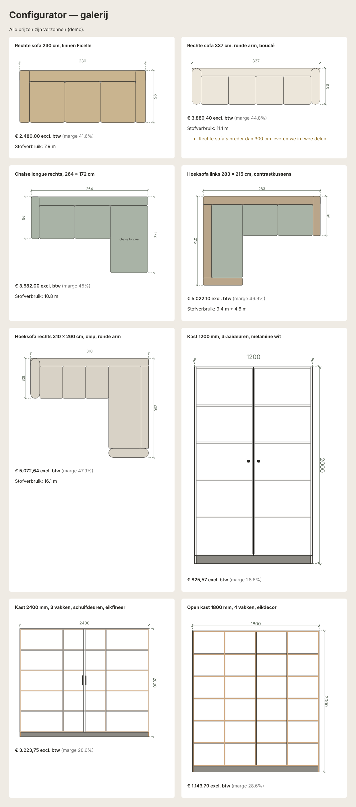

# Configurator

Productconfigurator (configureren → prijzen → offerte) voor maatwerkmeubelen en andere maakbedrijven.

- **Werkt op zichzelf**: kan als apart product verkocht worden.
- **Koppelbaar met Missing Link**: artikels, prijzen en offertes via de API.
- **TypeScript**: dezelfde motor draait in de browser (live prijs en foutmeldingen) en op de server (controle vóór de offerte).

Achtergrond en stappenplan: [`docs/configurator-analyse-en-stappenplan.md`](docs/configurator-analyse-en-stappenplan.md)
Fase 0 (productkennis van de pilootklant): [`docs/fase0-productkennis-meubels.md`](docs/fase0-productkennis-meubels.md)
Onderzoek andere zetelconfigurators (prijsopbouw, stofverbruik, tekenen): [`docs/onderzoek-zetelconfigurators.md`](docs/onderzoek-zetelconfigurators.md)

## Structuur

```
packages/
  core/                 De configurator-motor (geen afhankelijkheid van UI, server of ERP)
    src/
      types.ts          Productmodel: kenmerken, keuzes, regels, stuklijst, prijstabellen
      formule.ts        Excel-achtige formules → JsonLogic
      logica.ts         Evaluatie (JsonLogic + eigen functies)
      motor.ts          berekenConfiguratie(): zichtbaarheid, fouten, stuklijst, prijs
      modelcontrole.ts  controleerModel(): fouten in een productmodel vinden
      svg.ts            tekenSvg(): 2D-tekening (bovenaanzicht, vooraanzicht) met maatlijnen
      materialen.ts     Materialen (stof/leder): controle, unieke codes, patroonfactor, inlezen uit JSON
      ontwerp.ts        berekenOntwerp(): vrij zetelontwerp uit elementen (prijs, stof, overlap, opties, tekening)
      vooraanzicht.ts   tekenVooraanzicht(): poten, zithoogte, rug, armvormen, bies, houten delen
      ruimtelijk.ts     bouw3D(): 3D-blokken van het ontwerp (gerenderd met three.js in de demo)
      plattegrond.ts    Plattegrond: ruimtes → muren (buiten/binnen), openingen, meubels, oppervlaktes,
                        controles (bereikbaarheid, daglicht), 3D van de woning
      plattegrondsvg.ts Tekening van de plattegrond (deurbogen, raamvakken, maten)
      offerte.ts        Offerte met meerdere posities, vrije regels, korting en btw
      gevels.ts         Gevelaanzichten uit de plattegrond, met kettingmaten
      werf.ts           Inmeting (bestelmaat, haaksheid) en meerwerk t.o.v. het akkoord
    voorbeelden/
      maatkast.ts       Kast op maat (prijs = kostprijs stuklijst + opslag)
      sofa.ts           Sofa op maat per cm: recht, chaise longue, hoeksofa; prijstabel × stofgroep,
                        eigen stof/leder, contraststof, stofverbruik, bovenaanzicht
      modellen.ts       Collectie van de klant: 42 modellen (sofa's, fauteuils, zetelbedden, poefs),
                        benadering op basis van de productfoto's van de website
      vrij-ontwerp.ts   Zetelelementen (incl. houten tussenstuk, afgerond eindelement), aanpassingen (poten, poothoogte, hout,
                        metaal, zithoogte, comfort, zitting, rug, rughoogte, naden, armstijl/-hoogte,
                        extra's) en startopstellingen
      aanbouw.ts        Bouwsector: aanbouw met schuifraam of enkel de raampartij (inmeting, systeemgrenzen,
                        vleugelgewicht, veiligheidsglas, Uw, btw 6/21 %, bestellijst, vooraanzicht)
      aanbouw3d.ts      3D-opbouw van de aanbouw (baksteen, houten planken, glas, dak)
      raam.ts           Raam, terrasdeur, voordeur of schuifraam: vakken met draairichting, bovenlicht, zonwering,
                        rooster, RC2, vensterbank; controles veiligheidsglas, ventilatie, privacy, Uw
      raam3d.ts         3D van een raam of deur (ook in de plattegrond gebruikt)
      inrichting.ts     Vloeren, wanden, binnendeuren, meubels en de offerteregels uit een plattegrond
      woning.ts         Voorbeeldwoning met 9 ruimtes, 10 ramen/deuren, binnendeuren en inrichting
      demo.ts           Commandoregel-demo
      galerij.ts        Maakt galerij.html met tekeningen en prijzen van voorbeeldconfiguraties
    test/               Automatische tests
  demo-web/             Klikbare demo, gebundeld tot één HTML-bestand:
                        - Modellen: kies een model en pas het vrij aan
                        - Sofa/Kast op maat: formulier uit het productmodel, live prijs en tekening
                        - Vrij ontwerp: elementen tekenen, slepen (magneet), vergroten, draaien,
                          materiaal en opties per element, aanpassingen voor de hele zetel,
                          vooraanzicht en 3D (three.js r128 via cdnjs), ongedaan maken,
                          ontwerpmodus: vorm van elk element (rugdikte, kussens, zachtheid,
                          rugvorm, houten frame)
                        - Materialen: toevoegen, bewerken, verwijderen, lijst kopiëren/inlezen
  bouw-web/             Aparte demo voor de bouwsector: plattegrond tekenen (ruimtes, ramen, deuren, meubels),
                        positie configureren (draairichting, zonwering …), offerte (PDF, bestellijst, export)
                        en werf (inmeting op tablet, meerwerkbon met handtekening); verdiepingen en gevels
```

Later volgen: het echte configuratiescherm met beheer, een server (API, opslag, offerte-PDF) en `packages/koppeling-missing-link`.

## Uitproberen

**Klikbare demo in de browser** (sofa per cm en kast, prijs en tekening live):

```bash
npm run build -w @configurator/demo-web
```

Open daarna `packages/demo-web/dist/configurator-demo.html` in een browser.

**Bouwsector (ramen, deuren, aanbouw):**

```bash
npm run build -w @configurator/bouw-web
```

Open daarna `packages/bouw-web/dist/bouw-configurator.html` (of de `-offline`-versie om door te sturen).

**Commandoregel:**

```bash
npm install
```

```bash
npm test
```

```bash
npm run demo -- sofa opstelling=hoek_links breedte=283 zijlengte=215 stof=jacquard_ruit contrast=ja contraststof=linnen_brume korting=20
```

```bash
npm run demo -- kast breedte=2400 deurtype=schuifdeuren materiaal=fineer_eik
```

```bash
npm run galerij
```

> De voorbeeldmodellen en alle prijzen zijn **verzonnen** en dienen alleen om de motor te testen.



## Formules

Beheerders schrijven formules zoals in Excel; argumenten scheiden met `;`.

| Wat | Voorbeeld |
|---|---|
| Rekenen | `breedte * hoogte / 1000000` |
| Vergelijken | `breedte >= 1000`, `deurtype <> "geen"` |
| Logisch | `hoek en hoekdiepte >= breedte`, `niet montage` |
| Als | `als(plint; 80; 0)` |
| Afronden | `naarboven(x; 100)`, `naarbeneden(x; 10)`, `afronden(x; 2)` |
| Min/max | `min(a; b)`, `max(a; b; c)` |
| In lijst | `in(kleur; "wit"; "zwart")` |
| Prijstabel | `tabel("basisprijs"; breedte; stof_groep)`; tussenmaten gaan naar de volgende maatklasse |
| Rest na deling | `rest(i; 2)` |
| Eigenschap van een keuze | `materiaal_dikte`, `stof_groep` (= `<kenmerk>_<eigenschap>`) |

## Tekening

Een productmodel kan een `tekening` hebben: rechthoeken en maatlijnen waarvan alle maten formules zijn. `herhaal` tekent een vorm meerdere keren (met volgnummer `i`), bv. zitkussens of legplanken. `vulling` kan de kleur van de gekozen stof zijn (`stof_kleur`). `tekenSvg()` maakt er een SVG van, bruikbaar op scherm en in de offerte-PDF.
