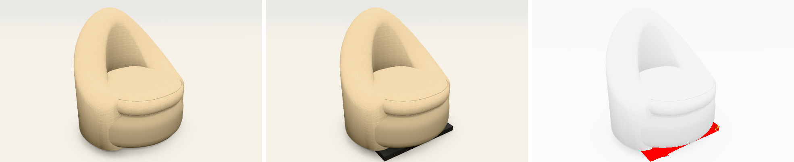

# Beeldvergelijking van de 3D

Een vaste reeks beelden van de zeteldemo en de bouwdemo, om een achteruitgang op te merken voor ze bij de klant komt:
een schaduw die verdwijnt, een onderdeel dat verschuift, een fout bij het tekenen.

## Gebruik (in de root van de repo)

```bash
npm run beelden
```

Bouwt beide demo's, maakt de beelden en vergelijkt ze met `referentie/`. Duurt ±2 minuten.

```bash
npm run beelden -- --vernieuw
```

Na een **bewuste** wijziging aan de 3D: eerst de verschilbeelden nakijken, dan de nieuwe beelden als referentie vastleggen
(en mee committen).

Extra: `node scripts/beeldvergelijking.mjs --zonder-bouw` (de gebouwde pagina's niet opnieuw bouwen) en
`--alleen doha,kotor` (alleen de beelden waarvan de naam zo begint).

## Uitslag

- In de terminal: per beeld hoeveel procent anders is. Meer dan 0,05 % is "te veel".
- In `uitslag/` (niet in git): elk nieuw beeld, en per beeld dat verschilt een strook
  **referentie | nu | verschil**, met de verschillen in rood.
- Afsluitcode 1 als een beeld te veel verschilt of als de pagina een fout gaf.

Voorbeeld (proef van 5/11, de vierkante voet onder Pebble tijdelijk teruggezet):



## De reeks

| Beeld | Waarom |
|---|---|
| `doha-schuin`, `montego-schuin` | doorlopende zetel, ook in een boog |
| `doha-boven-daglicht` | slagschaduw en contactschaduw (de fout van 5/11) |
| `kotor-schuin` | hoeksofa met chaise, poten, sierkussens |
| `kotor-woonkamer` | decor met parket, raam en glas |
| `husk-schuin` | strakke arm (eigen doorsnede) |
| `pebble-schuin` | kuipfauteuil met verdekte voet |
| `stockholm-schuin` | ronde poef |
| `bouw-woning`, `bouw-raam` | de 3D van de bouwdemo (dezelfde 3D-code) |
| `milton-schuin`, `mabel2-schuin` | fauteuils met de opbouw van de klant: vaste ronde zitting, dunne schaal met bies, houten frame op schuine poten (13/11) |
| `fraser-schuin` | vier schuine poten met een kruis, zitting in twee lagen, schaal die rond de zitting uitsteekt |
| `satie-schuin`, `quin-schuin` | trommel tot op de vloer of op een lage voet, met één of vier losse kussens tegen de schaal |
| `satie-na-herstart` | herstel na een weggevallen grafisch toestel (14/11): hetzelfde beeld als `satie-schuin`, genomen nadat het toestel (nagebootst met `__zetel3d.proefVerlies()`) wegviel en de 3D zichzelf opnieuw startte |
| `karl-schuin` | zwevende rugschijf boven een vaste zitting, op een houten frame |
| `tumble-schuin` | dikke rug die op een bolle zitting staat |
| `manon-voor` | de schaal die uitwaaiert: van voren een tulp rond een ronde zitting (14/11) |
| `sullivan-zij` | de rug die achterover helt, van opzij (14/11) |
| `sullivan-schuin` | armen die dikker zijn dan de rug, met de plooi ertussen (14/11) |
| `pebble-naad` (close-up) | de naad waar de schaal in de zitting duikt |
| `ross-kop` (close-up) | de dikke arm van Ross die vooraan in de zitting duikt, met de bies langs de buitenrand |
| `zora-arm` (close-up) | de arm met ronde bovenkant |

Allemaal bij kwaliteit *Mooi*, venster 1400 × 950. Een close-up is een stuk uit de foto op hoge resolutie (2400 px
breed), opgegeven als `uitsnede` in het script. Ze zijn er sinds 13/11: de gebreken op die plekken waren op het hele
beeld te klein om op te vallen (zie `docs/analyse-ronde-vormen.md`).

## Wat het niet doet

- **Geen fouten vinden die er al waren.** De referentie is gewoon het vorige beeld. De vierkante schaduw onder Doha
  zat er weken in; dit hulpmiddel had dat niet gezien, wel als ze later terugkwam.
- **Geen M5.** Het draait in Chromium zonder grafische kaart (de WebGL2-weg), zoals in de cloud. WebGPU op het toestel
  in de toonzaal blijft een eigen test.
- Na een update van Chromium kan alles een fractie verschuiven. Dan de verschilbeelden nakijken en vernieuwen.

## Waarom het betrouwbaar is

Dezelfde versie geeft exact hetzelfde beeld (0,00 % verschil). Daarvoor tekenen de texturen van vloer, wand en hout met
een vaste toevalsreeks (`vasteReeks` in `drie-d.ts`), en wacht het script tot het canvas stilstaat (twee keer na elkaar
hetzelfde beeld). Proef op 5/11: de vierkante voet onder Pebble en de Stockholm-poef tijdelijk teruggezet, en beide
beelden werden gemeld (0,94 % en 0,21 %), met de voet in het rood.

Hulpmiddelen: Playwright (Apache 2.0), pixelmatch (ISC), pngjs (MIT).
