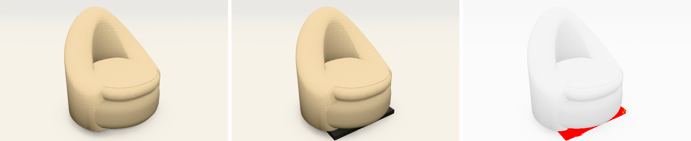

# Beeldvergelijking van de 3D

Een vaste reeks beelden van de zeteldemo en de bouwdemo, om een achteruitgang op te merken voor ze bij de klant komt:
een schaduw die verdwijnt, een onderdeel dat verschuift, een fout bij het tekenen.

## Gebruik (in de root van de repo)

```bash
npm run beelden
```

Bouwt beide demo's, maakt de beelden en vergelijkt ze met `referentie/`. Duurt ±2 minuten.

```bash
npm run beelden -- --vernieuw
```

Na een **bewuste** wijziging aan de 3D: eerst de verschilbeelden nakijken, dan de nieuwe beelden als referentie vastleggen
(en mee committen).

Extra: `node scripts/beeldvergelijking.mjs --zonder-bouw` (de gebouwde pagina's niet opnieuw bouwen) en
`--alleen doha,kotor` (alleen de beelden waarvan de naam zo begint).

## Uitslag

- In de terminal: per beeld hoeveel procent anders is. Meer dan 0,05 % is "te veel".
- In `uitslag/` (niet in git): elk nieuw beeld, en per beeld dat verschilt een strook
  **referentie | nu | verschil**, met de verschillen in rood.
- Afsluitcode 1 als een beeld te veel verschilt of als de pagina een fout gaf.

Voorbeeld (proef van 5/11, de vierkante voet onder Pebble tijdelijk teruggezet):



## De reeks

| Beeld | Waarom |
|---|---|
| `doha-schuin`, `montego-schuin` | doorlopende zetel, ook in een boog |
| `doha-boven-daglicht` | slagschaduw en contactschaduw (de fout van 5/11) |
| `kotor-schuin` | hoeksofa met chaise, poten, sierkussens |
| `kotor-woonkamer` | decor met parket, raam en glas |
| `husk-schuin` | strakke arm (eigen doorsnede) |
| `pebble-schuin` | kuipfauteuil met verdekte voet |
| `stockholm-schuin` | ronde poef |
| `bouw-woning`, `bouw-raam` | de 3D van de bouwdemo (dezelfde 3D-code). Sinds 15/11 staat de woning in haar omgeving (gras, schaduw op het gras, terras en stoep); het losse raam blijft op de effen achtergrond |
| `bouw-dak` | dak en lichtkoepel (15/11): zadeldak met rode pannen op de verdieping (topgevels, oversteek, nokvorst), grind op het lage platte dak en een lichtkoepel erin. Genomen ná de twee beelden hierboven: het zet een dak in het project |
| `bouw-gevel` | omgeving van een gebouw (15/11): de voorgevel van lager bekeken, met de lucht, de wolken, de bomenrij aan de horizon en het gras dat erin wegloopt; baksteen, hout en pannen met reliëf, glas dat de lucht spiegelt. Genomen ná `bouw-dak` |
| `bouw-binnen` | binnenkijken met lage muren (15/11): vloeren met nerf en voeg, de schaduw van de zon en, in *Mooi*, schaduw in de hoeken. Genomen ná `bouw-dak` |
| `bouw-zon` | lichtinval (15/11): 21 juni om 13 u, van boven in het gelijkvloers gekeken. De verdieping en het dak zijn verborgen maar werpen schaduw; de zonnevlekken van het schuifraam, de terrasdeur en de lichtkoepel liggen op de vloer. Genomen ná `bouw-dak` (de koepel komt daar vandaan) |
| `bouw-stolp`, `bouw-deur-zijlicht`, `bouw-hefschuif`, `bouw-vouwwand`, `bouw-steellook` | de raamtypes van 15/11: een raam van de voorbeeldwoning krijgt met één tegel een andere indeling (stolp, deur met zij- en bovenlicht, hef-schuif 3-delig, vouwwand 4-delig, steellook) |
| `bouw-garagepoort` | sectionale garagepoort met cassettes en vensters (eigen model, 15/11) |
| `bouw-schuin-plan`, `bouw-schuin-3d`, `bouw-schuin-binnen` | schuine muren (ronde 2c, 16/11): de voorbeeldwoning met een afgeschuinde leefruimte (vijfhoek, schuifraam in de schuine muur, terras schuin ervoor) en een aanbouw met een schuine zijmuur (raam erin). De plattegrond (verstek, lengte langs de schuine muur), de 3D van rechtsvoor (hoek tegen de woning, dakrand) en met lage muren van linksvoor. Op een eigen pagina met een vers project: het plan gaat via het bewaarde project (`SCHUIN_PLAN` in het script), dus deze drie hangen niet af van de beelden ervoor |
| `bouw-techniek`, `bouw-techniek-plan` | techniek voor de installateur (ronde 10, 16/11): de voorbeeldwoning uitgerust (`core/voorbeelden/techniekwoning.ts`) in de uitgezette weergave (vloeren, lage wanden, de omtrek op plafondhoogte; leidingen in hun kleur, kleine toestellen groter in de kleur van hun vak), schuin en een stap verder weg, in de **losse kijker** (`dist/bouw-kijker.html`, het pakket als bericht); en de tekening van het gelijkvloers met alle tekens en leidingen. De gegevens komen uit de motor via `tsx core/voorbeelden/techniekbeeld.ts` (dat bleef zo toen de configurator de techniek ging tonen). Hangen niet af van de beelden ervoor |
| `bouw-techniek-scherm-plan`, `bouw-techniek-scherm-3d` | techniek op het scherm van de configurator (ronde 10b, 16/11), op een eigen pagina: de knop *Techniek* en *Voorbeeld openen: woning met techniek* in het palet; de tekening met de techniek aan (elektriciteit op de voorgrond, de andere vakken en de meubels lichter) en de 3D *In de woning* met lage muren, het gelijkvloers schuin. Samen te vernieuwen met `--alleen bouw-techniek-scherm` |
| `bouw-model-carport`, `bouw-model-poolhouse`, `bouw-model-loods`, `bouw-model-loods-constructie`, `bouw-model-trap` | vaste modellen (ronde 8b, 16/11), elk via de snelstart in een eigen project, op een eigen pagina: een carport van 5 × 5 m met berging opzij en zadeldak (de bedekking wordt vanzelf zink), het poolhouse, de hal van 15 × 30 m buiten (helemaal in beeld: grondvlak, gras en zichtgrens groeien mee) en haar constructie, en de rechte trap met haar maten (bovenop, aan de kant van de camera). Samen te vernieuwen met `--alleen bouw-model` |
| `bouw-losse-plan`, `bouw-losse-3d` | losse wanden (ronde 2d, 16/11): de voorbeeldwoning met een halfhoog muurtje en een muur die halverwege stopt in de leefruimte, een tuinmuur langs de zijgevel en een lage tuinmuur in natuursteen met een hoek in verstek en een schuin stuk (`LOSSE_WANDEN` in het script). De tekening (lengte, hoogte, arcering van een lage wand) en de 3D van het gelijkvloers zonder dak. Op een eigen pagina met een vers project |
| `bouw-schuin-constructie` | dezelfde woning met schuine muren in de constructieweergave (ronde 6): de schuine wanden gedraaid mee met hun muur, de vloer en het dak van een vrije vorm als effen plaat. Na `bouw-schuin-binnen`, op dezelfde pagina |
| `bouw-constructie`, `bouw-doorsnede` | constructie (ronde 6, 16/11): de voorbeeldwoning met een zadeldak in de constructieweergave (houtskelet met lateien, balklagen met het trapgat, kepers, topgevels; de lagen als staal op één bouwdeel per opbouw; gelijke stukken samen getekend, `Scene3D.samenvoegen`), schuin; en de doorsnede dwars door de woning (tekening). Op een eigen pagina met een vers project: hangen niet af van de beelden ervoor |
| `bouw-uitbouw-3d`, `bouw-uitbouw-plan` | het voorbeeldproject van ronde 11 (16/11): *Uitbouw achter een rijwoning* uit Projecten (*Openen in 3D*). De bestaande woning (`Ruimte.bestaand`) en de buren (`Plattegrond.tegenBuren`, met hun volume na het kader) neutraal, de uitbouw in kleur (houten achtergevel, hef-schuifraam, plat dak met drie koepels), schuin van boven; en de tekening van het gelijkvloers (bestaand lichter, "buren" langs de scheidingsmuren). Op een eigen pagina met een vers project. Samen te vernieuwen met `--alleen bouw-uitbouw` |
| `milton-schuin`, `mabel2-schuin` | fauteuils met de opbouw van de klant: vaste ronde zitting, dunne schaal met bies, houten frame op schuine poten (13/11) |
| `fraser-schuin` | vier schuine poten met een kruis, zitting in twee lagen, schaal die rond de zitting uitsteekt |
| `satie-schuin`, `quin-schuin` | trommel tot op de vloer of op een lage voet, met één of vier losse kussens tegen de schaal |
| `satie-na-herstart` | herstel na een weggevallen grafisch toestel (14/11): hetzelfde beeld als `satie-schuin`, genomen nadat het toestel (nagebootst met `__zetel3d.proefVerlies()`) wegviel en de 3D zichzelf opnieuw startte |
| `karl-schuin` | zwevende rugschijf boven een vaste zitting, op een houten frame |
| `tumble-schuin` | dikke rug die op een bolle zitting staat |
| `manon-voor` | de schaal die uitwaaiert: van voren een tulp rond een ronde zitting (14/11) |
| `sullivan-zij` | de rug die achterover helt, van opzij (14/11) |
| `sullivan-schuin` | armen die dikker zijn dan de rug, met de plooi ertussen (14/11) |
| `pebble-naad` (close-up) | de naad waar de schaal in de zitting duikt |
| `ross-kop` (close-up) | de dikke arm van Ross die vooraan in de zitting duikt, met de bies langs de buitenrand |
| `zora-arm` (close-up) | de arm met ronde bovenkant |

Allemaal bij kwaliteit *Mooi*, venster 1400 × 950. Een close-up is een stuk uit de foto op hoge resolutie (2400 px
breed), opgegeven als `uitsnede` in het script. Ze zijn er sinds 13/11: de gebreken op die plekken waren op het hele
beeld te klein om op te vallen (zie `docs/analyse-ronde-vormen.md`).

## Wat het niet doet

- **Geen fouten vinden die er al waren.** De referentie is gewoon het vorige beeld. De vierkante schaduw onder Doha
  zat er weken in; dit hulpmiddel had dat niet gezien, wel als ze later terugkwam.
- **Geen M5.** Het draait in Chromium zonder grafische kaart (de WebGL2-weg), zoals in de cloud. WebGPU op het toestel
  in de toonzaal blijft een eigen test.
- Na een update van Chromium kan alles een fractie verschuiven. Dan de verschilbeelden nakijken en vernieuwen.

## Waarom het betrouwbaar is

Dezelfde versie geeft exact hetzelfde beeld (0,00 % verschil). Daarvoor tekenen de texturen van vloer, wand en hout met
een vaste toevalsreeks (`vasteReeks` in `drie-d.ts`), en wacht het script tot het canvas stilstaat (twee keer na elkaar
hetzelfde beeld). Proef op 5/11: de vierkante voet onder Pebble en de Stockholm-poef tijdelijk teruggezet, en beide
beelden werden gemeld (0,94 % en 0,21 %), met de voet in het rood.

Hulpmiddelen: Playwright (Apache 2.0), pixelmatch (ISC), pngjs (MIT).
