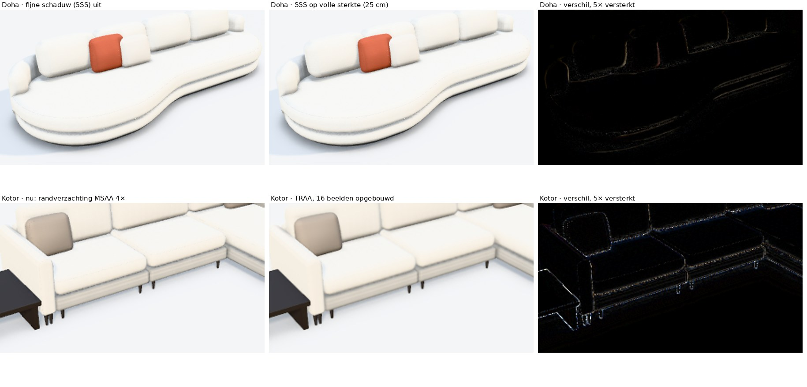

# 3D-technieken: wat werkt waarvoor (kennisbank)

*Stand 5/11/2026.* Wat we bij de zetels leerden over 3D, en hoe je het hergebruikt: voor een nieuw zetelmodel, een ander
meubel of de ramen en deuren van de bouwdemo. De uitwerking per onderwerp staat in de notities onderaan.

## De technieken op een rij

| Techniek | Wat het doet | Goed voor | Niet voor | Rekentijd |
|---|---|---|---|---|
| **Blokken** | Elk onderdeel apart: afgeronde balken, cilinders, kegels, een vrije omtrek of een gebogen wand. | Een snelle eerste indruk; alles wat recht en eenvoudig is (poten, houten delen, kasten, de huidige ramen). | Vormen die "uit één stuk" moeten lijken. | Meteen |
| **Eigen doorsnede** (profiel) | Eén doorsnede in 2D die langs een lijn loopt. Dezelfde doorsnede tekent ook het vooraanzicht. | Een vorm die per stijl terugkomt: de strakke en de uitlopende arm. Later ook raamprofielen. | Vrije, organische vormen. | ±40 ms per arm, daarna onthouden |
| **Zachte vormen** | De delen smelten samen tot één vorm, met een afronding in de hoeken en schaduw in de plooien. | Gestoffeerde, ronde vormen: zetels. | Harde, precieze producten met details van millimeters (ramen, deuren, kasten). | 0,2 à 0,7 s per zetel, 20.000 à 110.000 driehoeken; in de achtergrond |
| **Doorlopende opbouw** | Een rij elementen wordt in 3D één product. Prijs en tekeningen blijven per element. | Modulaire zetels die als één geheel ogen (Doha, Montego). | Hoeksofa's (nog niet uitgewerkt). | Zoals de zachte vormen |
| **Boog** | De hele vorm buigt in een boog; wat erop staat (kussens) draait mee. | Gebogen sofa's (Montego); later rondboogramen. | – | Meteen |
| **Echt 3D-bestand** | Een afgewerkt model uit een 3D-programma of van de fabrikant (GLB), met onze stoffen en afwerking. De configurator kijkt of het bestand bij de gekozen maten past. | Vaste onderdelen (krukken, scharnieren) of topmodellen met een eigen bestand. | Producten op maat: een bestand kun je uitrekken, niet omvormen. | Laden bij het openen |
| **Weergave** | Licht en reflecties uit een omgevingsbeeld, schaduw in de hoeken, zachte slagschaduwen, echte kamers als decor, een fotomodus die licht natuurgetrouw narekent. | Beide demo's: de bouwdemo gebruikt dezelfde 3D-weergave. | – | Fotomodus ±1 min |
| **Snelheid** | Zware vormen in de achtergrond rekenen (één per keer, tot dan de eenvoudige vorm) en onthouden; tabellen per cm in het grondvlak voor lange vormen. | Alles wat zwaar rekent. | – | 2 à 3 × sneller |

Waar in de code: blokken in `packages/core/src/ruimtelijk.ts` (zetels) en `packages/core/voorbeelden/raam3d.ts`
(ramen), de doorsnedes `strakProfiel` en `uitlopendProfiel` in `ruimtelijk.ts`, de zachte vormen in
`packages/core/src/zachtevorm.ts`, de doorlopende opbouw en de boog in `packages/core/src/doorlopend.ts`, echte
3D-bestanden in `packages/core/src/echt3d.ts`, de weefselkaarten (normal map en ruwheid, proef 4/11) in `packages/core/src/weefselkaart.ts` en
`packages/demo-web/src/weefsel.ts`, de weergave in `packages/demo-web/src/drie-d.ts` en de decors in
`decor3d.ts`.

## WebGPU (sinds 4/11)

De 3D draait op de WebGPU-renderer van three.js: op WebGPU waar de browser het heeft (Safari 26 of nieuwer op de Mac in
de toonzaal, Chrome), anders automatisch op WebGL2, met hetzelfde beeld. De fotomodus rekent met WebGPU op de
WebGPU-path tracer met ontruiser, anders zoals vroeger. Nieuwe effecten maken we in TSL (de taal van three.js voor
WebGPU), niet meer met eigen WebGL-shaders. In de cloudsessie is er geen WebGPU: daar is alleen de WebGL2-weg te testen.

## Wat we leerden

1. **Echtheid komt van één eigen vorm per type.** Samensmelten alleen gaf weinig winst. Het verschil kwam van een eigen
   doorsnede per armstijl, die dan geldt voor alle modellen met die stijl (de strakke arm: 16 van de 21 modellen met
   armen). Voor ramen is dat een eigen doorsnede per profielsysteem.
2. **Eerst de opbouw, dan de details.** Doha en Montego leken identiek omdat de opbouw niet klopte (losse elementen
   naast elkaar), niet door een detail. Beschrijf eerst in woorden hoe het product is opgebouwd:
   - welke banden of lagen er zijn;
   - waar de rug staat en waar hij stopt;
   - wat eronder doorloopt;
   - wat één stuk is.
3. **Vergelijk met de grote foto's.** De foto's in de demo zijn 420 px breed. De productpagina's hebben foto's van
   1100 px, vaak vanuit meerdere standpunten. Pas daarop zagen we de twee banden van Doha en de kortere rug van Montego.
   Lees ook de maten op de productpagina (bij Doha: armhoogte 65 cm, armbreedte 20 cm).
4. **Een vergelijkingsbeeld per ronde**: foto · vorige versie · nu, in hetzelfde standpunt. Zo ziet iedereen wat
   verbeterd is en wat nog verschilt.
5. **Benaderingen markeren.** Alles wat uit een foto komt (diepte van het loungedeel, dikte van de zitting, de boog,
   hoe ver de rug omloopt) is een benadering tot de klant het bevestigt. Modellen van de klant niet verzinnen.
6. **Een 3D-keuze kan prijs en offerte raken.** Bij Montego veranderde de opbouw (vaste zitting, rug alleen op het
   rechte deel) ook de prijs en de offertetekst. Zeg dat er altijd bij.
7. **3D en tekeningen kunnen uit elkaar lopen.** De doorlopende zetel is in 3D één geheel, in het boven- en vooraanzicht
   nog losse elementen. Vermeld dat, of trek het gelijk.
8. **Meten op het echte toestel.** Rekentijd op een tablet is waarschijnlijk 2 à 3 keer langer dan op de server.
   Zwaar werk hoort in de achtergrond, met eerst een eenvoudige vorm.
9. **Een echt 3D-bestand is geen vervanging voor maatwerk.** Het past bij een vast model of een vast onderdeel. Voor
   een zetel of raam op maat moet de configurator de vorm zelf maken.

## Gratis hulpmiddelen (advies en proeven van 5/11)

Voorwaarden: alles in één HTML-bestand, niets van internet laden, alleen materialen die we zelf maken (procedureel of
uit de foto's van de productsite), gratis HDRI's mogen (CC0, met bronvermelding).

**In de configurator zelf** (zit in three.js 0.187, MIT):

| Hulpmiddel | Wat het doet | Uitslag |
|---|---|---|
| **SSS** (fijne contactschaduw op het scherm) | Kleine schaduwen van de zon waar de schaduwkaart te grof is. | Getest 5/11, **niet opgenomen**: ook op volle sterkte alleen dunne randjes; de zonneschaduw dekt die plekken al. Kost een extra tekenronde van de hele scène. |
| **TRAA** (randverzachting over meerdere beelden) | Bouwt het beeld op over 8 à 16 schermbeelden. | Getest 5/11, **niet opgenomen**: even goed als de huidige randverzachting (MSAA 4×), iets zachter; het weefsel wordt een fractie waziger. Helpt niet tijdens het draaien (dan tekenen we het snelle beeld). |
| **SSGI** (weerkaatsend licht) | Kleur die van het ene vlak op het andere straalt. | Nog niet getest. Zwaar: alleen bij *Mooi* en op WebGPU, eerst op de M5. Met mist (die wij gebruiken) meldt het forum een te donkere vloer. |
| **SSR** (spiegelingen) | Spiegeling in een glanzende vloer, glas, metaal. | Weinig nut bij stof; wel later voor ramen en deuren. |
| **Inspector** | Meetvenster: beelden per seconde, geheugen, tussenbeelden. | Om op de M5 te meten. |

Beeld van de proef: `docs/afbeeldingen/proef-sss-traa.jpg`.

**Buiten de app** (het resultaat gaat als afbeelding mee in de pagina):
- **Material Maker 1.8** (MIT, Windows, Mac, Linux): naadloze stoffen bouwen (bouclé, velours, linnen, rib) met kleur,
  reliëf en glans, met blokjes die je verbindt, zonder code. Past bij de regel "procedureel, zelf gemaakt". Voorrang 1.
- **DeepBump** (Blender-uitbreiding, GPL-3): een echte reliëfkaart uit de stoffoto van de productsite, in plaats van de
  foto zelf als reliëf (dat geeft nep-reliëf uit de schaduw in de foto). De licentie geldt voor het hulpmiddel, niet
  voor de kaarten die het maakt.
- **Real-ESRGAN** (BSD-3): kleine foto's vergroten. Verzint fijn detail en is niet vanzelf naadloos: lage voorrang,
  altijd als benadering markeren.
- **Poly Haven** (CC0): extra HDRI's voor lichtsferen. Hun stoffen en modellen zijn scans: valt buiten de regel.

**Kwaliteitscontrole:** de beeldvergelijking `npm run beelden` (Playwright, pixelmatch, pngjs), sinds 5/11. Zie
[Beeldvergelijking](../beeldtest/LEESMIJ.md).

## Werkwijze voor een nieuw model of product

1. **Bronnen:** de grote foto's en de maten van de productpagina. Voor de bouw: doorsnedes en gegevens van de
   systeemleverancier.
2. **Opbouw in woorden** (zie les 2).
3. **Per onderdeel een techniek** kiezen uit de tabel hierboven.
4. **In de motor bouwen**, met tests:
   - de vorm is dicht en de schaduw klopt;
   - de maten van de opbouw kloppen;
   - prijs en tekening veranderen niet ongewild.
5. **3D-beelden** nemen in hetzelfde standpunt als de foto, en het vergelijkingsbeeld maken. Daarna
   `npm run beelden`: de vaste reeks beelden tegenover de vorige versie (zie [Beeldvergelijking](../beeldtest/LEESMIJ.md)).
   Wat verandert moet bewust zijn; dan `npm run beelden -- --vernieuw`.
6. **Benaderingen markeren**; prijs en offertetekst nakijken.
7. **Documenteren** (overdracht, uitleg, skill), publiceren en het doorstuurpakket vernieuwen.

## Toepassen op ramen en deuren (advies van 4/11, nog niet gebouwd)

**Hoe het nu is** (`raam3d.ts`):
- **Kader en vleugels:** rechthoekige balken van 7 cm diep; in de hoeken schuiven ze over elkaar.
- **Glas en afstandhouder:** het glas is een plaat van 1 cm, de afstandhouder een smalle rand eromheen.
- **Beslag:** een kruk is een balkje, een trekbeugel een cilinder met twee blokjes.
- **Zonwering en afwerking:** de zonwering is een kast met geleiders en lamellen of doek. Vensterbank en dorpel zijn
  ook balken.
- **Weergave:** de 3D-weergave is dezelfde als bij de zetels.

**De zachte vormen zelf passen niet:**
- **Ander soort product:** een zetel is stof die over hoeken spant. Een raam is een hard, recht profiel in aluminium,
  kunststof of hout, met details van enkele millimeter (sponning, glaslat, dichting). Wat een raam echt doet lijken,
  zijn net de strakke randen en de zichtbare naden in de hoeken, die de zachte vormen juist wegwerken.
- **Te grof:** de zachte vormen rekenen op een raster van 2 cm, waarin alle details van een profiel verdwijnen. Een
  fijner raster is veel te traag.
- **Te zwaar:** een woning met 20 ramen zou twintig keer de rekentijd van een zetel vragen, voor niets.

**Wat wel past, in volgorde van winst:**
1. **Een eigen doorsnede per profielsysteem**, zoals de armstijlen bij de zetels.
   - **Het echte profiel:** kader met sponning, vleugel, glaslat, dorpel. In de hoeken in verstek (aluminium,
     kunststof) of stomp (hout).
   - **Andere manier van tekenen:** het profiel wordt langs het kader getrokken. Dat is exact, licht en meteen klaar;
     het is niet dezelfde techniek als de zachte vormen.
   - **Ook een tekening:** dezelfde doorsnede geeft een technische doorsnedetekening voor de offerte of het
     werfdossier.
   - **Bogen:** rondboog- en segmentboogramen worden mogelijk, met hetzelfde profiel langs een boog (zoals de boog bij
     Montego).
   - **Bron:** de doorsnedes komen van de systeemleverancier (Reynaers, Schüco, Aliplast, Deceuninck … leveren ze als
     DXF), niet verzonnen. Voor een demo kan een benadering, als benadering gemarkeerd.
   - **Zelfde maten:** dezelfde maten als de rekenregels in `raam.ts` (dagmaat, glasmaat, aftrekken), zodat 3D en
     berekening kloppen.
2. **Echte 3D-bestanden voor vaste onderdelen:** krukken, trekbeugels, scharnieren, brievenbussen, ventilatieroosters.
   - Die hebben een vaste maat, dus een bestand past perfect.
   - Vooral bij voordeuren loont het: die worden op uitzicht gekocht.
   - Fabrikanten bieden 3D-modellen aan; de licentie per bestand nakijken.
3. **De weergave hebben we al:** licht, reflecties en de fotomodus. Sinds de proef met glas (4/11) laat het glas het
   licht door en spiegelt het volledig (vroeger half doorzichtig, met maar ±28 % van de spiegeling), ook in de fotomodus.
4. **Kleine afrondingen** (de ronde randen van kunststofprofielen) gaan in de doorsnede zelf, niet via zachte vormen.

**Wat we van een leverancier of klant nodig hebben:**
- **Doorsnedes** (DXF) per systeem: kader, vleugel, tussenstijl, glaslat, dorpel, koppelprofiel;
- **Maten:** de aanzichtbreedtes en de bouwdiepte;
- **Kleuren en afwerking:** RAL, structuur, anodisatie;
- **Beslag:** 3D-bestanden of goede foto's van krukken en trekbeugels.

**Mogelijke eerste stap:** één systeem met een benaderde doorsnede, verstek in de hoeken en een doorsnedetekening, en
één echte kruk of trekbeugel.

## Technische valkuilen (voor wie verder bouwt)

- **Een omtrek mag niet plooien.** Schuift een kant naar binnen, maak de hoeken dan kleiner. De test op snijdende
  zijden staat in `doorlopend.test.ts`.
- **Een wand die oploopt of zakt:** de helling moet meetellen in de richting van het oppervlak, anders kloppen de
  schaduwen niet. Test de richtingen tegen kleine stapjes in het veld (`zachtevorm.test.ts`).
- **Schaduw van buurdelen met hun echte vorm.** Een zitkussen met een vrije omtrek dat als rechthoekige doos meetelde,
  gaf grijze vlekken waar niets staat.
- **Elke schaduw volgt de echte vorm, niet het kader.** De contactschaduw onder de zetel tekende per onderdeel een
  rechthoek: een ronde poef kreeg een vierkante schaduw, en bij Doha stak de schaduw rechthoekig uit voorbij de ronde
  uiteinden. Ook de verdekte voet (donker, onder het meubel) was altijd vierkant en stak onder een ronde fauteuil uit:
  dat leek een harde, vierkante schaduw. Sinds 5/11 volgen beide de vorm (omtrek, rond, gedraaid, gebogen wand, arm).
- **Delen binnen elkaars omtrek houden.** Een rug die buiten de onderbouw uitstak, gaf vinnen en strepen.
- **Snelheid meten:** met een gebundeld script in node; de eerste keer met `tsx` geeft een veel te hoge tijd.
- **Twee vlakken op exact dezelfde plaats** geven vlekken (z-fighting): laat het ene deel net binnen het andere liggen.
- **Eenheden:** de voorbeelden van three.js rekenen in meter, onze scène in cm. Een afstand of dikte uit een voorbeeld
  (bv. 0,1 voor de fijne contactschaduw) doet bij ons niets: maal 100.
- **Nabewerking in de scène loopt één beeld achter.** Een effect dat via `builtinShadowContext` of `builtinAOContext`
  in de scène zelf werkt, werd op de WebGL2-weg pas berekend nadat de scène getekend was: spookranden van het vorige
  standpunt. Eerst apart berekenen (een kleine pijplijn naar een doel van 4 × 4 pixels), dan de scène tekenen.
- **Effecten die over meerdere beelden opbouwen** (TRAA, tijdsfilters) passen slecht bij een weergave die alleen
  tekent als er iets verandert: ze vragen 8 à 16 schermbeelden na elke wijziging, en een foto voor de offerte ook. Ze
  rekenen hun geschiedenis maar één keer per schermbeeld bij, dus snel na elkaar tekenen helpt niet.
- **Een gebogen wand die oploopt:** op de knikpunten van het pad moet de helling meetellen (gemiddelde van de stukken
  ernaast), anders lichte vlekjes om de 2 cm. Hou de stijging ook niet te steil, en laat een wand niet eindigen op
  exact de hoogte van een ander vlak (flikkeren): liever een paar cm erin. Verdeel de punten op gelijke afstanden en
  laat de hoogte de afstand volgen, niet de hoek: bij een afgeronde rechthoek golfde de bovenkant anders.
- **Geen Math.random in texturen:** dan ziet het parket er bij elke keer laden anders uit, en kan de beeldvergelijking
  niets vergelijken. Gebruik `vasteReeks(sleutel)` in `drie-d.ts`.
- **Een fijner raster lost een rafelige naad niet op** (proef 13/11, Pebble): 1 cm in plaats van 2 cm gaf vier keer
  zoveel driehoeken en rekentijd, en de rand werd eerder rafeliger. Gemeten: waar de bovenrand van een gebogen wand
  steiler zakt dan ±0,8 cm per cm, klopt de afstand uit de motor bij 60 à 75 % van de punten niet (Pebble, Ross); bij
  een vlakke rand (Doha) klopt ze overal. Nog niet hersteld. Zie [Analyse ronde vormen](analyse-ronde-vormen.md).
- **Meer:** de skills `zetel-3d` (`.claude/skills/zetel-3d/SKILL.md`) en `bouw-woning`
  (`.claude/skills/bouw-woning/SKILL.md`).

## Meer lezen

- [Zachte vormen](zachte-vormen.md): zelf zetels opmaken in 3D, de eigen armvormen en de doorlopende zetel.
- [Analyse ronde vormen](analyse-ronde-vormen.md) (13/11): de twee manieren om rond te tekenen, wat er in beeld misgaat,
  en 23 ideeën met hun grond, werk en risico. Nog niets gebouwd.
- [Echte 3D-modellen](echte-3d-modellen.md): de proef met een echt 3D-bestand, en wat we van de klant nodig hebben.
- [Overdracht](overdracht.md): de stand van zaken per ronde.
- [Onderzoek raamsoftware](onderzoek-raamsoftware.md): hoe LogiKal, ReynaPro en Chacal met profielen en tekeningen
  werken.
- [Onderzoek bouw](onderzoek-bouw-ramen-deuren.md): de pijnpunten bij ramen en deuren.
