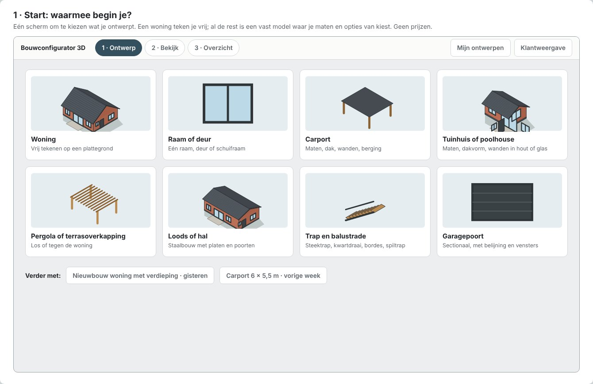
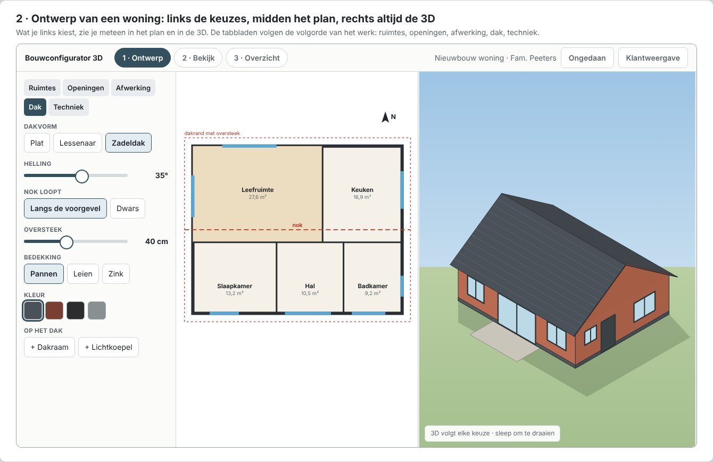
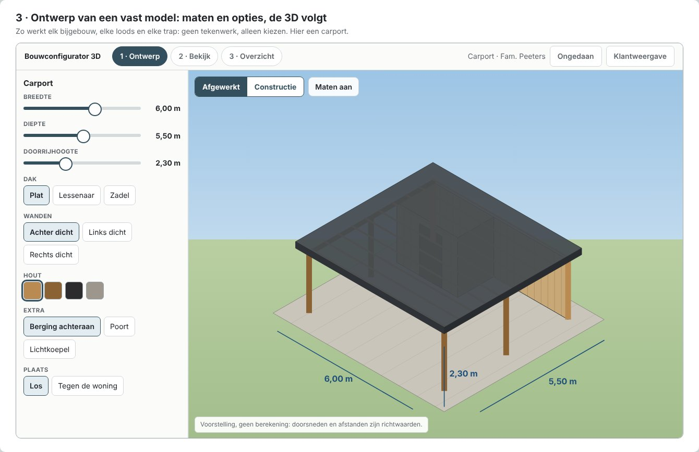
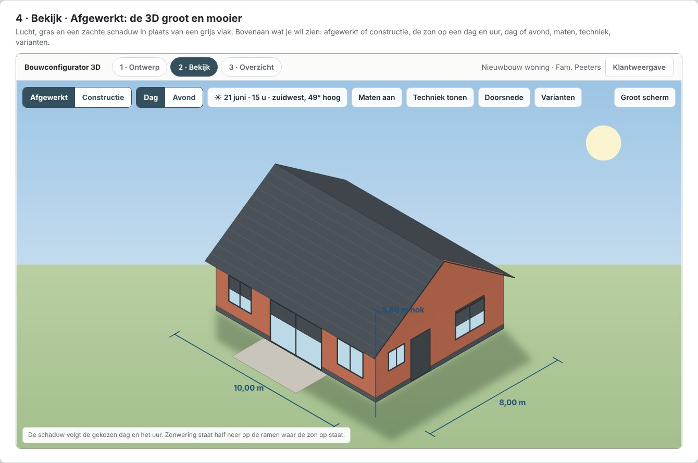
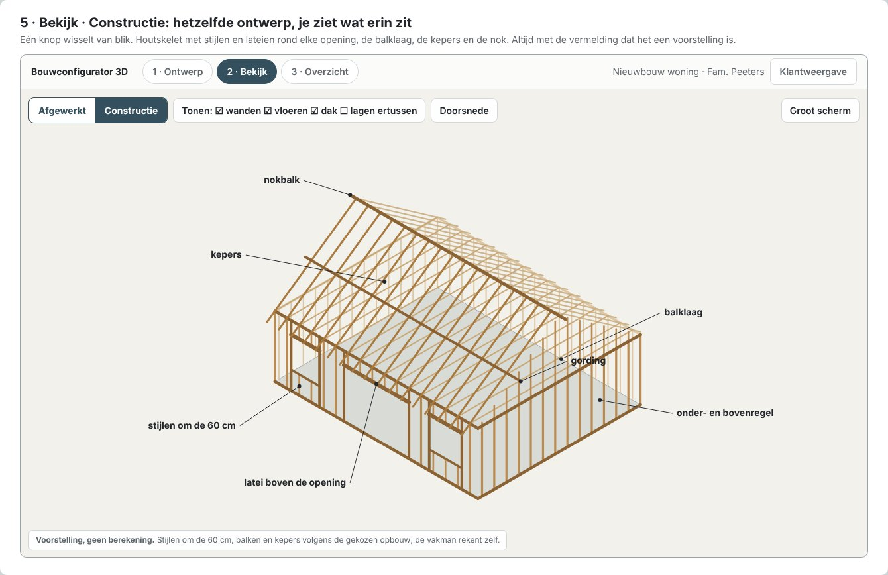
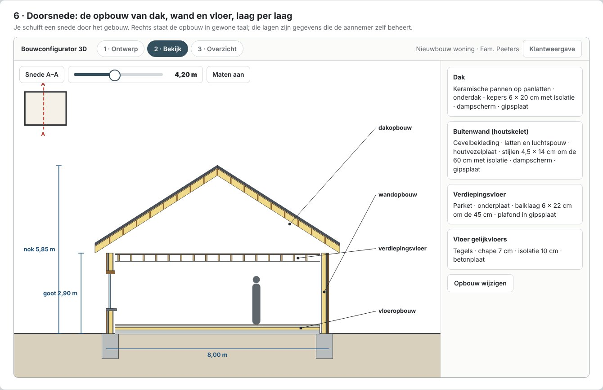
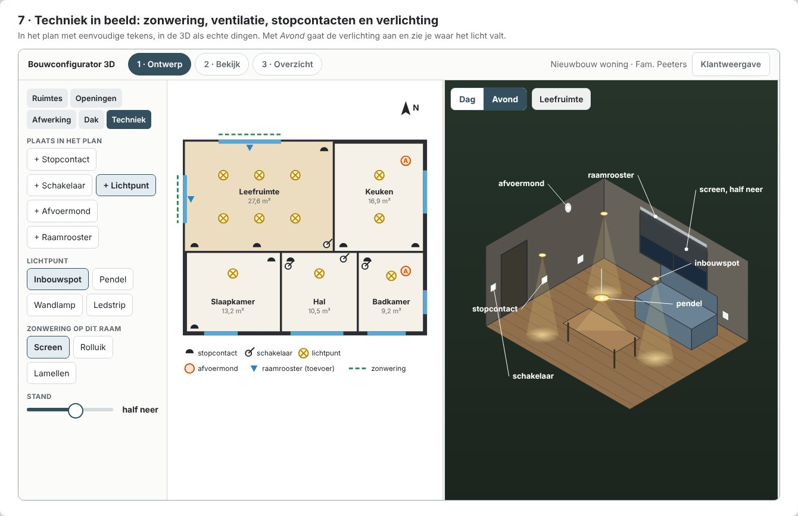
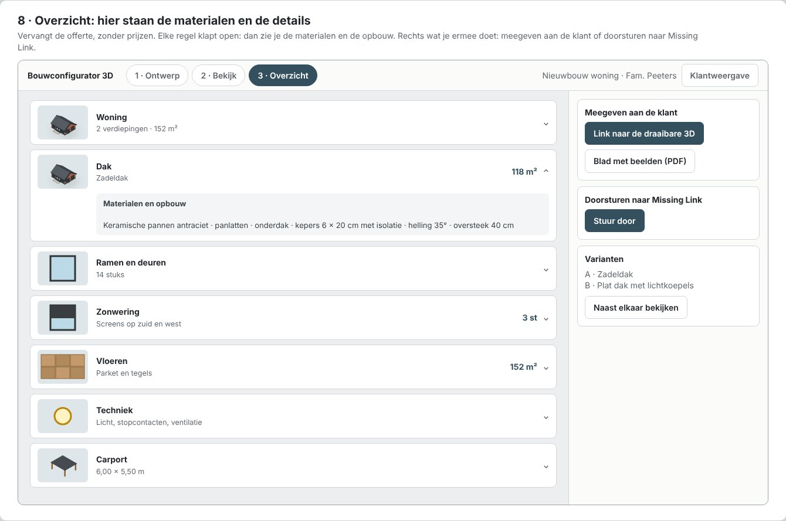
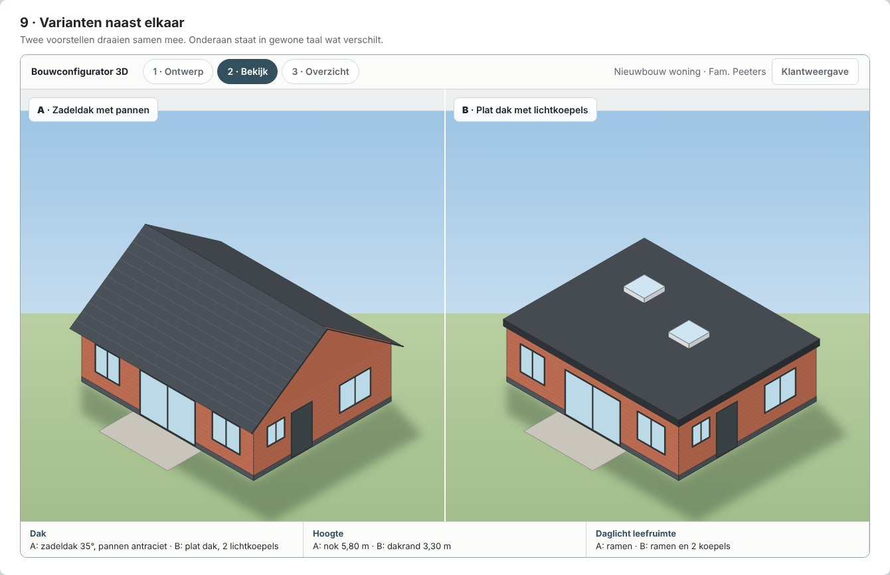
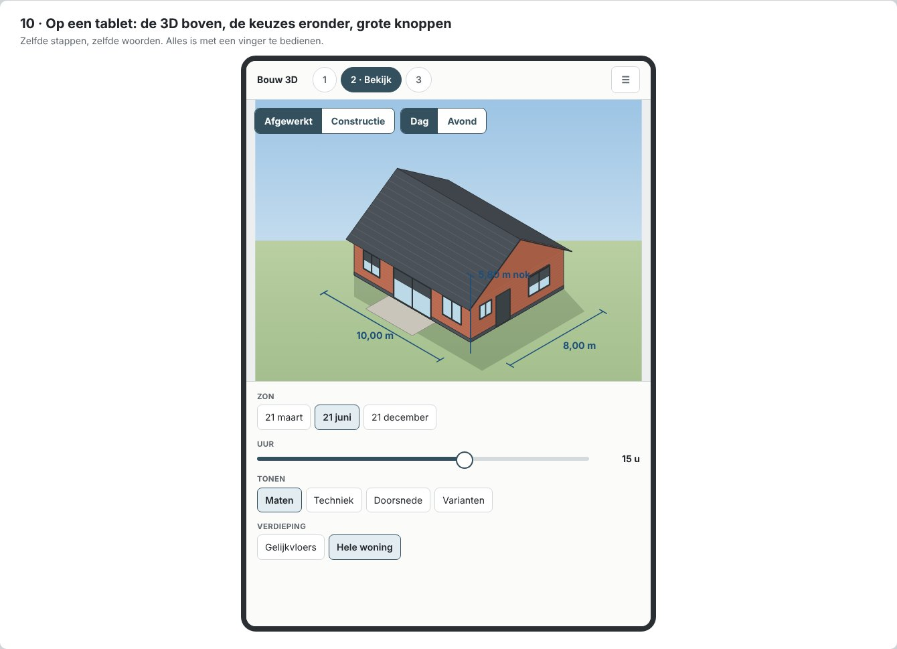

# 3D tonen aan klanten in de bouw, los van prijzen — analyse (15 november 2026)

Vraag van Jonas (15/11): *"Graag ook verschillende raamtypes, vloeren, houtconstructies, metaalconstructie etc. Maak een analyse om dit bruikbaar te maken om 3D te tonen aan klanten los van prijzen."* Eerder die dag: *"Ik zou enkel 3D zonder prijzen maken in eerste instantie"* en *"kunnen we de 3D-bouwconfigurator helemaal afwerken en zeer gebruiksvriendelijk maken?"*

Dit is alleen een analyse. Ze bouwt voort op `docs/analyse-bouw-3d-missing-link.md` (de 3D doorsturen, de eerste lijst afwerkingen).

> **Labels:** **[code]** = vandaag vastgesteld in de code. **[beslist]** = antwoord van Jonas op een van de twaalf vragen hieronder. **[inschatting]** = mijn redenering. **[te bevestigen]** = moet iemand anders bevestigen (leverancier, aannemer, Missing Link).
> Werk: **S** = enkele dagen, **M** = één à twee weken, **L** = meer.

## Het doel (Jonas, 15/11)

> *"Snel een mooie 3D opmaken die een verkoper kan tonen na het eerste gesprek ter plaatse bij de klant. Dit kan nadien
> verder in detail ingevuld worden."*

Daaruit volgen twee fasen, en alles in dit document wordt daaraan getoetst:

| Fase | Wanneer | Wat telt | Wat erbij hoort |
|---|---|---|---|
| **1 · Eerste gesprek** | Bij de klant, of meteen erna | Snel, mooi, kunnen tonen en meegeven | Snelstart, stijlen, tik op het ding, vrij tekenen, een mooiere 3D, meegeven (bestand of link, blad met beelden), zonder prijzen |
| **2 · Detail invullen** | Nadien, op kantoor | Volledig en juist | Constructie en doorsnede, alle raamtypes, vloeropbouw, techniek en installateur, het detail van de offerte, beheer |

Fase 1 gaat voor. Niets uit fase 2 mag fase 1 trager of drukker maken: het detail zit achter *Meer opties*, in het
overzicht, of in een aparte weergave.

## In het kort

1. **Het doel verschuift van "offerte maken" naar "het ontwerp tonen".** De verkoper bouwt het ontwerp op, de klant ziet het in 3D en krijgt het mee. Prijzen verdwijnen uit beeld; de rekenmotor blijft bestaan voor later.
2. **Wat je vraagt, valt uiteen in drie soorten werk:**
   - *meer van hetzelfde* (raamtypes, vloerafwerking): de bouwstenen bestaan, er komen keuzes bij;
   - *nieuwe producten* (carport, tuinhuis, loods, stalen trap): elk een vast model met maten en opties, zoals nu een raam;
   - *een nieuwe blik* (constructie: houtskelet, dakconstructie, vloeropbouw): hetzelfde ontwerp, maar je ziet wat erin zit.
3. **Eén ding maakt alles goedkoper: een bibliotheek van bouwdelen.** Paal, ligger, spant, wandvlak, dakvlak, plaat, poort. Een carport, een loods en een houtskeletwand zijn alle drie een samenstelling daarvan. Vandaag is de 3D van elk model apart geprogrammeerd; dat houdt geen zes productsoorten vol.
4. **Het zwaarste stuk is niet de 3D maar het beheer.** Je koos dat de aannemer zelf zijn modellen, kleuren en materialen beheert. Dat kan voor materialen, kleuren, maten en welke opties hij toont. Een **nieuwe vorm** (een ander soort carport) blijft programmeerwerk. En beheren vraagt bewaren buiten de browser.
5. **Volgorde:** herschikt naar het doel (zie hoofdstuk 8): eerst snel, mooi en kunnen meegeven; de constructieweergave en al het andere detail komen daarna. Elke ronde eindigt met echte schermafdrukken en een test op tablet en groot scherm.

Wat ik nog van je nodig heb, staat in hoofdstuk 15. **Het belangrijkste is gebruiksgemak: zie hoofdstuk 13 (de kortste weg naar een resultaat).** Hoofdstuk 14: aanwijzing voor EPB, schatting van de stabiliteit en meetstaat, zoals de referentie-app. Later op 15/11 kwamen erbij: de toets aan twee echte offertes (hoofdstuk 10), alles voor de installateur (hoofdstuk 11) en het oordeel over de schetsen (hoofdstuk 12).

---

## 1. Jouw twaalf antwoorden [beslist]

| # | Vraag | Jouw antwoord |
|---|---|---|
| 1 | Wie bedient de 3D? | De verkoper maakt het ontwerp; de klant krijgt het daarna om zelf te bekijken, zonder te kunnen wijzigen. |
| 2 | Welke constructies? | Alle vier: bijgebouwen in hout, houtskelet en dakconstructie, staalbouw (loods of hal), staal in en rond de woning. |
| 3 | Hoe begint een ontwerp? | Een vast model met maten en opties. De woning zelf blijf je vrij tekenen op de plattegrond. |
| 4 | Vloeren? | Beide: de afwerking (parket, tegels, legpatroon, plinten) en de opbouw (balklaag, chape, isolatie). |
| 5 | Welke raamtypes? | Alle vier de groepen: grote glaspartijen, bijzondere vormen, dakramen en poorten, indelingen en uitzicht. |
| 6 | Afwerking en constructie tonen? | Twee weergaven met één knop: *Afgewerkt* en *Constructie*. |
| 7 | Offerte en Werf? | Offerte wordt *Overzicht* (wat er is en hoeveel, met beelden en doorsturen). Werf verdwijnt uit het menu. Alle prijzen uit beeld. |
| 8 | Wat eerst, na dak, koepels en lichtinval? | De constructieweergave. |
| 9 | Wie beheert het aanbod? | De aannemer zelf. |
| 10 | Wat krijgt de klant mee? | Alles: een link naar de draaibare 3D, beelden of een PDF, varianten naast elkaar, maten op het beeld. |
| 11 | Toestel? | Tablet en groot scherm even belangrijk. |
| 12 | Missing Link? | Aparte app; Missing Link ontvangt een beeld per regel en de draaibare 3D (de *zending*, al gebouwd, zonder prijzen). |

---

## 2. Wat er vandaag is [code]

| Onderdeel | Stand |
|---|---|
| **Woning** | Vrij te tekenen plattegrond met verdiepingen, muren die vanzelf ontstaan, ramen en deuren in de muren, trap, meubels. In 3D als massieve muren met materiaal buiten en binnen, vloerplaten, plat dak. |
| **Raam en deur** | Eén model met vier soorten (raam met 1 tot 3 vakken naast elkaar, terrasdeur, voordeur, schuifraam), bovenlicht, roeden, 5 profielen, 6 kleuren, zonwering. De 3D is een apart programma per model (`raam3d.ts`). |
| **Aanbouw** | Een ouder vast model met maten en opties, met o.a. hef-schuif 2- en 3-delig, schuifraam 4-delig, vouwdeur, lichtstraat en koepel. Bewijst dat "vast model met maten en opties" werkt; zijn onderdelen zijn nog niet herbruikbaar. |
| **Gevel, vloer, wand** | Gevelmaterialen als gegevens (8 materialen, per muurvlak). Vloer en wand per ruimte uit een korte lijst. |
| **In opbouw** (15/11) | Dak (plat met afwerking, lessenaar, zadel), lichtkoepels, lichtinval. |
| **Tonen en doorsturen** | Klantweergave (verbergt interne zaken), afdrukken, het 3D-pakket, de losse kijker en de zending voor Missing Link. |
| **Maten in de 3D** | Bestaan alleen voor de zetels (breedte, diepte, hoogte van het geheel). De gevelaanzichten van de woning hebben wel kettingmaten. |
| **Beheer** | De zeteldemo heeft een beheerscherm (stoffen, elementen, opties, modellen). **De bouwdemo heeft er geen.** |
| **Bewaren** | Alleen in de browser van één toestel, of als bestand. |
| **Techniek van de 3D** | Alles is opgebouwd uit blokken (balk, cilinder, kegel, bol, gebogen wand, profiel langs een lijn; een blok kan kantelen). Elk blok is een apart getekend stuk: er is geen techniek om duizend gelijke stijlen in één keer te tekenen. Gemeten op de voorbeeldwoning: 697 blokken geven ±2 000 tekenopdrachten na één klik (schaduw inbegrepen). |

---

## 3. De kern: van aparte programma's naar bouwdelen

Vandaag heeft elk model zijn eigen 3D-programma. Voor zes productsoorten erbij is dat niet houdbaar, en het botst met "de aannemer beheert zelf".

**Voorstel [inschatting]: een bibliotheek van bouwdelen**, die elk uit maten en een materiaal hun blokken maken:

| Bouwdeel | Dient voor |
|---|---|
| Paal en kolom (hout, staalprofiel) | carport, pergola, loods, luifel |
| Ligger, balk, gording | balklaag, carport, loods, dakconstructie |
| Spant en portaal (driehoek, schaar, stalen portaal) | dakconstructie, loods |
| Wandvlak met opbouw (lagen en skelet) | houtskelet, tuinhuis, gevel van een loods |
| Dakvlak met opbouw | alle daken (komt uit het werk dat nu loopt) |
| Vloervlak met opbouw | vloeropbouw, verdiepingsvloer |
| Beplating en panelen (planken, sandwichpaneel, glas) | wanden en daken van bijgebouwen en loodsen |
| Opening (raam, deur, poort) | overal |
| Trap en balustrade | woning, bordes, loods |

Een **model** is dan een recept: welke bouwdelen, met welke formules voor hun maten. Een carport is "vier of zes palen, twee liggers, een dakvlak, nul tot drie wandvlakken". Dat recept schrijven wij; de aannemer kiest de maten, materialen en opties.

**De opbouw als gegevens.** Een wand, een vloer en een dak krijgen elk een *opbouw*: de lagen van binnen naar buiten (bv. gipsplaat, houtskelet 140 mm met isolatie, plaat, latten, gevelbekleding) en het raster van het skelet (stijlen om de 40 of 60 cm). Uit die ene beschrijving komen drie dingen:

- de **afgewerkte** weergave (alleen de buitenste lagen);
- de **constructie**weergave (het skelet en de lagen ertussen);
- later een **doorsnede**tekening.

Dat is hetzelfde principe als bij de gevel: een afwerking is gegevens, geen programma.

---

## 4. Wat erbij komt, per onderwerp

### 4.1 Raamtypes [beslist: alle vier de groepen]

| Groep | Wat | Wat er technisch voor nodig is | Werk |
|---|---|---|---|
| **Indelingen en uitzicht** | Stolpraam, deur met zijlicht en bovenlicht, vakken boven elkaar, kleinhouten, steellook met fijne verdeling | De indeling van een raam wordt een **raster van vakken** (rijen en kolommen, ook genest) in plaats van "1 tot 3 naast elkaar". De basis voor al de rest. | M |
| **Grote glaspartijen** | Hef-schuif met 3 of 4 delen, vouwwand, vaste glaswand, hoekraam zonder stijl | Hef-schuif en vouwdeur bestaan in het aanbouwmodel en verhuizen naar het raammodel. Het hoekraam is nieuw: één positie over twee muren. | M |
| **Bijzondere vormen** | Schuine bovenkant (onder een dakhelling), rondboog, rond | Een kader dat een lijn volgt in plaats van een rechthoek. De techniek bestaat bij de zetels (een profiel langs een boog). | M |
| **Dakramen en poorten** | Dakraam in een hellend dak, lichtstraat, sectionale garagepoort | Het dakraam hangt af van het dak dat nu gebouwd wordt. De garagepoort is een eigen model (belijning, vensters, kleur). | M |
| **Kleur en beslag** | Volledige RAL-waaier met afwerking, krukken en trekbeugels als echt 3D-bestand | Stond al in de vorige analyse (punten 10 en 12). | S + M |

Niet in deze stap: de echte profieldoorsnede per systeem. Die wacht op doorsnedes van een leverancier **[te bevestigen]**.

### 4.2 Vloeren [beslist: afwerking en opbouw]

| Wat | Hoe | Werk |
|---|---|---|
| **Afwerking** | Legpatroon (recht, halfsteens, visgraat, Hongaarse punt), formaat van tegel of plank, voegkleur; plinten; per ruimte, later per zone | M |
| **Opbouw** | Lagen per vloertype: draagvloer (houten balklaag, welfsels, beton), isolatie, chape, afwerking. Zichtbaar in de constructieweergave en in een doorsnede. | M (samen met 4.4) |

### 4.3 Bijgebouwen in hout [beslist]

Vaste modellen met maten en opties: **carport, tuinhuis, poolhouse, pergola, terrasoverkapping**.

| Keuzes per model [inschatting, te bevestigen met een aannemer] | |
|---|---|
| Maten | breedte, diepte, hoogte, aantal vakken |
| Dak | plat, lessenaar, zadel; bedekking; oversteek |
| Wanden | per zijde open, dicht (planken staand of liggend), glas, schuifwand |
| Hout | soort en kleur (naturel, gebeitst, zwart) |
| Extra's | berging aan een carport, poort, deur, dakgoot, lichtkoepel |
| Plaats | los, of tegen de woning (dan staat het bij de woning in 3D) |

Werk: de bouwdelen eerst (M), daarna ±S per model.

### 4.3b De aanbouw als eigen vorm [beslist, 15/11: "aanbouw is specifieke vorm, mag ook toegevoegd worden"]

De aanbouw is een vast model dat **al bestaat** [code]: tegen de woning, met breedte, diepte en hoogte, een raampartij
(schuifraam 2-, 3- of 4-delig, hef-schuif, vouwdeur, deur met zijpanelen), 3 gevels voor de zijmuren, 4 bekledingen boven de
raampartij en een plat dak met EPDM, lichtstraat of lichtkoepel. Hij krijgt een eigen tegel op het startscherm (schets 1).

Wat erbij moet: hij wordt opgebouwd uit dezelfde bouwdelen als de rest (zodat hij ook een constructieweergave en een
doorsnede krijgt), hij neemt de gevel- en dakcatalogus van de woning over in plaats van zijn eigen korte lijstjes, en je
kunt hem **tegen een getekende woning** zetten in plaats van alleen los. Werk: M.

### 4.4 Houtskelet, dakconstructie en de constructieweergave [beslist: eerst]

Dit is de **tweede weergave** van de woning: één knop wisselt tussen *Afgewerkt* en *Constructie*.

| In de constructieweergave zie je | Komt uit |
|---|---|
| Wanden als skelet: onder- en bovenregel, stijlen op raster, extra stijlen en latei rond elke opening | de opbouw van het wandtype en de openingen in het plan |
| Verdiepingsvloer als balklaag, met het trapgat uitgespaard | de opbouw van het vloertype |
| Dak als spanten, gordingen en kepers, of als platte balklaag | de dakvorm (uit het werk dat nu loopt) en de opbouw van het dak |
| De lagen ertussen half doorzichtig of weggelaten, naar keuze | de opbouw |

**Eerlijk over wat dit is:** een **voorstelling**, geen berekening. De afstanden en doorsneden zijn regels van goed vakmanschap (bv. stijlen om de 60 cm), geen stabiliteitsstudie. Dat moet op het scherm en op elk blad staan. **[te bevestigen]**: welke opbouwen een houtskeletbouwer wil tonen.

**Risico:** veel stukken. Een woning in houtskelet heeft al snel duizend stijlen en balken; vandaag tekent de kijker elk stuk apart [code]. Er is een techniek nodig die gelijke stukken in één keer tekent, anders hapert het op een tablet. Dat hoort bij deze stap.

Werk: L (opbouw als gegevens, drie soorten skelet, de knop, de snelheid).

### 4.5 Staalbouw: loods of hal [beslist]

Eén vast model: **breedte, lengte, goothoogte, dakhelling, afstand tussen de portalen**.

| Onderdeel | Keuzes |
|---|---|
| Draagstructuur | portalen (kolommen en spanten), gordingen, windverbanden; zichtbaar in de constructieweergave |
| Dak en gevel | sandwichpanelen of geprofileerde plaat, kleur (RAL), lichtplaten of lichtstraat, betonplint |
| Openingen | sectionale poorten (aantal, maat, plaats), loopdeuren, ramen |
| Extra's | luifel, goten en afvoeren, binnenwand, tussenvloer |

Ook hier: **geen berekening**. De profielen zijn een voorstelling; de staalbouwer rekent zelf. Werk: M–L.

### 4.6 Staal in en rond de woning [beslist]

| Product | Keuzes | Werk |
|---|---|---|
| Trap | rechte steektrap, kwartdraai, met bordes, spiltrap; open of dicht; treden in hout of staal | M |
| Balustrade en leuning | spijlen, glas, kabels; langs trap, vide en terras | S–M |
| Luifel | boven een deur of een terras | S |
| Stalen binnendeuren en ramen | steellook met fijne verdeling (zie raamtypes) | S, na 4.1 |

### 4.7 Tonen en meegeven [beslist: alle vier]

| Wat de klant krijgt | Hoe | Wat het vraagt | Werk |
|---|---|---|---|
| **Draaibare 3D** | De losse kijker bestaat. Eerst als één bestand om te mailen (kijker met het ontwerp erin). Een echte **link** vraagt een plaats waar het ontwerp bewaard staat: Missing Link of een eigen server. | bewaren buiten de browser **[te bevestigen]** | S (bestand), M (link) |
| **Beelden of PDF** | Een blad zonder prijzen: enkele vaste standpunten (voor, achter, schuin, binnen), de keuzes in gewone taal. | het afdrukblad bestaat, maar is een offerte | S–M |
| **Varianten naast elkaar** | Een variant is een kopie van het ontwerp met een andere keuze. Twee kijkers naast elkaar die samen draaien, en eronder wat verschilt. | varianten bestaan nog niet; projecten kopiëren wel | M |
| **Maten op het beeld** | Hoofdmaten in de 3D (breedte, diepte, goot- en nokhoogte) en op de aanzichten. | in de 3D alleen voor zetels [code] | S–M |

### 4.8 Zonder prijzen [beslist]

| Wat | Hoe |
|---|---|
| Stap *Offerte* wordt *Overzicht* | Lijst van wat er in het ontwerp zit en hoeveel, met een beeld per onderdeel, en de knoppen om mee te geven en door te sturen. |
| *Werf* verdwijnt uit het menu | Inmeting, akkoord en meerwerkbon blijven in de code, uit beeld. |
| Alle bedragen uit beeld | Prijs per positie, totalen, korting, kostprijs en marge. In de code staan bedragen op 51 plaatsen in 7 schermbestanden [code]. |
| De rekenmotor blijft | Formules, stuklijst en prijslijsten blijven bestaan en getest; ze worden alleen niet getoond. |
| De zending | Gaat al zonder prijzen, totalen en stuklijst (15/11). |

Werk: M, samen met de eerste ronde gebruiksgemak.

### 4.9 Beheer door de aannemer [beslist]

Wat hij **zelf** kan, zonder ons:

| Zelf te beheren | Voorbeeld |
|---|---|
| Materialen en kleuren | een gevelsteen, een dakpan, een RAL-kleur, een houtsoort erbij, met naam en kleur |
| Maten | standaardmaten en grenzen per model |
| Het aanbod | welke modellen en opties hij toont, onder welke naam |
| Opbouwen | zijn wand-, vloer- en dakopbouwen, uit de lagen die bestaan |
| Uitzicht | logo en huisstijl |

Wat **niet** zelf kan: een nieuwe vorm (een ander soort carport, een ander dak). Dat is een nieuw recept en blijft werk voor ons.

**Voorwaarde:** beheren heeft pas zin als het bewaard blijft en op elk toestel van die firma geldt. Vandaag bewaart de bouwdemo alleen in de browser. Tot er een server of Missing Link achter zit, kan het beheer alleen als *bestand* (een catalogus die je opslaat en inleest). **[te bevestigen]**: waar die catalogus komt te staan.

Werk: L (een nieuw scherm, veilig tegen fouten, met voorbeeld terwijl je wijzigt).

### 4.10 Tablet en groot scherm even goed [beslist]

- Elke nieuwe functie wordt getest op tablet (vinger) en op een groot scherm (muis) vóór ze als klaar geldt.
- De 3D krijgt een vaste plaats; panelen schuiven ernaast (groot scherm) of eronder (tablet).
- Zware scènes (constructie, loods) worden gemeten: hoe lang duurt het tekenen op een toestel zonder sterke grafische kaart.
- De werkwijze staat in `docs/analyse-gebruiksgemak.md`, hoofdstuk 8 (taken met een teller van handelingen, vijf schermformaten).

---

## 5. Hoe het scherm eruit zou zien [inschatting]

Drie stappen in plaats van vier:

| Stap | Wat |
|---|---|
| **1 · Ontwerp** | Kies waarmee je begint: een woning (plattegrond), een raam of deur, of een vast model (carport, tuinhuis, loods, trap …). Links de keuzes, rechts altijd de 3D. |
| **2 · Bekijk** | De 3D groot: *Afgewerkt* of *Constructie*, verdieping, zon en uur, maten aan of uit, varianten naast elkaar. |
| **3 · Overzicht** | Wat er in het ontwerp zit, met beelden. Meegeven (bestand of link, PDF) en doorsturen naar Missing Link. |

De klantweergave blijft: één knop die alles verbergt wat de klant niet hoeft te zien.

### Schermschetsen (15/11, op vraag van Jonas: "maak eerst een aantal tekeningen")

Tien schetsen van hoe de schermen, de 3D en de doorsnede eruit zouden zien. Het zijn tekeningen, geen schermafdrukken:
niets hiervan is gebouwd. Bron: `docs/proeven/schermschetsen-bouw.html` (één pagina die zichzelf tekent).

**Oordeel van Jonas op de eerste versie (15/11):** *"de kwaliteit is wel subpar nu, ik zou ook minder detail van
materialen meteen zichtbaar, dit enkel in de samenvatting. Moet snel en duidelijk zijn voor een verkoper."* Daaruit
volgen twee regels voor het ontwerp van de schermen:

1. **Snel en duidelijk voor een verkoper.** De 3D is het grootste vlak. Links hoogstens vijf onderwerpen; onderaan één
   rij grote keuzes als beeld (bv. drie dakvormen en vier kleuren), maten met grote − en + knoppen. Alles wat minder
   vaak nodig is, zit achter *Meer opties*.
2. **Geen materiaaldetail tijdens het ontwerpen.** Geen namen van lagen, geen lijsten van materialen, geen opbouw in
   tekst: de 3D toont het. De materialen en de opbouw staan alleen in het **overzicht** (schets 8), waar elke regel
   openklapt.

De schetsen 2, 3, 6, 7 en 8 zijn daarop hertekend. Over de **kwaliteit van het beeld**: een schets kan die niet tonen.
De echte 3D van de bouw is vandaag kaal (voor gebouwen tekent de kijker een effen achtergrond en eenvoudige schaduw
[code]); "mooier" moet bewezen worden met echte beelden uit de 3D, als eerste stap na het dak.

| # | Schets | Wat ze toont |
|---|---|---|
| 1 |  | Kiezen waarmee je begint: woning, aanbouw, raam, carport, tuinhuis, pergola, loods, trap, garagepoort |
| 2 |  | De 3D groot, links vijf onderwerpen, onderaan één rij grote keuzes, het plan als kaartje |
| 3 |  | Een vast model (carport): drie maten met grote − en + knoppen, de 3D volgt |
| 4 |  | De 3D groot en mooier: lucht, gras, schaduw, zon op dag en uur, maten, zonwering |
| 5 |  | Hetzelfde ontwerp als houtskelet: stijlen, lateien, balklaag, kepers, nok |
| 6 |  | Snede door het gebouw; op het scherm alleen vier namen, de lagen staan in het overzicht |
| 7 |  | Vijf grote knoppen (stopcontact, schakelaar, lichtpunt, ventilatie, zonwering): tik en plaats in het plan; rechts de kamer, met avondbeeld |
| 8 |  | Overzicht zonder prijzen: hier staan de materialen en de opbouw (regel klapt open), met meegeven en doorsturen |
| 9 |  | Twee voorstellen naast elkaar, met wat verschilt |
| 10 |  | Dezelfde stap op een tablet |

Na de schetsen kwamen er nog wensen bij (15/11): **zonneschermen, ventilatie, stopcontacten, verlichting** (schets 7) en
**"maak onze 3D mooier"** (schets 4: lucht, gras, zachte schaduw, avondbeeld). Ze horen bij de rondes *techniek* en
*de 3D mooier*, die nog in de volgorde van hoofdstuk 8 moeten komen na het oordeel van Jonas over de schetsen.

---

## 6. Wat dit niet is

- **Geen officiële berekening.** De configurator geeft wel schattingen (hoofdstuk 14: een aanwijzing voor EPB, een schatting
  van de stabiliteit, een meetstaat), maar geen EPB-aangifte en geen stabiliteitsstudie. Bij elke schatting staat dat erbij,
  met de aannames. De bestaande controles (daglicht, veiligheidsglas, de statiek van een raam) blijven richtwaarden en
  "te verifiëren".
- **Geen foto.** De 3D blijft opgebouwd uit blokken met een getekende structuur. Met dak, kleuren en profielen wordt ze rijker, maar ze wordt geen foto van het huis.
- **Geen uitvoeringsplan.** De constructieweergave toont wat erin zit, niet hoe het gezaagd en gemonteerd wordt.
- **Geen prijzen**, in eerste instantie.

---

## 7. Risico's

| Risico | Wat we eraan doen |
|---|---|
| **Te breed tegelijk.** Zes productsoorten, beheer, varianten en twee toestellen samen is veel. | Vaste volgorde, één ronde tegelijk, elke ronde af vóór de volgende begint. |
| **De klant leest een voorstelling als een belofte** (bv. het aantal stijlen). | Op het scherm en op elk blad: "voorstelling, geen berekening". |
| **De constructieweergave hapert op een tablet.** | Gelijke stukken in één keer tekenen; meten vóór we verder bouwen. |
| **Recepten zonder vakman.** Hoe een carport of loods echt in elkaar zit, weet een aannemer, niet ik. | Per productsoort één aannemer die het recept naleest **[te bevestigen]**. |
| **Beheer zonder opslag.** | Eerst als bestand; het echte beheer na de keuze waar gegevens bewaard worden. |
| **Bestaande projecten breken.** | Elk nieuw veld is optioneel; een test opent oude projecten. |

---

## 8. Volgorde

Herschikt op 15/11 naar het doel hierboven: eerst fase 1 (snel, mooi, meegeven), dan fase 2 (detail).

| Ronde | Fase | Wat | Werk [inschatting] |
|---|---|---|---|
| 1 | 1 | **Klaar (15/11):** dak (plat, lessenaar, zadel, met bedekking), lichtkoepels en lichtstraten, lichtinval (zon op een dag en uur, noordrichting, zon per gevel); 3D doorsturen als pakket en zending. Niet nagekeken op een toestel met WebGPU | – |
| 2 | 1 | *(start zodra de ramen samengevoegd zijn: de stijlen zetten ook de kleur van het schrijnwerk)* **Snel resultaat** (hoofdstuk 13): snelstart in drie vragen, daarna vrij tekenen, stijlen, tik op het ding zelf; Overzicht in plaats van Offerte, Werf uit het menu, bedragen uit beeld; gemeten in tikken op tablet en groot scherm | M–L |
| 3 | 1 | *(loopt sinds 15/11)* **De 3D mooier:** een omgeving in plaats van een effen vlak (lucht, gras, terras), zachte schaduw, rijkere materialen, later een avondbeeld; echte beelden vóór en na | M |
| 4 | 1 | **Meegeven:** één bestand of een link met de draaibare 3D, een blad met beelden zonder prijzen, maten in de 3D, varianten naast elkaar | M |
| – | | **Mijlpaal: bruikbaar na een eerste gesprek.** Toets: de uitbouw uit hoofdstuk 10 in hoogstens 25 tikken, mooi genoeg om te tonen | |
| 5 | 2 | **Klaar (16/11), alleen de motor:** bouwdelen en opbouw als gegevens (hoofdstuk 3 en 16); de woning en de schermen gebruiken ze nog niet | – |
| 6 | 2 | **Constructieweergave** en doorsnede: houtskelet, balklaag, dakconstructie, vloeropbouw; met de **meetstaat** van de nodige materialen (hoofdstuk 14) | L |
| 6b | 2 | *(de rekenfuncties staan sinds 16/11 in de motor, hoofdstuk 17; het scherm volgt met ronde 6)* **Aanwijzing voor EPB** (U-waarde per deel) en **schatting van de stabiliteit** (balken, kepers, lateien in hout), elk met de aannames erbij (hoofdstuk 14) | M–L |
| 7 | 2 | *(loopt sinds 15/11, naar voren gehaald: de uitbouw uit hoofdstuk 10 heeft het hefschuifraam nodig)* **Ramen:** raster van vakken, grote glaspartijen, bijzondere vormen, dakraam en garagepoort, kleurwaaier | L |
| 8 | 2 | **Aanbouw en bijgebouwen in hout** op bouwdelen; carport, tuinhuis, poolhouse, pergola | M–L |
| 9 | 2 | **Staalbouw** (loods of hal) en **staal in en rond de woning** (trap, balustrade, luifel) | L |
| 10 | 2 | **Techniek en installateur** (hoofdstuk 11): toestellen en leidingen, zonwering, ventilatie, elektriciteit, verlichting met avondbeeld | L |
| 11 | 2 | **Detail van de offerte** (hoofdstuk 10): elk deel van de 3D kent zijn post; detail in het overzicht en op een tik | M |
| 12 | 2 | **Vloerafwerking** en de rest van de afwerkingen | M |
| 13 | 2 | **Beheer door de aannemer**, met bewaren in Missing Link | L |

Elke ronde eindigt met echte schermafdrukken, een testbestand en de gemeten tikken op tablet en groot scherm.

---

## 9. Hoe dit past bij Missing Link

Niets verandert aan de beslissing: een aparte app die de 3D doorstuurt. Elk nieuw product (carport, loods, trap) komt vanzelf mee in het 3D-pakket en in de zending, omdat die de scène doorsturen en niet het soort product. Het beheer van de aannemer en de link voor de klant zijn de twee plaatsen waar Missing Link later de natuurlijke opslag is.

---

## 10. Toets aan twee echte offertes (15/11)

Jonas gaf twee offertes van twee aannemers voor **hetzelfde werk**: een uitbouw in houtskelet achter een rijwoning, tussen
twee bestaande scheidingsmuren, met plat dak. Zijn vraag: *"Deze offerte willen we kunnen weergeven met ook detail."*
Namen, adressen en bedragen staan bewust niet in dit document (de repo is publiek).

**Wat dit oplevert:** een concreet eerste doel. Kan de configurator deze uitbouw tonen, post per post, dan is hij
bruikbaar voor een echte verkoper. Het is ook precies de **aanbouw** die Jonas als eigen vorm vroeg.

| Post in de offertes | Wat je in 3D zou moeten zien | Stand vandaag |
|---|---|---|
| Bestaande woning waar de uitbouw tegen komt | De bestaande toestand in een neutrale tint, het nieuwe deel in kleur | **Ontbreekt.** De aanbouw staat los. |
| Afbraak terras, grondwerken, container | Niets: dat is werk, geen ding | Hoort alleen als regel in het overzicht |
| Fundering, betonplaat, kimblokken, isolerende blokken onder de wand | In de doorsnede en in de constructieweergave | Ontbreekt (bouwdelen, opbouw) |
| Houtskeletwanden: stijlen, grondbalk, plaat buiten, isolatie, dampscherm, regelwerk, plaat binnen | Constructieweergave en doorsnede van de wand | Ontbreekt (rondes 3 en 4) |
| Dakstructuur: randbalken en liggers of balken, beplating | Constructieweergave van het dak | Ontbreekt (rondes 3 en 4) |
| Dakopbouw: dampscherm, isolatie, afschot, EPDM; aluminium dakrand; noodafvoer; regenafvoeren | Plat dak met afwerking en dakrand; de lagen in de doorsnede | Dak en dakrand: in opbouw. Afvoeren en lagen: ontbreekt |
| Drie platte dakramen 120 × 120 met buitenzonwering | Koepels in het dak, zonwering open of dicht | Koepels: in opbouw. Zonwering erop: ontbreekt |
| Hefschuifraam 4,00 × 2,35 m | Het raam in de achtergevel, open te schuiven | Hef-schuif bestaat in het aanbouwmodel [code] |
| Twee screens op dat raam | Screens half of helemaal neer | Screen bestaat per raam [code]; twee naast elkaar op één raam niet |
| Raamventilatie (toestellen op het raam) | Een toestel bovenaan het raam | Alleen een rooster ja of nee [code] |
| Gevel in thermisch behandeld hout, verticaal; zijwanden tegen de buren | Houten gevel achteraan; zijwanden die je niet ziet | Hout verticaal bestaat [code]; "tussen twee muren" niet |
| Binnen: gipsplaten op wand en plafond, schilderklaar | Wanden en plafond in een kleur | Wand bestaat [code]; plafond ontbreekt |
| Vloeropbouw: isolatie, chape, vloer (PVC of tegels) | Vloerafwerking in de ruimte; de lagen in de doorsnede | Afwerking bestaat [code]; opbouw ontbreekt |
| Elektriciteit: schakelaars, stopcontacten, inbouwspots, een kleine verdeelkast | Op hun plaats in wand en plafond; avondbeeld | Ontbreekt (techniek) |
| Sanitair: hangtoilet, buitenkraan, leidingen | Toestellen op hun plaats; leidingen als lijn | Wc bestaat als meubel [code]; de rest ontbreekt |

**"Met ook detail" en "minder detail op het scherm" gaan samen** als het detail op twee plaatsen zit en nergens anders:

1. in het **overzicht**: elke regel klapt open en toont de regels van de offerte (zoals "dampscherm, isolatie 100 en 60 mm,
   EPDM, muuraansluitingen");
2. in de **3D**: tik je op een deel (het dak, de wand, het raam), dan verschijnt hetzelfde detail als een kaartje.

Daarvoor moet elk deel van de 3D weten bij welke post het hoort. Dat is nieuw: vandaag kent de 3D alleen blokken.

**Wat de tweede offerte goed doet** [afgeleid uit de tekst, de beelden zijn niet bekeken]: ze volgt de volgorde van het
bouwen (voorbereiding, wind- en waterdichte constructie met wand en dak, binnenafwerking, supplementen) en beschrijft de
opbouw van wand en dak in gewone zinnen. Die volgorde is een goed voorbeeld voor het overzicht.

**Voorstel:** deze uitbouw (zonder namen) wordt het **voorbeeldproject** van de configurator en de maatstaf per ronde:
"kunnen we deze offerte nu tonen?"

---

## 11. Voor de installateur (15/11)

Vraag van Jonas: *"voeg ook alles wat een installateur kan nodig hebben toe, airco, leidingen, meterkasten etc."* Eerder
die dag: zonneschermen, ventilatie, stopcontacten, verlichting.

Dit hoofdstuk is een **eerste indeling** uit algemene kennis **[inschatting]**. Het online onderzoek staat in
`docs/onderzoek-bouw-constructies.md` (hoofdstukken 5 en 6: zonwering, ventilatie, elektriciteit, verlichting, en wat een
installateur vast plaatst). Let op: dat onderzoek kon geen enkele pagina zelf openen; alles komt uit samenvattingen van
de zoekmachine en elk getal moet nog op de pagina zelf nagekeken worden. Het vond geen hulpmiddel voor installateurs
dat bedoeld is om aan een klant te tonen: hun software is gemaakt om te rekenen. Alle maten, hoogtes en afstanden die erbij komen, zijn richtwaarden **[te bevestigen]** door een
installateur.

### 11.1 Wat een installateur wil plaatsen en tonen

| Vak | Toestellen (een ding op een plaats) | Leidingen (een lijn van A naar B) |
|---|---|---|
| **Elektriciteit** | tellerkast en verdeelbord, stopcontacten, schakelaars, lichtpunten en armaturen, datakast en datapunten, laadpaal, omvormer en batterij van zonnepanelen, bel en videofoon | kabels en buizen per kring, aarding |
| **Koeling en verwarming** | airco binnenunit (wand, cassette, kanaal, vloer) en buitenunit, warmtepomp (buiten- en binnenunit, boiler of buffervat), gasketel, radiatoren en convectoren, verdeler van de vloerverwarming, thermostaat | koelleidingen en condensafvoer, aanvoer en retour, lussen van de vloerverwarming, gasleiding |
| **Ventilatie** | de unit (systeem C of D), toevoer- en afvoermonden, raamroosters, dakdoorvoer, gevelrooster, dampkap | kanalen (rond of plat), collectoren |
| **Sanitair** | wc, lavabo, douche, bad, spoelbak, wasmachine en droogkast, boiler, collector, waterverzachter, regenwaterpomp, buitenkraan | warm en koud water, afvoeren met hun diameter, regenwater |
| **Zonwering** | screens, rolluiken, buitenjaloezieën, knikarmscherm, lamellendak | (de voeding hoort bij elektriciteit) |

Alles valt dus in twee soorten: **toestellen** en **leidingen**. Dat maakt het bouwbaar: één manier om een toestel te
plaatsen, één manier om een leiding te trekken, en een catalogus die zegt welke er bestaan.

### 11.2 Hoe het getoond wordt

| Waar | Hoe |
|---|---|
| **In het plan** | Een eenvoudig teken per toestel, een gekleurde lijn per leiding (een vaste kleur per soort: bv. rood warm water, blauw koud, bruin afvoer, groen ventilatie, geel gas). De tekens voor elektriciteit volgen de gewoonte van het vak **[te bevestigen]**. |
| **In de 3D** | Toestellen als echte dingen op hun hoogte; leidingen als buizen. Met één knop *Techniek* wordt de woning doorschijnend en zie je alleen de installaties; per vak aan of uit te zetten. |
| **In de doorsnede** | Leidingen in de vloeropbouw, in de leidingspouw van een houtskeletwand, boven een verlaagd plafond. |
| **In het overzicht** | Aantallen per toestel en lopende meters per soort leiding en per diameter. Zonder prijzen. |
| **Avond** | De armaturen geven licht (zie schets 7). |

### 11.3 Wat het moet kunnen, en wat niet

- **Snel plaatsen:** tik op een toestel, tik in het plan. Een leiding trek je van toestel naar toestel; ze volgt de wanden
  en krijgt vanzelf een hoogte (in de vloer, in de wand, tegen het plafond) die je kunt wijzigen.
- **Vaste hoogtes als voorstel:** een stopcontact, een schakelaar, een airco-unit krijgen een gangbare hoogte, te wijzigen.
- **Technische ruimte:** de toestellen die samen horen (tellerkast, verdeelbord, boiler, verdeler, ventilatie-unit) als
  één opstelling die je in een berging of garage zet, met de vrije ruimte die ze vragen.
- **Buiten:** buitenunit van airco of warmtepomp tegen een gevel of op een plat dak, met de vrije ruimte errond.
- **Geen berekening van de installatie.** Geen vermogen, geen debiet, geen leidingdiameters uitrekenen, geen controle op
  het AREI of op de regels van de netbeheerder. De configurator **toont en telt** (de toestellen en de meters leiding komen
  in de meetstaat van hoofdstuk 14); de installateur dimensioneert. Dat staat op het scherm en op elk blad.

### 11.4 Wat het technisch vraagt

| Onderdeel | Wat nieuw is | Werk |
|---|---|---|
| **Toestel in het plan** | Een nieuw soort element naast meubel en opening: het hangt aan een wand, een plafond, een vloer of een raam, op een hoogte | M |
| **Leiding** | Een lijn met een soort, een diameter en een hoogte, die wanden volgt en door wanden kan | M–L |
| **Catalogus techniek** | Toestellen en leidingen als gegevens (naam, maat, teken, vorm in 3D, kleur) | M |
| **Weergave** | De knop *Techniek* (doorschijnende woning), aan en uit per vak, armaturen die licht geven | M |
| **Tellen** | Aantallen en lopende meters in het overzicht | S |
| **Vormen in 3D** | Per toestel een eenvoudige vorm uit blokken; voor de bekende toestellen later een echt 3D-bestand (de techniek bestaat bij de zetels) | S per toestel |

Dit is een eigen ronde, na de constructieweergave: de leidingen lopen door de opbouw van vloer, wand en plafond.

---

## 12. Jonas over de schetsen en de bestaande configurator (15/11)

- Op de eerste schetsen: te veel detail, moet snel en duidelijk zijn voor een verkoper (zie hoofdstuk 5).
- Daarna: *"Ik ben nog meer overtuigd van hoe de vorige versie eruitziet van de 3D-bouwconfigurator."* Gevolg: we bouwen
  **verder op de bestaande configurator en zijn echte 3D**. De schetsen blijven alleen als idee voor de indeling (de 3D
  groot, weinig keuzes tegelijk, het detail in het overzicht). Wat getoond wordt om te beoordelen, zijn voortaan echte
  schermafdrukken, geen tekeningen.

---

## 13. De kortste weg naar een resultaat (15/11)

Jonas: *"Belangrijkste is gebruiksgemak, een verkoper moet zo snel mogelijk een resultaat krijgen, kijk voor een manier
om dit te stroomlijnen."* Dit gaat vóór alles in dit document.

**Waar de tijd vandaag in zit** [code, gemeten op 1/11 in `docs/analyse-gebruiksgemak.md`]: van niets tot een afdrukbaar
resultaat met **één ruimte en één raam** zijn 13 handelingen nodig. De verkoper begint met een leeg blad en bouwt alles
zelf op. Voor de uitbouw uit hoofdstuk 10 (wanden, drie koepels, een groot raam, screens, techniek) schat ik meer dan
60 handelingen **[inschatting]**.

**Het principe keert om: eerst volledig, dan verbeteren.** De verkoper begint nooit leeg. Na drie antwoorden staat er
een volledig ontwerp dat er goed uitziet; daarna past hij alleen aan wat bij deze klant anders is.

| # | Maatregel | Wat het doet | Bestaat al? |
|---|---|---|---|
| 1 | **Snelstart in drie vragen** | *Wat* (een tegel: woning, aanbouw, carport …), *hoe groot* (drie maten met grote − en +, gangbare maten al ingevuld), *welke stijl* (één van vier beelden). Dan staat de 3D er, met ramen, dak en afwerking. | Nee |
| 1b | **Daarna vrij tekenen** (Jonas, 15/11: "na de snelstart ook vrij tekenen") | Wat de snelstart oplevert, is een gewoon ontwerp, geen gesloten sjabloon. De verkoper tekent vrij verder: ruimtes verschuiven en bijtekenen, wanden, ramen, een verdieping erbij. Vanuit de 3D is vrij tekenen één tik ver, en terug ook. | De plattegrond-editor bestaat [code]; de aanbouw staat er nog los van |
| 2 | **Stijlen** | Een stijl is een volledige set keuzes in één tik: gevel, kleur van het schrijnwerk, dak, vloer, binnenkleur. De aannemer legt zijn eigen stijlen vast (zijn typische werk). | Nee |
| 3 | **Tik op het ding zelf** | Tik in de 3D op het dak, een raam of een wand: alleen de keuzes van dat ding verschijnen. Geen menu's zoeken. | De kijker meldt al waar je tikt (bij de zetels) [code] |
| 4 | **Uitrusting in één tik** | "Basisuitrusting" plaatst per ruimte de stopcontacten, schakelaars, lichtpunten en ventilatie volgens vaste regels; "screens op zuid en west" in één tik. Daarna verplaats of schrap je wat niet past. | Het principe bestaat: een raam krijgt nu al keuzes volgens de ruimte [code] |
| 5 | **Beginnen van eigen werk** | De laatste ontwerpen en de eigen sjablonen van de aannemer als start: "zoals bij de vorige klant, maar een meter breder". | Sjablonen en kopiëren bestaan [code] |
| 6 | **Niets is verplicht** | Geen stappen die je moet doorlopen, geen velden die je moet invullen. *Bekijk*, *Overzicht* en *Meegeven* zijn altijd één tik ver. | Deels |
| 7 | **Onthouden** | De configurator onthoudt wat deze verkoper meestal kiest en stelt dat voor. | Nee |
| 8 | **Uit Missing Link vertrekken** | Het project en de klant komen uit Missing Link; niets overtypen. | Later |

**Doelen, te meten in een echte browser bij elke ronde** (zelfde methode als op 1/11):

| Taak | Vandaag | Doel |
|---|---|---|
| Een eerste 3D die je aan de klant kunt tonen | 13 handelingen (één ruimte, één raam) | hoogstens 5 tikken, onder de minuut |
| De uitbouw uit de twee offertes, volledig | meer dan 60 **[inschatting]** | hoogstens 25 |
| Een variant maken (ander dak of andere kleur) | ± 8 (project kopiëren en wijzigen) **[inschatting]** | 2 |
| Meegeven aan de klant | 2 (afdrukken, met prijzen) | 1 |

**Referentie van Jonas (15/11):** de video *"App voor houtskeletbouw"* van Carpentier (YouTube, `CYrOsKgC-ZA`). Wat ik
ervan kon nagaan: de titel, het kanaal en vier stilstaande beelden; de video zelf en de gesproken tekst kon ik niet
bekijken. Het is een getekende uitlegfilm, geen opname van de app. Op de beelden: een vakman tekent met de vinger een
plan op een tablet, toont het op de tablet aan een koppel ("en kan u eender waar en wanneer uw plannen raadplegen") en
"spaart bijzonder veel tijd, werkuren én geld uit". Volgens het onderzoek gaat het om een app voor de vakman bij de
klant: maten, wanden en ramen op een grondplan, dan 3D met zoninval **[niet zelf gezien]**. Wat dit bevestigt voor ons:
de tablet en de vinger eerst, tekenen ter plaatse, het resultaat meteen tonen, en de plannen daarna overal kunnen
raadplegen (bij ons: meegeven en bewaren in Missing Link).

**Gevolg voor de volgorde** (hoofdstuk 8): ronde 2 wordt *"snel resultaat"*: snelstart, stijlen, tik op het ding, prijzen
uit beeld, Overzicht. Ze komt meteen na het samenvoegen van dak, koepels en lichtinval, op de bestaande configurator, met
de uitbouw uit hoofdstuk 10 als proef. Elke latere ronde moet de doelen hierboven halen of verbeteren; een functie die
het trager maakt, gaat achter *Meer opties*.

---

## 14. Wat de referentie-app nog doet: EPB-waarde, schatting van stabiliteit, meetstaat (15/11)

Jonas over de app van Carpentier: *"app geeft EPB-waarde, doet schatting van stabiliteit en geeft meetstaat van nodige
materialen."* Dat hoort dus ook bij ons doel. Het zijn alle drie uitkomsten van **fase 2** (detail invullen): ze staan in
het overzicht en maken het eerste gesprek niet trager.

Alle drie volgen uit hetzelfde: de **bouwdelen en de opbouw als gegevens** (hoofdstuk 3). Wie weet welke lagen en welke
balken er in een wand, vloer en dak zitten, kan ze tellen, hun isolatiewaarde optellen en hun overspanning nakijken.

| Uitkomst | Wat de verkoper krijgt | Hoe het werkt | Wat al bestaat [code] | Werk |
|---|---|---|---|---|
| **Meetstaat** | Per ontwerp een lijst van wat nodig is: aantal en lengte van stijlen, balken en kepers per doorsnede; m² plaat, isolatie, folie, gevel- en dakbekleding per soort; ramen, koepels, toestellen. Zonder prijzen; te kopiëren of door te sturen. | Elk bouwdeel telt zijn eigen stukken en lagen; de meetstaat is de som, met een snijverlies per soort. | De motor heeft al een stuklijst met formules (nu gebruikt voor de prijs van ramen) en een glasbestelling per ruit | M, na de bouwdelen |
| **Aanwijzing voor EPB** | Per deel van de schil (wand, dak, vloer, raam) de U-waarde, met een groen of rood teken tegenover de grootste toegelaten waarde. | Uit de lagen: dikte gedeeld door de warmtegeleiding van het materiaal, opgeteld, met een toeslag voor het hout tussen de isolatie. Voor ramen bestaat de berekening al. | De U-waarde van een raam (glas, profiel, afstandhouder) | M |
| **Schatting van de stabiliteit** | Per balklaag, dak en latei: "deze doorsnede volstaat voor deze overspanning" of "te licht, neem er een zwaardere", met de aannames erbij. | De klassieke formules voor een balk op twee steunpunten (doorbuiging en sterkte), met een vaste belasting per soort vloer of dak en de eigenschappen van de houtklasse. | Dezelfde aanpak bestaat al voor de stijl van een raam (winddruk, doorbuiging, nodige stijfheid) | M–L |

**Eerlijk over wat dit wel en niet is**

- **EPB:** de configurator kan U-waarden per deel geven. Het **E-peil of S-peil van een hele woning** is veel meer
  (vorm, oriëntatie, ventilatie, installaties, de officiële software). Dat bouw ik niet; ik noem het daarom een
  *aanwijzing voor EPB*, geen EPB-waarde. De grootste toegelaten U-waarden en de warmtegeleiding per materiaal moeten uit
  een bron komen die iemand naleest **[te bevestigen]**; ik ken ze uit algemene kennis (bv. 0,24 W/m²K voor wand, dak en
  vloer in Vlaanderen), niet uit een nagelezen tekst.
- **Stabiliteit:** het is een **schatting**, zoals Jonas het noemt. Ze gaat over hout (balken, kepers, lateien, stijlen),
  niet over staal, funderingen, windverbanden of aansluitingen. De belastingen en de veiligheidsfactoren zijn aannames
  die een ingenieur moet nalezen **[te bevestigen]**. Op het scherm en op elk blad staat: *schatting, een ingenieur rekent
  na*.
- **Meetstaat:** die is zo goed als het recept van het bouwdeel. Zonder een vakman die het recept naleest (hoeveel
  stijlen rond een opening, welke plaat waar) is ze een benadering.
- Of de app van Carpentier dit op dezelfde manier doet, weet ik niet: ik heb de app en de film niet kunnen bekijken.

**Plaats in de volgorde:** de meetstaat komt samen met de constructieweergave (ronde 6); de aanwijzing voor EPB en de
schatting van de stabiliteit zijn een eigen ronde erna.

---

## 15. Wat ik nog van je nodig heb

1. **Eén aannemer per productsoort** die een recept wil nalezen (houtbouw, staalbouw). Zonder vakman blijven het benaderingen.
2. **Waar wordt bewaard?** Voor de link naar de klant en voor het beheer: in Missing Link, of op een eigen server van de configurator?
3. **De volgorde wijkt af van jouw keuze.** Jij koos de constructieweergave als eerste na het dak. Ik zet er twee rondes vóór: ronde 2 (prijzen uit beeld en gebruiksgemak) en ronde 3 (bouwdelen en opbouw als gegevens). Akkoord, of wil je de constructieweergave meteen, ook als het skelet dan later opnieuw gemaakt moet worden voor carport en loods?
4. **Welk bijgebouw en welk soort loods eerst?** Een concrete klant of een voorbeeld (foto, folder) helpt meer dan een algemene beschrijving.

---

## 16. Gebouwd op 16/11: bouwdelen en opbouw als gegevens (ronde 5)

De basis uit hoofdstuk 3 staat in de motor, met tests en met echte beelden uit de losse kijker. **De woning en de schermen
gebruiken ze nog niet**: dat is ronde 6 (constructieweergave, doorsnede en meetstaat op het scherm).

| Wat | Waar | Inhoud |
|---|---|---|
| **De opbouw** | `packages/core/src/opbouw.ts` | Een wand, vloer of dak als lagen (wand: van binnen naar buiten; vloer en dak: van onder naar boven), elke laag met materiaal, dikte en rol. Een skeletlaag kent haar hout: doorsnede, hart-op-hart, vulling. Gewone gegevens, met een controle in gewone taal. Maten in **mm**. |
| **De bouwdelen** | `packages/core/src/bouwdelen.ts` | Wandvlak (met raam- en deuropeningen: stijlen ernaast, latei erboven, regel onder een raam), vloervlak, dakvlak plat en hellend, paal, ligger, spant. Elk in twee weergaven: *afgewerkt* en *constructie*. Maten in **cm**, doorsneden in mm. |
| **De meetstaat** | `meetstaat(...)` in `bouwdelen.ts` | Hout per doorsnede met aantal en lengte, latten in lopende meter, platen, isolatie, folie en bekleding in m². Netto en zonder prijzen. De test telt het hout in de 3D en legt het naast de meetstaat. |
| **Negen voorbeelden** | `packages/core/voorbeelden/opbouwen.ts` | Buitenwand in houtskelet met hout, met steenstrips en met sierpleister; spouwmuur; binnenwand; plat dak (warm dak); hellend dak met pannen; vloer op volle grond; verdiepingsvloer in hout. **Voorbeelden, door geen vakman nagelezen** (elk draagt `nagelezen: false`). |

**De constructieweergave** toont het skelet over het hele bouwdeel en aan één einde een *staal* van de lagen, trapsgewijs: zo zie
je het hout én waaruit de wand bestaat. Voorbeeld van een meetstaat (wand van 4 m × 2,7 m met een raam, houtskelet met houten
gevel): 16 stijlen en regels van 38 × 140 mm, samen 33,2 m; één latei; 8,8 m² OSB, dampscherm, gevelfolie, gipsplaat en
gevelplanken; 7,3 m² isolatie.

**Wat ronde 6 moet weten**

- Hellend dak en spant plaats je met `plaatsBouwdeel` (in `bouwdelen.ts`), niet met `plaatsBlokken`: die laatste verschuift de
  doorsnede van een schuin stuk niet mee.
- Rond een opening bestaat een laag uit meerdere blokken; op de naden schemert een dunne stippellijn door (duidelijk op een
  folie, vaag op steenstrips). Oorzaak niet uitgezocht; op te lossen in de kijker (een vlak met een gat) of door de lagen anders
  te snijden.
- Twee eenheden (opbouw in mm, bouwdelen in cm): bewust, maar een bron van vergissingen.
- Roep eerst `controleerOpbouw` aan: een foute opbouw wordt toch getekend.
- Nog te beslissen: vervangt het bouwdeel de bestaande muur van de woning ook in de afgewerkte weergave, of voedt het alleen de
  constructieweergave? Voorstel: alleen de constructieweergave, zodat het afgewerkte beeld (gevelmaterialen per vlak) blijft wat
  het is.
- Een wand van 4 m is 35 blokken, een zadeldak 97. Een hele woning in constructieweergave is niet gemeten; de kijker tekent elk
  blok apart (hoofdstuk 7, risico snelheid).
- De kijker mist: een vlak met een gat, een half doorzichtig materiaal, een eigen tekening voor isolatie, OSB, folie en beton, en
  een stalen I-profiel in één blok. Staal komt erbij als een extra vorm van doorsnede en een eigen groep in de meetstaat.

**Wat een vakman moet nalezen** (hoort bij punt 1 van hoofdstuk 15)

1. Alle lagen en diktes van de negen opbouwen.
2. Naast een opening: dubbele stijl, en een latei uit één stuk van 190 mm hoog (zelf gekozen).
3. Een stijl op het raster vervalt als hij binnen één stijlbreedte van een vaste stijl valt (zelf gekozen).
4. Enkele onder- en bovenregel.
5. Roostering 70 × 220 mm om de 40 cm met een randbalk; geen klossen, geen raveling rond een trapgat of koepel.
6. Kepers 50 × 180 mm om de 45 cm; muurplaat, gordingen en nokbalk zitten niet in het dakvlak.
7. Latten: maten, richting, enkel of dubbel latwerk, en de latafstand van de pannen.
8. Plat dak zonder afschot.
9. Spouwmuur zonder lateien en spouwankers.
10. De volgorde van de lagen in de vloer op volle grond.
11. Het spant heeft geen verbindingen.
12. De meetstaat is netto: zonder snijverlies en handelslengtes; isolatie is het vlak min het hout.

---

## 17. Gebouwd op 16/11: aanwijzing voor EPB en schatting van de stabiliteit (ronde 6b, alleen de motor)

De twee uitkomsten uit hoofdstuk 14 staan als rekenfuncties in de motor, bovenop de bouwdelen. Het scherm volgt met de
constructieweergave. **Geen enkel getal is in een bron nagelezen**: alle waarden zijn richtwaarden uit algemene kennis, staan in
aparte tabellen en dragen `nagelezen: false`. Elke uitkomst somt haar aannames op als tekst en zegt zelf dat ze een aanwijzing of
een schatting is.

| Wat | Waar | Inhoud |
|---|---|---|
| **U-waarde van een opbouw** | `core/src/warmte.ts` (`uWaarde`), waarden in `core/voorbeelden/warmtewaarden.ts` | Weerstand per laag (dikte gedeeld door warmtegeleiding), overgangsweerstanden, hout tussen de isolatie volgens de gecombineerde methode (gemiddelde van een boven- en een ondergrens), stilstaande luchtlaag uit een tabel, een geventileerde spouw en wat erbuiten ligt telt niet mee. Ontbreekt een waarde, dan komt er geen U-waarde maar een uitleg. Toets tegen een grootste toegelaten waarde: *voldoet*, *voldoet niet* of *niet te zeggen*. |
| **Schatting voor hout** | `core/src/stabiliteit.ts` (`schatBalk`, `schatBouwdeel`), waarden in `core/voorbeelden/stabiliteitswaarden.ts` | Balk op twee steunpunten met een gelijkmatige last: sterkte en doorbuiging in procent van wat toegelaten is, voor vloerbalk, dakbalk, keper en latei. Oordeel *volstaat*, *te licht* of *niet te zeggen*; bij *te licht* een voorstel uit een lijst van gangbare doorsneden. `schatBouwdeel` loopt een vloer, dak of wand met openingen na. |

**Uitslag voor de voorbeelden** (richtwaarden; grens 0,24 W/m²K uit het geheugen)

| Opbouw | U (W/m²K) | Toets |
|---|---|---|
| Houtskeletwand, 14 cm wol, houten gevel of steenstrips | 0,28 | voldoet niet |
| Houtskeletwand met 6 cm pleisterdragende isolatie erbij | 0,20 | voldoet |
| Spouwmuur, 12 cm harde isolatie | 0,19 | voldoet |
| Plat dak (warm dak), 14 cm | 0,16 | voldoet |
| Hellend dak met pannen, 18 cm wol | 0,23 | voldoet (nipt) |
| Vloer op volle grond, 10 cm | 0,23 | voldoet (nipt) |

| Geval (hout C24) | Oordeel | Sterkte | Doorbuiging |
|---|---|---|---|
| Vloer van 4 m, balken 70 × 220 om de 40 cm | volstaat | 42 % | 58 % |
| Plat dak van 5 m, zelfde roostering | volstaat | 33 % | 67 % |
| Hellend dak 40°, kepers 50 × 180 om de 45 cm over 5,2 m zonder gording | te licht | 62 % | 143 % |
| Zelfde dak met één gording | volstaat | 15 % | 18 % |
| Latei 140 × 190 boven een opening van 4 m, onder 2,5 m plat dak | te licht | 94 % | 296 % |

Twee handberekeningen heb ik zelf nagerekend (de vloerbalk: spanning 6,2 tegenover 14,8 N/mm², doorbuiging 7,7 tegenover 13,3 mm):
ze kloppen met de uitkomst. De latei boven een hefschuifraam van 4 m volstaat in hout niet, wat de werkelijkheid is: daar komt een
stalen of gelijmde ligger. Dat de configurator dat zegt, is het nut van de schatting.

**Waar het oordeel aan één getal hangt** (eerlijk te zeggen aan wie het gebruikt)

- De houtskeletwand met 14 cm wol voldoet of voldoet niet naargelang het aandeel hout: met alleen het raster 0,24, met de toeslag
  voor regels en lateien (8 %, een eigen getal) 0,28. Een wand met een breed raam heeft nog meer hout (tot 25 %) en komt op 0,32.
- "Harde isolatieplaat" is aangenomen als PIR (0,025 W/mK); met EPS of XPS vallen spouwmuur, plat dak en vloer slechter uit.
- De grens voor de doorbuiging van een latei (L/500) is een eigen keuze.

**Na te lezen door een EPB-verslaggever:** elke warmtegeleiding (tegen de fiche of de standaardwaarden), de grootste toegelaten
U-waarden per soort en jaar, de overgangsweerstanden en de luchtlaag, het aandeel hout, de behandeling van de spouw en van de vloer
op de grond, de toeslagen voor bevestigingen.

**Na te lezen door een ingenieur:** de belastingen per soort (vooral 1,0 kN/m² voor sneeuw of onderhoud op een dak, zonder wind), de
houteigenschappen en of C24 een goede standaard is, de factoren, de grenzen voor de doorbuiging, of de weggelaten controles
(dwarskracht, oplegdruk, kip, trillingen) een "volstaat" kunnen omkeren, de lijst van doorsneden en de aannames over de
overspanning.

**Buiten bereik, en dat zegt elke uitkomst:** staal, funderingen, windverband, verbindingen, knik van kolommen en stijlen,
puntlasten, sneeuwophoping, opwaaien; en voor de warmte: E-peil, S-peil, ventilatie, luchtdichtheid en koudebruggen.

**Voor de ronde van het scherm:** de belaste breedte van een balk staat in cm, de hart-op-hart in een opbouw in mm; het echte
aandeel hout kan uit het bouwdeel gehaald en doorgegeven worden (nu rekent de U-waarde met het raster plus de toeslag).

