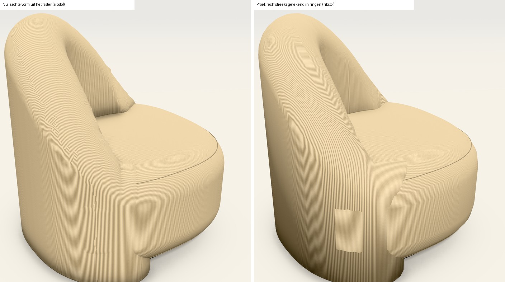
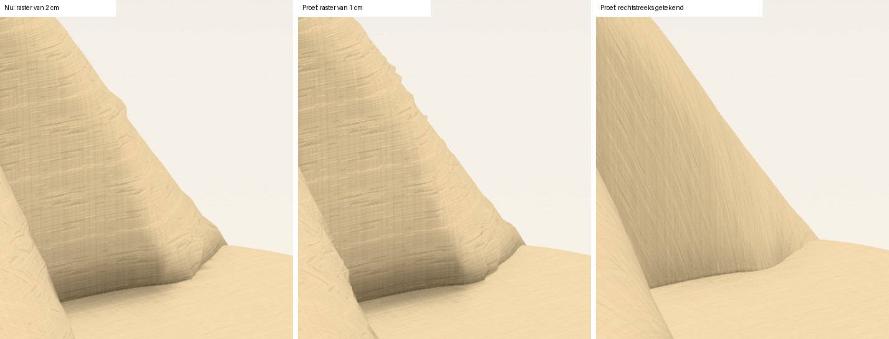
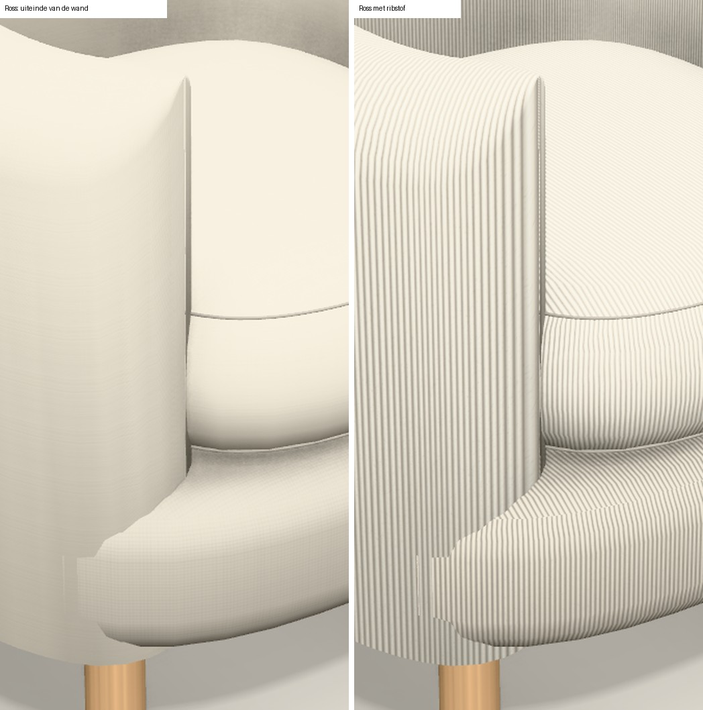
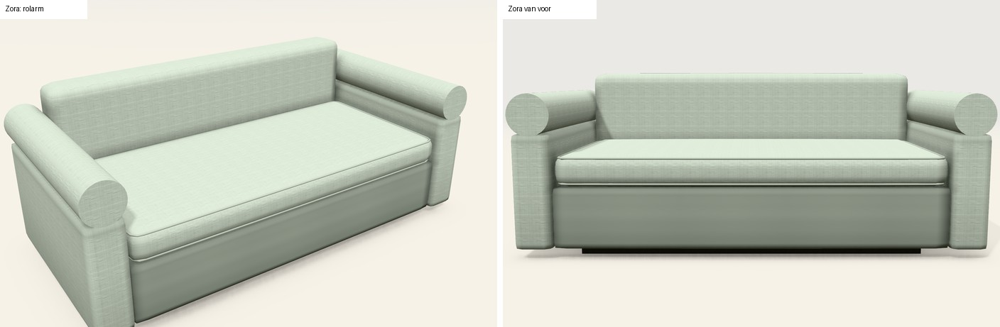
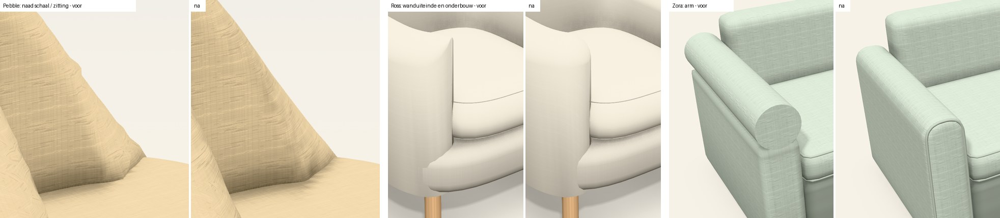
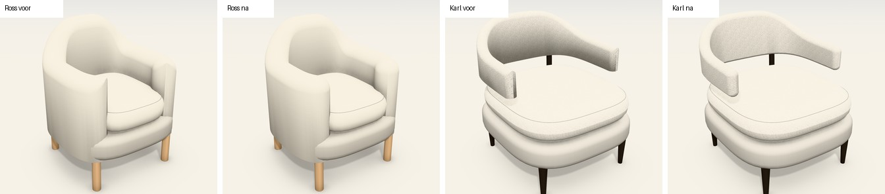
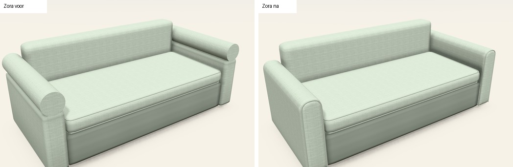

# Analyse: ronde vormen in de 3D (13/11/2026)

## Vraag

Jonas: bekijk hoe we nu de 3D maken, vooral hoe we met ronde vormen omgaan, en wat beter kan. Ook ongewone ideeën, en
ideeën waarvan de winst niet zeker is.

Het onderzoek zelf wijzigde geen code: de proeven draaiden in een kopie van de gebouwde pagina. Daarna, met het
akkoord van Jonas, zijn dezelfde dag vier herstellingen gebouwd: zie [Uitgevoerd op 13/11](#uitgevoerd-op-1311)
onderaan. Prijs, offerte en tekeningen zijn nooit aangeraakt.

## Kort

1. **We tekenen ronde vormen op twee manieren, en geen van beide is af.** De ene (ringen) geeft strakke lijnen en stof
   die de vorm volgt, maar onderdelen steken gewoon door elkaar. De andere (raster) smelt onderdelen mooi samen, maar
   geeft bobbelige naden, stof die de vorm niet volgt en ongeveer zes keer zoveel driehoeken (berekend).
2. **Fijner rekenen lost dat niet op.** Proef op Pebble: een raster van 1 cm in plaats van 2 cm geeft vier keer zoveel
   driehoeken en rekentijd, en de naad wordt eerder rafeliger. De oorzaak is gemeten: waar de bovenrand van een wand
   steil zakt, rekent de motor de vorm zelf fout.
3. **Advies, in deze volgorde:** eerst die rekenfout en drie andere gebreken herstellen die nu in beeld zitten; dan als
   proef de twee manieren samenvoegen (het net van de ringen, gelegd op de zachte vorm); en ronde vormen als gegevens
   beschrijven in plaats van als code per model.

## Hoe we nu ronde vormen maken

Geteld over de 42 modellen, bij de standaardinstelling (*Blokken*):

| Weg | Hoe het werkt | Waar | Gewicht |
|---|---|---|---|
| **Ringen** (rechtstreeks getekend) | De weergave legt ringen langs de omtrek of langs de wand en verbindt ze. | 10 kuipfauteuils (wand, onderbouw, zitkussen), 6 ronde poefs, 6 verdekte voeten. | ±2.000 à 3.000 driehoeken per deel, meteen klaar. |
| **Raster** (zachte vormen) | De motor rekent per punt in een raster van 2 of 2,5 cm hoe ver het van de vorm ligt, en haalt daar het oppervlak uit. | Doha, Montego en Pebble (altijd); de armen met een eigen doorsnede in 18 modellen; alles bij *Zacht*. | Pebble ±29.000 driehoeken, Doha ±76.000. 0,1 à 0,4 s op de server; tot dan staat de gewone vorm er. |
| **Vaste cilinder** | Een cilinder met 20 of 28 vlakken, een knoop met 12 × 8. | Poten in 17 modellen, de rolarm in 3 (Zora, Mabel), rollen bij Nestor en Belize. | Licht. |
| **Kussen** | Een fijn verdeelde balk, afgerond en licht bol. | Bijna elk model. | Licht. |

De vorm zelf wordt vroeg in de motor vastgelegd als een rij punten (een grondvlak in 72 punten, een wand in 33 à 73).
Wat daarna komt (3D, schaduw, tekening) werkt met die punten. De scheve schaal van Pebble is een eigen stuk code in de
motor, met de hoeken van dat ene model erin.

## Wat ik mat en zag

Beelden in Chromium zonder grafische kaart (de WebGL2-weg), kwaliteit *Mooi*, als foto van 2400 px breed.

**1. Pebble op de twee manieren, met ribstof** (ribstof toont de richting van de stof het best):

- **Raster (nu):** de ribbels blijven verticaal staan, wat de vorm ook doet, en breken in trapjes op het gebogen vlak
  (links op de schaal). Waar de schaal in de zitting duikt, is de lijn bobbelig.
- **Ringen (proef):** de stof loopt mee met de schaal en de lijn tussen schaal en zitting is strak. Maar:
  - een lichte vlek op de buitenkant, waar twee vlakken op dezelfde plaats liggen;
  - een hard uiteinde van de schaal vooraan;
  - binnenin is de stof plaatselijk tot strepen uitgerekt.

**2. Helpt een fijner raster?** Nee.

| Raster | Schaal van Pebble | Tijd (server) |
|---|---|---|
| 2 cm (nu) | 16.520 driehoeken | 61 ms |
| 1,5 cm | 29.532 | 114 ms |
| 1 cm | 66.252 | 258 ms |

Met 1 cm is de rand niet gladder, eerder rafeliger. De fout zit dus niet in het raster, maar in hoe de motor de wand
rekent waar de bovenrand steil zakt. Dat is nagemeten op de bovenste ronding van de wand: klopt de afstand die de motor
teruggeeft met kleine stapjes in de vorm?

| Wand | Steilste helling van de bovenrand | Punten waar de afstand meer dan 10 % fout is: vlak deel | Steil deel (meer dan 0,8 cm per cm) |
|---|---|---|---|
| Doha (rug overal even hoog) | 0 | 0 % | – |
| Ross | 1,17 | 0,1 % | 74 % |
| Pebble | 1,57 | 2 % | 61 % |

Op het steile deel wijst de richting van het oppervlak tot ±65° (Ross) en ±100° (Pebble) verkeerd. De motor zoekt het
dichtste punt recht onder de bovenrand; bij een steile rand ligt dat punt schuin. Bij Pebble is het grootste deel van de
bovenrand zo steil; bij Doha komt het niet voor, wat verklaart waarom Doha er wel netjes uitziet.

**3. De kuipfauteuils (ringen), hier Ross:**

- Het uiteinde van de wand is een dun mes in plaats van een ronde, gestoffeerde kop.
- De onderbouw steekt onderaan door de wand, met een rafelig hoekje en een smalle strook ernaast.
- Met ribstof zie je dat de stof op de wand wel netjes de vorm volgt.

**4. De rolarm (Zora):** een kale cilinder met een platte, scherpe kop, op een blok. Het aantal vlakken is niet het
probleem; de arm heeft geen eigen vorm (geen ronde rand, geen voorpaneel met naad, geen overgang naar de arm eronder).

*Rechtzetting na de productfoto's (zelfde dag):* Zora heeft helemaal geen rol. Het is een slanke arm met een ronde
bovenkant en een bies rond het voorpaneel. Het vooraanzicht tekende dat al juist; alleen de 3D zette er een cilinder
op, en hoger dan de tekening. De echte fout was dus dat de 3D afweek van de tekening en van de foto.

**5. Wat goed is:**
- Doha oogt van dichtbij netjes. Het raster doet het goed bij grote, zacht gebogen vormen.
- Poten met 20 vlakken zie je op gewone afstand niet als hoekig.
- Een kussen tegen een ronde buur: de code slaat ronde buren over bij de schaduw, maar in beeld zag ik geen storend
  verschil.

## Waar het aan ligt

1. **De beschrijving.** Een ronde vorm is een rij punten, en een bijzondere vorm is code in de motor. Elk nieuw
   organisch model vraagt dus programmeerwerk en veel rondes (Pebble: vijf).
2. **Het oppervlak.** Twee manieren naast elkaar. Bij elke fout verhuisden we een vorm van de ene naar de andere: de
   zitting van Doha naar het raster (strepen in het bovenvlak), Pebble ook (vormen door elkaar). Zo kregen we telkens
   de gebreken van de andere manier erbij.
3. **De bekleding.** Op een rastervorm weet de weergave niet in welke richting de vorm loopt. De stof wordt dan per
   driehoek recht van voor, van opzij of van boven opgelegd.

## Wat we beter kunnen doen

### Eerst

**A. Vier herstellingen die nu al kunnen** (idee 2, 3, 4 en 23).
- **De steile rand van een wand juist rekenen.** Gemeten oorzaak van de bobbelige naad bij Pebble (zie hierboven). Dit
  komt eerst: ook stap B steunt op deze berekening.
- **Fauteuils:** een ronde kop aan het wanduiteinde, en de onderbouw afsnijden binnen de wand. Gezien bij Ross; de
  andere negen modellen met een gebogen wand gebruiken dezelfde code.
- **De rolarm** een eigen vorm geven.
- **Drie close-ups** toevoegen aan de beeldvergelijking (naad Pebble, kop Ross, rolarm Zora). Deze plekken zaten niet
  in de vaste reeks; daardoor vielen ze niet op.

**B. Proef: het net van de ringen, gelegd op de zachte vorm** (idee 1 in de lijst).
- De weergave tekent het net zoals bij de fauteuils: ringen die de vorm volgen. Daarna legt ze elk punt op de zachte
  vorm, zoals het raster nu al met zijn eigen punten doet. Wat binnen een ander deel valt, knipt ze weg.
- Dat geeft de strakke lijnen en de stof langs de vorm van de ene manier, en de ronde koppen en het samensmelten van
  de andere.
- Verwacht voor Pebble: ±5.000 driehoeken in plaats van ±29.000 (berekend uit de code), en geen wachtbeeld meer.
- **Wat de proef moet bewijzen:** het samensmelten. Bij Pebble en Ross smelt bij de standaardinstelling niets samen;
  daar komt dit idee neer op "de ringen herstellen" (idee 2 en 6). De proef moet dus ook een echte overgang bevatten:
  de rug van Doha op zijn onderbouw, en een arm met een eigen doorsnede bij *Zacht*.
- **Open risico:** op 4/11 gaven gebogen wanden en vrije omtrekken foutjes aan de randen toen ze samensmolten; daarom
  smelten ze nu niet mee. Deze proef moet tonen dat het met een net dat de vorm volgt wel lukt. Lukt het niet, dan
  blijft het raster voor wat samensmelt en de herstelde ringen voor de rest.
- Het andere lastige punt is het wegknippen waar twee delen in elkaar steken.
- Maatstaf: de naad van dichtbij, ribstof, het aantal driehoeken, de tijd en de beeldvergelijking.

**C. Ronde vormen als gegevens: een ruggengraat met doorsneden** (idee 10 en 11).
- Een vorm wordt een lijn door een paar punten, met op enkele plaatsen de hoogte, de dikte en de ronding. De motor
  trekt er een vloeiende kromme door.
- De schaal van Pebble is dan een tiental getallen in het modelbestand, geen code in de motor.
- Daar past een hulpscherm bij om de punten over de productfoto te slepen. Dat maakt een nieuw model sneller en
  dichter bij de foto.

### Ongewone ideeën

- **De foto als meetlat** (idee 20). We hebben nu beelden die bij elke keer gelijk zijn, en een script dat beelden
  vergelijkt. Een script kan dus zelf de getallen van een vorm bijsturen tot de omtrek van de 3D op de omtrek van de
  productfoto valt, uit hetzelfde standpunt. Het resultaat is een voorstel dat jij goedkeurt. Het blijft een
  benadering, maar een gemeten.
- **Een scan door de klant** (idee 21). Apple levert de techniek om uit een reeks foto's een 3D-scan te maken gratis
  mee (Object Capture: op de Mac, en op de iPhone vanaf iOS 17). Er is wel een app nodig die ze gebruikt; niet getest.
  Zo'n scan van een echte fauteuil dient als meetlat voor onze vorm, of voor een model met een vaste vorm (Pebble, de poefs: daar verandert alleen de stof) rechtstreeks als echt
  3D-bestand met onze stoffen. Dat raakt jouw regel "geen scans": zie de vragen.
- **Tekeningen uit de 3D-vorm halen** (idee 22). Het boven- en vooraanzicht worden dan de omtrek van dezelfde vorm als
  de 3D. Tekening en 3D kunnen niet meer uit elkaar lopen, ook niet bij de boog van Montego. Dit verandert de
  tekeningen, dus dit is jouw beslissing.
- **Kussens als opgeblazen vorm** (idee 14). Een echt kussen trekt in het midden van elke zijde wat naar binnen en
  heeft hoeken die uitsteken. De onze zijn afgeronde blokken met een bolling. Kussens staan op bijna elk model.

### Volledige lijst

Grond: *gezien* = in de beelden hierboven; *gemeten*; *uit de code*; *beredeneerd* = niet getest.

| # | Idee | Lost op | Grond | Werk | Risico of regel |
|---|---|---|---|---|---|
| | **Oppervlak** | | | | |
| 1 | Net van de ringen, gelegd op de zachte vorm | Messcherpe koppen, stof die de vorm niet volgt, ±zes keer zoveel driehoeken (berekend), wachtbeeld. Bobbelige naden alleen samen met 3. | Beide helften gezien; de combinatie beredeneerd | Middel | Samensmelten gaf op 4/11 foutjes aan de randen; wegknippen waar delen in elkaar steken. Alleen 3D. |
| 2 | Ronde kop aan het wanduiteinde; onderbouw afsnijden binnen de wand | Mes en rafelig hoekje bij de fauteuils met een gebogen wand (10 modellen) | Gezien bij Ross; de andere negen gebruiken dezelfde code. **Gedaan 13/11.** | Klein | Laag |
| 3 | Steile rand van een wand juist rekenen | Bobbelige naad bij Pebble; ook nodig voor 1 | Gezien en gemeten. **Gedaan 13/11.** | Klein à middel | Zelfde berekening als de rug van Doha: beeldvergelijking |
| 4 | Eigen vorm voor de rolarm | Kale cilinder op een blok | Gezien. **Gedaan 13/11**, als arm met ronde bovenkant (zie de rechtzetting). | Middel | Stond al als volgende stap |
| 5 | Recht bouwen, dan buigen | Net en stof volgen de boog (Montego, later rondboogramen) | Uit de code | Middel | Komt mee met 1 |
| 6 | Bovenvlak met een echt net in plaats van een waaier | Strepen in het bovenvlak (de reden voor de overstap naar het raster) | Uit de code | Klein à middel | Hoort bij 1 |
| 7 | Rekenen in de achtergrond | Scherm staat even stil | Beredeneerd | Middel | Niet nagekeken of het in het artifact mag. Minder nodig na 1. |
| 8 | Het raster op de grafische kaart rekenen | Rekentijd | Hier niet te testen (alleen WebGPU) | Groot | Alleen op de M5. Minder nodig na 1. |
| 9 | Aantal vlakken van poten, rollen en knopen volgens de grootte | Hoekige rand van heel dichtbij | Gezien: op gewone afstand geen verschil | Klein | Alleen nuttig voor close-ups |
| | **Beschrijving** | | | | |
| 10 | Ruggengraat met doorsneden als gegevens | Code per model, veel rondes | Uit de code en het verloop van Pebble | Middel | Tekeningen lezen dezelfde vorm: testen dat ze niet veranderen |
| 11 | Hulpscherm: punten over de productfoto slepen | Gissen naar maten | Beredeneerd | Middel | Foto's blijven lokaal |
| 12 | Inspringen als afstand in plaats van schalen of herberekenen | Omtrek die plooit; voet die niet overal even ver inspringt | Uit de code | Klein | Kleine verschuiving van de voet: beeldvergelijking |
| 13 | Vloeiender afrondingen, zonder knik in de glans | Glans die breekt op een afronding | Beredeneerd; winst onzeker, vooral bij leder | Klein | Laag |
| 14 | Kussens als opgeblazen vorm | Kussens ogen als afgeronde blokken | Gezien; winst beredeneerd | Klein à middel | Laag |
| 15 | Plooien en spanning langs naden, als reliëf | Te gladde, "plastic" vormen | Beredeneerd | Middel | Wordt snel te veel |
| | **Bekleding en licht** | | | | |
| 16 | Stof volgt de vorm, zonder uitrekken | Verticale ribbels, strepen | Gezien | – | Hoort bij 1 |
| 17 | Tussenoplossing: de stof mengen over drie richtingen | Trapjes in de stof op rastervormen | Gezien; oplossing beredeneerd. three 0.187 heeft de bouwsteen. | Klein à middel | Nakijken of de fotomodus dat materiaal kent |
| 18 | Kromming in de belichting: ruggen iets lichter, dalen donkerder | Rond leest ronder | Beredeneerd; winst onzeker (het scheerlicht van 4/11 gaf weinig) | Klein | Laag |
| 19 | Eén schaduwberekening voor alle delen | Schaduw tegen ronde buren | Uit de code; in beeld geen storend verschil | Klein à middel | Laag |
| | **Bron en proces** | | | | |
| 20 | De vorm automatisch laten passen op de productfoto's | Rondes van gissen | Beredeneerd | Groot | Blijft een benadering. Het standpunt van de foto moet mee geschat worden. |
| 21 | Scan door de klant, als meetlat of als echt bestand | Vaste, organische modellen | Beredeneerd; het hulpmiddel bestaat | Middel, plus werk bij de klant | Raakt "geen scans" |
| 22 | Tekeningen uit de 3D-vorm halen | 3D en tekening lopen uiteen | Beredeneerd | Middel à groot | Verandert boven- en vooraanzicht |
| 23 | Close-ups in de beeldvergelijking | Gebreken die niet opvallen | Gezien. **Gedaan 13/11.** | Klein | Geen |

## Wat ik niet zou doen

- **Een fijner raster:** zie de proef hierboven.
- **Manifold** (ander hulpmiddel om het oppervlak te maken): op 4/11 getest, trager en niet nauwkeuriger.
- **SSS en TRAA:** op 5/11 getest, geen zichtbare winst.
- **De vorm tekenen zonder driehoeken:** dat is rond op elke afstand, maar de fotomodus, de schaduw en het aanklikken
  hebben driehoeken nodig.
- **Een grove vorm laten verfijnen** (de gewone weg in 3D-programma's): three.js levert dat niet meer mee, het losse
  pakket `three-subdivide` (MIT) is sinds 2023 stil en is niet getest met onze versie. De vorm krimpt ook ten opzichte
  van de opgegeven maten, wat slecht past bij maatwerk. Onze ringen geven hetzelfde voordeel.
- **Een 3D-model laten maken uit één foto door AI:** het verzint de achterkant, wat botst met "modellen niet
  verzinnen". Hunyuan3D mag volgens zijn licentie niet in de EU gebruikt worden. TripoSR (MIT) kan lokaal draaien,
  hoogstens als ruwe meetlat.

## Vragen voor Jonas

1. Mogen de vier herstellingen (A) en de proef van idee 1 (B) gebouwd worden? Alleen de 3D verandert.
2. Wil je de tekeningen uit de 3D-vorm laten komen (idee 22)? Dat verandert het boven- en vooraanzicht.
3. Valt een scan die de klant zelf van zijn eigen fauteuil maakt onder "geen scans" (idee 21)?
4. Mogen de productfoto's gebruikt worden om de vorm automatisch te laten passen, als ze op deze machine blijven
   (idee 20)?

## Uitgevoerd op 13/11

Jonas gaf zijn akkoord voor de herstellingen (A) en de proef (B). De vier herstellingen zijn gebouwd, elk met tests en
een eigen commit. De proef B is nog niet begonnen. Nog niet gepubliceerd: eerst de beelden laten goedkeuren.

**1. De steile rand van een wand** (`zachtevorm.ts`, `wand`). Twee oorzaken, allebei gemeten:
- De hoogte van de bovenrand volgde het dichtste punt van het pad, en dat verspringt op elk hoekpunt: aan de binnenkant
  van een bocht een sprong, aan de buitenkant een stukje waar het stilstaat. Op een steile rand gaf dat trapjes tot
  1 cm. De hoogte volgt nu de plaats tussen de twee verstekken van een stuk (de lijnen door zijn eindpunten, haaks op
  de gemiddelde richting daar) en loopt overal vloeiend door.
- De afstand werd niet gedeeld door de lengte van de helling.
- Uitslag: punten met een verkeerde afstand of richting bij Pebble van 61 % naar 0 %, bij Ross van 74 % naar 0 %.
  Zelfde rekentijd. Recht boven de middenlijn ligt het oppervlak nog altijd op de opgegeven hoogtes (test), dus de
  tekeningen kloppen nog. Doha en Montego: 0,00 % verschil.
- Een eerste poging (het pad fijner maken) is verworpen: ze hielp te weinig en verdubbelde de rekentijd.

**2. De kuipfauteuils.**

- **Ronde kop** (`kuipwandGeometrie` in `drie-d.ts`): het uiteinde loopt bovenaan als een kwart bol naar beneden, in
  plaats van tot aan de punt even hoog te blijven. Geldt voor elke gebogen wand die in ringen getekend wordt.
- **Onderbouw binnen de wand** (`ruimtelijk.ts`): het dunne streepje naast het wanduiteinde kwam doordat de buitenkant
  van de wand bij een afgerond grondvlak in de hoeken tot ±1 cm binnen de omtrek ligt. De onderbouw krimpt nu zoveel
  extra. Niet bij Pebble: daar is de zitting de vorm zelf, en die is goedgekeurd.
- **Schelp (Karl):** de schaal zweeft boven de zitting, dus je ziet haar onderrand. Ook die is nu rond, zoals op de
  productfoto.
- De aansluiting onderaan bij Ross is nu een strakke lijn. Dat de onderbouw vooraan uit de wand komt, klopt met de foto
  (de zitting steekt daar voorbij de schaal).

**3. De arm met ronde bovenkant** (armstijl *rond* en *Engels*, `rondProfiel` in `ruimtelijk.ts`).

- Eén doorsnede met dezelfde omtrek als in het vooraanzicht: rond tot 3 cm boven de armhoogte, Engels 8 cm eronder.
  Afgeronde rand, licht bol voorpaneel, naad of bies eromheen (zoals de strakke arm).
- *Rond* volgt de foto van Zora. *Engels* heeft geen foto: benadering volgens de tekening.
- De 3D van Zora, Mabel 2-zit en Mabel méridienne verandert; de tekeningen niet.

**4. De beeldvergelijking** heeft drie close-ups erbij (`pebble-naad`, `ross-kop`, `zora-arm`): stukken uit de foto op
hoge resolutie. De referenties zijn eerst genomen op de oude versie en na elke herstelling bewust vernieuwd.

**Controle na elke herstelling:** prijs, offertegegevens, boven- en vooraanzicht van alle 42 modellen vergeleken met een
momentopname van vóór de herstellingen: ongewijzigd. 256 tests (7 nieuwe). In de vaste reeks veranderden alleen de drie
close-ups en Pebble (0,05 %).

**Wat er na de herstellingen overblijft van de proef (idee 1).** Niet gebouwd; eerst opnieuw gekeken:
- De bobbelige naad is weg op de gewone weg (raster). Dat was het zwaarste argument voor de proef, en het zat in de
  berekening van de wand, niet in de manier van tekenen.
- Ook de trapjes in ribstof zijn op Pebble grotendeels weg: ze kwamen mee met het bobbelige oppervlak. Wat blijft: de
  ribbels staan verticaal in plaats van de vorm te volgen.
- Hoe vaak speelt dat? Van de 59 stoffen hebben er 7 een duidelijke richting (6 ribstoffen, 1 jacquard). Geen van de 42
  modellen heeft zo'n stof als standaard; Doha en Montego staan in bouclé, Pebble in linnen.
- Minder driehoeken en geen wachtbeeld tellen alleen op de M5 of een tablet. Dat is hier niet te meten.
- De ringen-weg heeft op Pebble nog altijd vlekken waar twee vlakken samenvallen.
- Besluit voor Jonas: de proef schrappen of uitstellen, en als ribstof op ronde vormen stoort, de kleine oplossing
  nemen (idee 17).
- Let op bij de cijfers van de eerste herstelling: bij de standaardinstelling zie je ze alleen op Pebble. Ross tekent
  zijn wand in ringen; de 74 % was gemeten met die wand als zachte vorm.

**Opgemerkt, niet aangepast:**
- **Mabel 2-zit** is op de productfoto een kuip: een gebogen rug die om de zijkanten loopt, op schuine poten. Bij ons is
  het arm + zit + arm. Dat rechtzetten vraagt andere elementen en raakt dus de prijs: beslissing voor Jonas.
- **Ross** heeft op de foto een dunne schaal (±5 cm, met bies) waarvan de arm vooraan in een boog naar de zitting zakt,
  en één dikke ronde zitting zonder los kussen. Bij ons een wand van 13 cm die vooraan recht eindigt, met een los
  kussen. Dat is werk voor "vorm als gegevens" (idee 10), niet voor een herstelling.
- **De rok onder een arm met hoes** is een los blokje van 6 cm (bestond al).

## Zo zijn de proeven gedaan

- **Tellen:** `bouw3D` voor alle 42 modellen, per rond blok de weg die de weergave kiest.
- **Tijd en driehoeken:** `zachteVorm` in een gebundeld script in node, tweede keer gemeten.
- **Steile rand:** per punt op de bovenste ronding van de wand de richting uit `zachteVorm` tegenover stapjes van
  0,05 cm in `zachtVeld`, gegroepeerd volgens de helling van de bovenrand ter plaatse.
- **Rechtstreeks getekend:** in de pagina de laatste scène opnieuw getoond via `window.__zetel3d`, met `glad` uit de
  blokken gehaald. Ribstof: `weefsel: 'rib'` op alle stof.
- **Raster van 1 cm:** in een kopie van `configurator-demo.html` de rastermaat vervangen.
- **Bronnen voor de hulpmiddelen:** [three-subdivide](https://github.com/stevinz/three-subdivide),
  [Object Capture van Apple](https://developer.apple.com/documentation/realitykit/creating-3d-objects-from-photographs),
  [licentie van Hunyuan3D](https://huggingface.co/tencent/Hunyuan3D-2/blob/main/LICENSE),
  [TripoSR](https://github.com/VAST-AI-Research/TripoSR).
