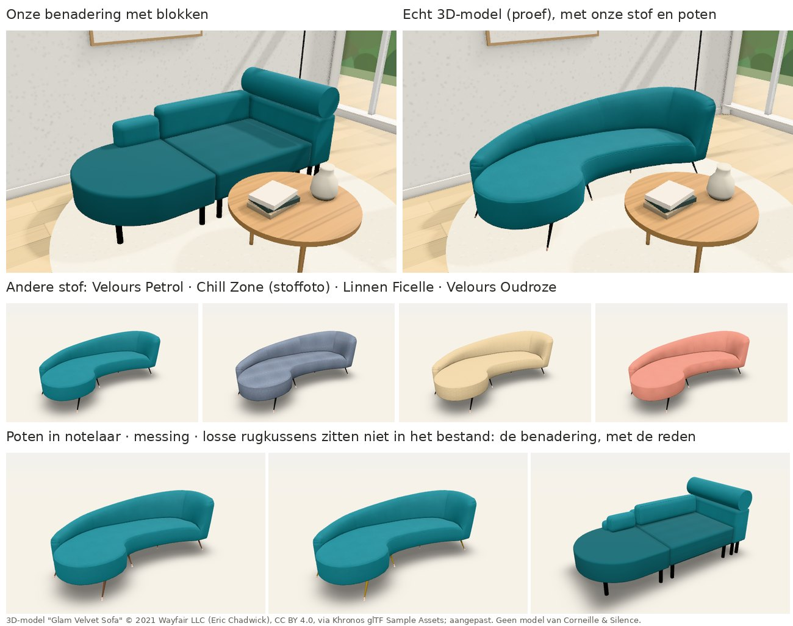

# Echte 3D-modellen in de configurator (proef, 4/11/2026)

## Waarom deze proef

Op 4/11 kwam de vaststelling: "Ik vrees dat we er niet raken om de zetels realistisch te maken." Dat klopt. Onze 3D
bouwt elke zetel op uit blokken die de motor berekent: armen, zitkussens, rugkussens, poten. Daarmee kloppen de maten
en volgt de 3D elke keuze, maar het ziet eruit als een benadering. Gebogen vormen zoals Montego, de opgerolde arm van
Wallace of plooien in een hoes zijn met blokken bijna niet te maken.

Configurators die er echt uitzien, werken met **3D-bestanden** van de zetels. Die zijn gemaakt door een 3D-ontwerper
of komen uit de tekenprogramma's (CAD) van de fabrikant. De proef toont dat de configurator zulke bestanden kan
gebruiken:

- met **onze stoffen en poten**;
- terwijl **prijs, tekeningen en offerte gewoon blijven werken**.

## Wat je ziet

Een nieuw model, **Glam Velvet (proef echt 3D-model)**. Je vindt het onder *Modellen*, filter *Proef: echt 3D-model*.

**Herkomst.** Het is een gratis 3D-bestand van een sofa van Wayfair, gemaakt door Eric Chadwick. Het komt uit de
voorbeeldbibliotheek van Khronos, de organisatie achter het formaat glTF. De licentie is CC BY 4.0: vrij te gebruiken
mits de naam vermeld wordt. Het is **geen model van Corneille & Silence**.

**Bestand.** Voor de demo is het verkleind van 3,1 MB naar 163 kB. Wat er precies is aangepast, staat in
`packages/demo-web/modellen3d/BRON.md`.

**In 3D:** het echte model in plaats van blokken. Elke keuze in de configurator verandert het beeld mee:

- **Stof**:
  - de kleur;
  - het weefsel op ware grootte;
  - de glans van velours;
  - een stoffoto zoals Chill Zone.
- **Poten** in onze afwerking:
  - metaal: mat zwart, brons, rvs of chroom;
  - messing;
  - hout, in de gekozen houtafwerking.
- **Maten:** het model rekt mee tot ± 15 %:
  - een breedte van 186 tot 252 cm;
  - een diepte van 87 tot 117 cm;
  - een zithoogte van 38 tot 52 cm.

**Schakelaar.** Linksboven in de 3D wissel je tussen *Echt 3D-model* en *Benadering*, om te vergelijken. In de
klantweergave staat die schakelaar niet.

**Bronvermelding.** Onderaan het beeld staat de bronvermelding: dat is verplicht bij deze licentie.

**Wat blijft.** Prijs, bovenaanzicht, vooraanzicht en offerte blijven op de elementen gebaseerd: een afgerond
eindelement van 90 cm, een zitelement van 104 cm en een arm van 25 cm. Een andere breedte van het zitelement
verandert de prijs én het model.

**Wanneer de benadering terugkomt.** De configurator toont de blokken als het bestand niet past bij de zetel zoals de
klant hem samenstelt. Linksboven staat dan de reden in gewone taal, bijvoorbeeld
*"Rug: 'Losse rugkussens' zit niet in het 3D-bestand."* Dat gebeurt bij:

- een andere opstelling (een element weg, gedraaid, een extra zitelement);
- een keuze die het bestand niet heeft: losse rugkussens, een nekrol, een andere armstijl, een haarspeldpoot of slede,
  een houten frame;
- een kussen of rugleuning op de zetel;
- een andere stof per element;
- een maat buiten de 15 %.

Een losse poef ernaast mag wel: die wordt zoals altijd met blokken getekend.

## Hoe het werkt

| Waar | Wat |
|---|---|
| `packages/core/src/echt3d.ts` | Beschrijving van een 3D-bestand bij een model (`ModelDefinitie.echt3d`). Ze legt vast: • welk bestand; • welke elementtypes, van links naar rechts; • de maten in het bestand; • hoeveel het mag rekken; • welke keuzes het kan tonen (`toont`); • welke vormgeving vastligt (`vast`). `echt3dPlaatsing()` beslist of het past en geeft anders de reden. |
| `packages/core/src/ruimtelijk.ts` | `bouw3D(ontwerp, catalogus, materialen, { echt3d })` zet `scene.echt` (waar, hoe groot, welke stof en poten) of `scene.echtNiet` (de reden). De blokken blijven altijd in de scène: voor de terugval, de schakelaar en de schaduw. |
| `packages/demo-web/src/drie-d.ts` | De weergave laadt het GLB-bestand en schaalt het per richting tot het kader van de elementen. Ze legt onze stof op de delen met *fabric* of *stof* in de naam, en onze pootafwerking op de delen met *leg* of *poot*. Andere delen blijven zoals in het bestand, en ook de schaduw in plooien en naden (AO) uit het bestand blijft. Klikken op het model kiest het element op die plaats. |
| `packages/demo-web/modellen3d/` | De 3D-bestanden (`.glb`) met een beeld voor de modelkaart (`.jpg`) en `BRON.md`. `bouw.mjs` sluit ze in de **gewone demo** in. De versie in de huisstijl van de klant krijgt ze niet: het zijn geen modellen van de klant. |
| `packages/core/voorbeelden/proefmodellen.ts` | Het proefmodel en zijn beschrijving. Tests: `packages/core/test/echt3d.test.ts`. |

## Wat we nodig hebben van Corneille & Silence (of van een 3D-ontwerper)

Per model:

1. **Een 3D-bestand per element**: arm, zitelement, hoek, chaise longue, poef. Voor een vaste zetel: één bestand per
   breedte, of één bestand dat in de breedte mag rekken.
   - Formaat: liefst **glTF/GLB**.
   - FBX, OBJ of een export uit CAD (bv. STEP) kunnen we omzetten.
2. **Ware grootte** (cm of mm), met de rug achteraan en de onderkant op de vloer.
3. **Aparte delen met duidelijke namen**: stof, poten, houten delen, bies. De configurator legt dan zelf de gekozen
   stof en afwerking erop.
4. **Textuurcoördinaten (UV) op de stof** met een gelijke dichtheid, zodat het weefsel op ware grootte ligt. Geen stof
   ingebakken in het bestand.
5. **Varianten die de vorm veranderen** als aparte delen of bestanden: armstijl, losse of vaste rug, rughoogte, nekrol.
   Wat niet in een bestand zit, toont de configurator als benadering.
6. **Licht genoeg voor een webpagina**: enkele tienduizenden driehoeken per element en texturen van 1 à 2K. Het
   proefmodel heeft er 4.300 in totaal.
7. **Voor de stoffen**: foto's of scans van de stalen. Recht, gelijkmatig belicht, met de maat erbij, liefst naadloos
   herhaalbaar. Met zulke foto's ziet de stof er veel echter uit dan met onze getekende weefsels (zie Chill Zone).

**Vragen voor Corneille & Silence:**

- Tekenen jullie de modellen in een CAD-programma? Bestaan er 3D-bestanden, bijvoorbeeld van de ontwerper of voor de
  website of catalogus?
- Zo niet: willen jullie één model laten maken door een 3D-ontwerper? Dat kan op basis van de technische tekening en
  foto's, bijvoorbeeld Kotor of Wallace. Zo kennen we de kost en de kwaliteit voor we verder gaan.
- Hebben de stofleveranciers digitale stalen (texturen) van hun collecties?

## Grenzen van de proef

- **Eén bestand voor de hele zetel.** Een andere breedte rekt het hele model, ook de uiteinden, en het weefsel rekt
  mee. Met een bestand per element zet de configurator de elementen naast elkaar, zoals nu de blokken, en rekt alleen
  het zitelement. Dat is de volgende stap, zodra er bestanden van de klant zijn.
- **De pootvorm komt uit het bestand;** alleen de afwerking is van ons.
- **Eén stof voor de hele zetel.** Een tweede stof per element vraagt een apart stofdeel per element in het bestand.
- **De rugkussens, armen en rughoogte van het bestand liggen vast.** Wat de klant anders kiest, geeft de benadering
  (zie hierboven).
- **Getest in Chromium zonder grafische kaart** (swiftshader), ook in de fotorealistische modus. Niet getest op een
  echte tablet of telefoon.

## Volgende stap

1. De vragen hierboven aan Corneille & Silence voorleggen.
2. Met de bestanden van één model per element inladen. Het mechanisme is hetzelfde, maar dan per elementtype: arm,
   zitelement, hoek.
3. Per model beslissen of het een echt 3D-model krijgt of de benadering houdt. Beide kunnen naast elkaar bestaan in
   dezelfde configurator.
