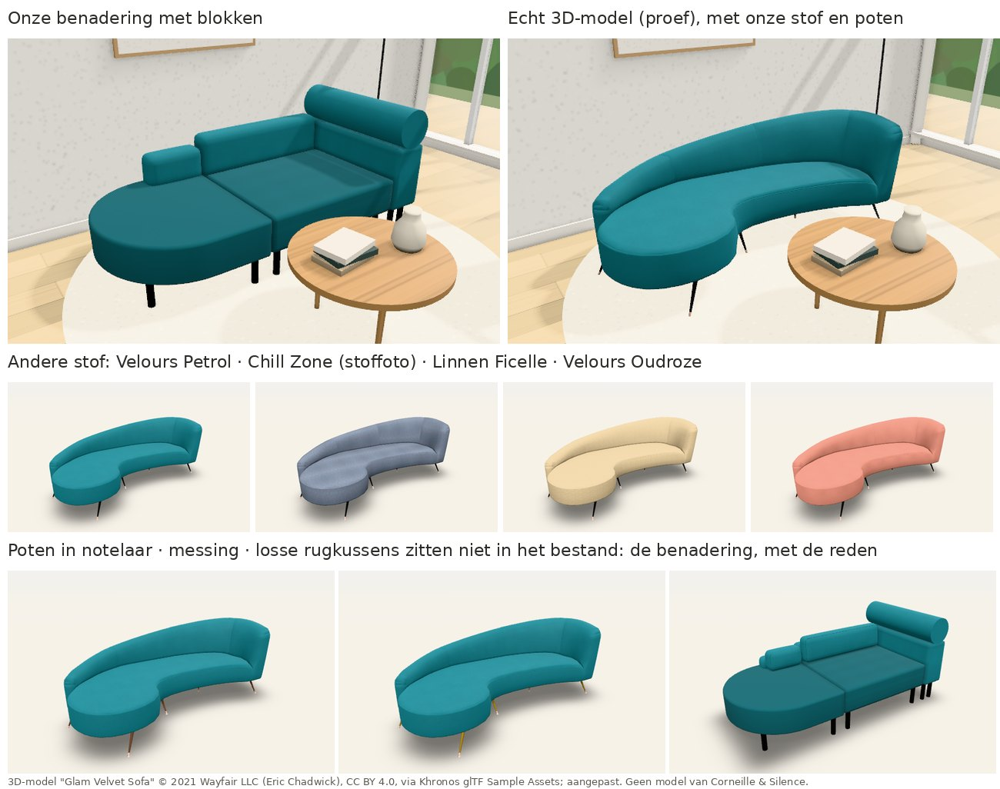
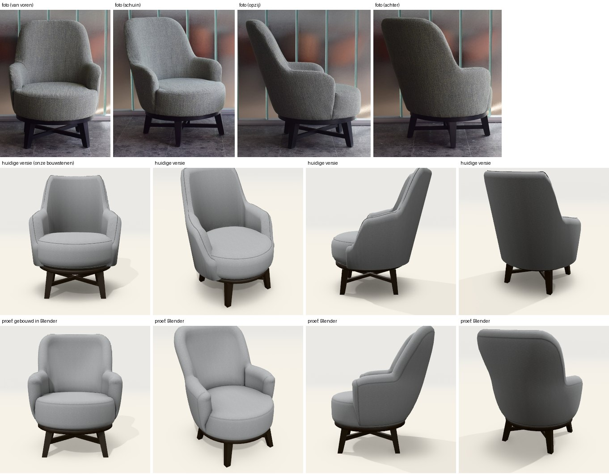
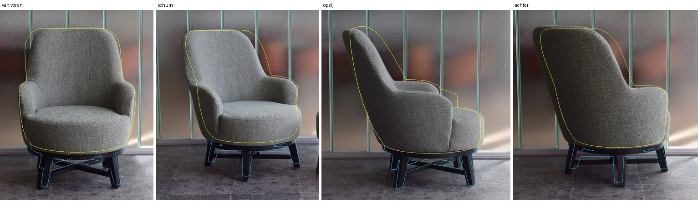
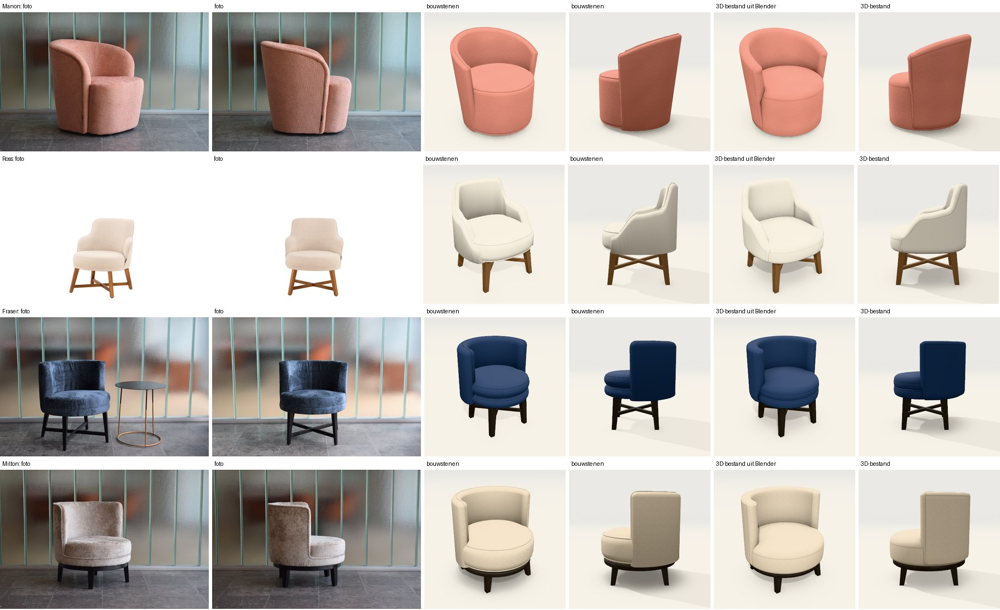
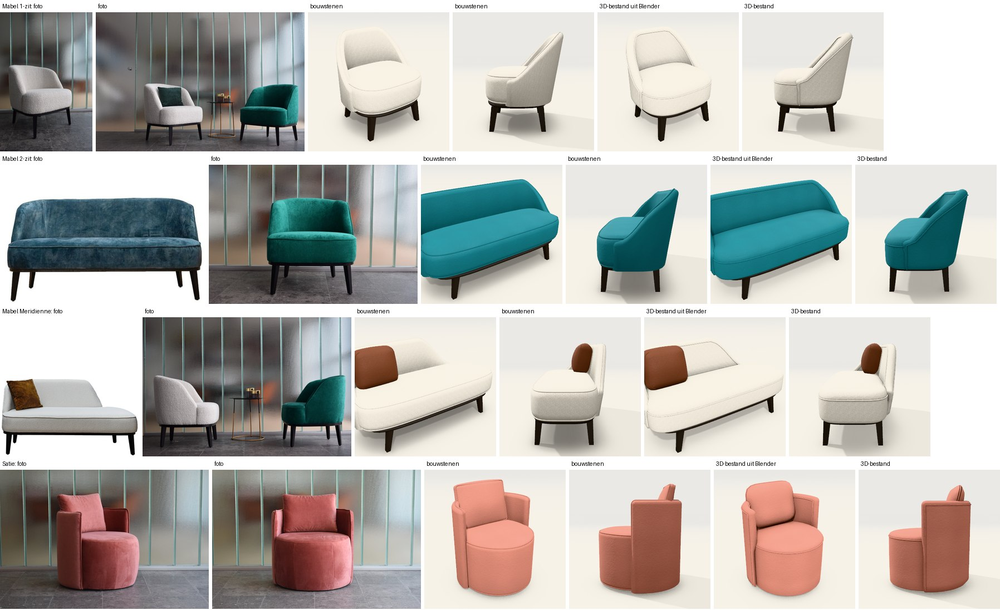
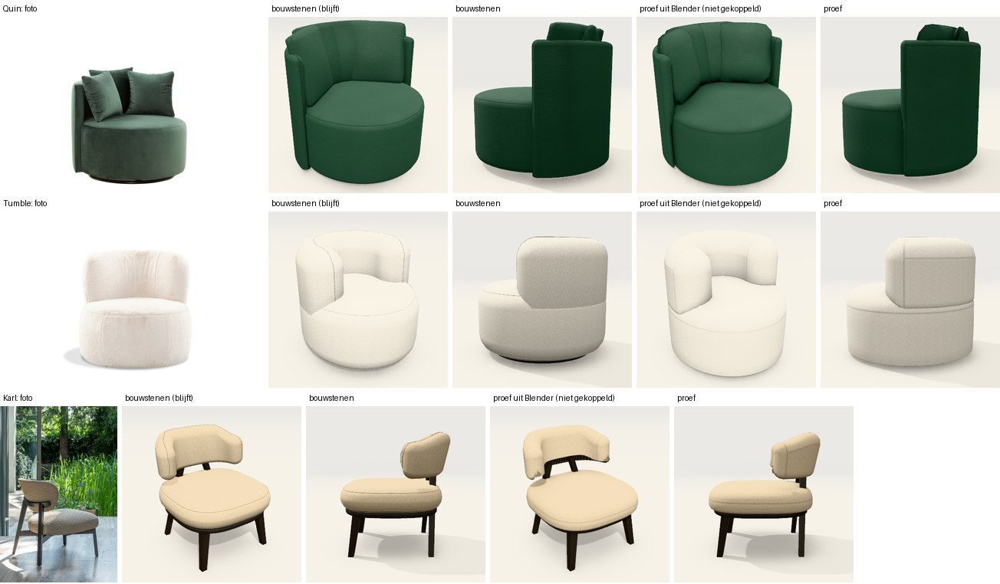

# Echte 3D-modellen in de configurator (proef, 4/11/2026; Blender, 15/11/2026)

## Waarom deze proef

Op 4/11 kwam de vaststelling: "Ik vrees dat we er niet raken om de zetels realistisch te maken." Dat klopt. Onze 3D
bouwt elke zetel op uit blokken die de motor berekent: armen, zitkussens, rugkussens, poten. Daarmee kloppen de maten
en volgt de 3D elke keuze, maar het ziet eruit als een benadering. Gebogen vormen zoals Montego, de opgerolde arm van
Wallace of plooien in een hoes zijn met blokken bijna niet te maken.

Configurators die er echt uitzien, werken met **3D-bestanden** van de zetels. Die zijn gemaakt door een 3D-ontwerper
of komen uit de tekenprogramma's (CAD) van de fabrikant. De proef toont dat de configurator zulke bestanden kan
gebruiken:

- met **onze stoffen en poten**;
- terwijl **prijs, tekeningen en offerte gewoon blijven werken**.

## Wat je ziet

Een nieuw model, **Glam Velvet (proef echt 3D-model)**. Je vindt het onder *Modellen*, filter *Proef: echt 3D-model*.

**Herkomst.** Het is een gratis 3D-bestand van een sofa van Wayfair, gemaakt door Eric Chadwick. Het komt uit de
voorbeeldbibliotheek van Khronos, de organisatie achter het formaat glTF. De licentie is CC BY 4.0: vrij te gebruiken
mits de naam vermeld wordt. Het is **geen model van Corneille & Silence**.

**Bestand.** Voor de demo is het verkleind van 3,1 MB naar 163 kB. Wat er precies is aangepast, staat in
`packages/demo-web/modellen3d/BRON.md`.

**In 3D:** het echte model in plaats van blokken. Elke keuze in de configurator verandert het beeld mee:

- **Stof**:
  - de kleur;
  - het weefsel op ware grootte;
  - de glans van velours;
  - een stoffoto zoals Chill Zone.
- **Poten** in onze afwerking:
  - metaal: mat zwart, brons, rvs of chroom;
  - messing;
  - hout, in de gekozen houtafwerking.
- **Maten:** het model rekt mee tot ± 15 %:
  - een breedte van 186 tot 252 cm;
  - een diepte van 87 tot 117 cm;
  - een zithoogte van 38 tot 52 cm.

**Schakelaar.** Linksboven in de 3D wissel je tussen *Echt 3D-model* en *Benadering*, om te vergelijken. In de
klantweergave staat die schakelaar niet.

**Bronvermelding.** Onderaan het beeld staat de bronvermelding: dat is verplicht bij deze licentie.

**Wat blijft.** Prijs, bovenaanzicht, vooraanzicht en offerte blijven op de elementen gebaseerd: een afgerond
eindelement van 90 cm, een zitelement van 104 cm en een arm van 25 cm. Een andere breedte van het zitelement
verandert de prijs én het model.

**Wanneer de benadering terugkomt.** De configurator toont de blokken als het bestand niet past bij de zetel zoals de
klant hem samenstelt. Linksboven staat dan de reden in gewone taal, bijvoorbeeld
*"Rug: 'Losse rugkussens' zit niet in het 3D-bestand."* Dat gebeurt bij:

- een andere opstelling (een element weg, gedraaid, een extra zitelement);
- een keuze die het bestand niet heeft: losse rugkussens, een nekrol, een andere armstijl, een haarspeldpoot of slede,
  een houten frame;
- een kussen of rugleuning op de zetel;
- een andere stof per element;
- een maat buiten de 15 %.

Een losse poef ernaast mag wel: die wordt zoals altijd met blokken getekend.

## Hoe het werkt

| Waar | Wat |
|---|---|
| `packages/core/src/echt3d.ts` | Beschrijving van een 3D-bestand bij een model (`ModelDefinitie.echt3d`). Ze legt vast: • welk bestand; • welke elementtypes, van links naar rechts; • de maten in het bestand; • hoeveel het mag rekken; • welke keuzes het kan tonen (`toont`); • welke vormgeving vastligt (`vast`). `echt3dPlaatsing()` beslist of het past en geeft anders de reden. |
| `packages/core/src/ruimtelijk.ts` | `bouw3D(ontwerp, catalogus, materialen, { echt3d })` zet `scene.echt` (waar, hoe groot, welke stof en poten) of `scene.echtNiet` (de reden). De blokken blijven altijd in de scène: voor de terugval, de schakelaar en de schaduw. |
| `packages/demo-web/src/drie-d.ts` | De weergave laadt het GLB-bestand en schaalt het per richting tot het kader van de elementen. Ze legt onze stof op de delen met *fabric* of *stof* in de naam, en onze pootafwerking op de delen met *leg* of *poot*. Andere delen blijven zoals in het bestand, en ook de schaduw in plooien en naden (AO) uit het bestand blijft. Klikken op het model kiest het element op die plaats. |
| `packages/demo-web/modellen3d/` | De 3D-bestanden (`.glb`) met een beeld voor de modelkaart (`.jpg`) en `BRON.md`. `bouw.mjs` sluit ze in de **gewone demo** in. De versie in de huisstijl van de klant krijgt ze niet: het zijn geen modellen van de klant. |
| `packages/core/voorbeelden/proefmodellen.ts` | Het proefmodel en zijn beschrijving. Tests: `packages/core/test/echt3d.test.ts`. |

## Wat we nodig hebben van Corneille & Silence (of van een 3D-ontwerper)

Per model:

1. **Een 3D-bestand per element**: arm, zitelement, hoek, chaise longue, poef. Voor een vaste zetel: één bestand per
   breedte, of één bestand dat in de breedte mag rekken.
   - Formaat: liefst **glTF/GLB**.
   - FBX, OBJ of een export uit CAD (bv. STEP) kunnen we omzetten.
2. **Ware grootte** (cm of mm), met de rug achteraan en de onderkant op de vloer.
3. **Aparte delen met duidelijke namen**: stof, poten, houten delen, bies. De configurator legt dan zelf de gekozen
   stof en afwerking erop.
4. **Textuurcoördinaten (UV) op de stof** met een gelijke dichtheid, zodat het weefsel op ware grootte ligt. Geen stof
   ingebakken in het bestand.
5. **Varianten die de vorm veranderen** als aparte delen of bestanden: armstijl, losse of vaste rug, rughoogte, nekrol.
   Wat niet in een bestand zit, toont de configurator als benadering.
6. **Licht genoeg voor een webpagina**: enkele tienduizenden driehoeken per element en texturen van 1 à 2K. Het
   proefmodel heeft er 4.300 in totaal.
7. **Voor de stoffen**: foto's of scans van de stalen. Recht, gelijkmatig belicht, met de maat erbij, liefst naadloos
   herhaalbaar. Met zulke foto's ziet de stof er veel echter uit dan met onze getekende weefsels (zie Chill Zone).

**Vragen voor Corneille & Silence:**

- Tekenen jullie de modellen in een CAD-programma? Bestaan er 3D-bestanden, bijvoorbeeld van de ontwerper of voor de
  website of catalogus?
- Zo niet: willen jullie één model laten maken door een 3D-ontwerper? Dat kan op basis van de technische tekening en
  foto's, bijvoorbeeld Kotor of Wallace. Zo kennen we de kost en de kwaliteit voor we verder gaan.
- Hebben de stofleveranciers digitale stalen (texturen) van hun collecties?

## Grenzen van de proef

- **Eén bestand voor de hele zetel.** Een andere breedte rekt het hele model, ook de uiteinden, en het weefsel rekt
  mee. Met een bestand per element zet de configurator de elementen naast elkaar, zoals nu de blokken, en rekt alleen
  het zitelement. Dat is de volgende stap, zodra er bestanden van de klant zijn.
- **De pootvorm komt uit het bestand;** alleen de afwerking is van ons.
- **Eén stof voor de hele zetel.** Een tweede stof per element vraagt een apart stofdeel per element in het bestand.
- **De rugkussens, armen en rughoogte van het bestand liggen vast.** Wat de klant anders kiest, geeft de benadering
  (zie hierboven).
- **Getest in Chromium zonder grafische kaart** (swiftshader), ook in de fotorealistische modus. Niet getest op een
  echte tablet of telefoon.

## Proef 15/11: Sullivan gebouwd in Blender

Vraag van Jonas: "Kunnen we Blender gebruiken voor de 3D?" Antwoord: ja, als **werkplaats naast de configurator**, niet
in de plaats van de 3D erin. Blender draait niet in een webpagina; de configurator moet de zetel bij elke keuze opnieuw
tekenen, in één bestand en zonder internet. Wat Blender wél kan: een vast model als 3D-bestand bouwen, dat de
configurator dan toont met onze stoffen en afwerkingen, langs de weg van de proef hierboven.

**De proef:** Sullivan, de fauteuil die het meest van de foto afweek, gebouwd met een script in Blender
(`scripts/blender/sullivan.py`, uitleg in `scripts/blender/LEESMIJ.md`). Eerst als apart proefmodel naast het gewone
model; na het akkoord van Jonas ("Ja ga maar los!") hoort het bestand bij het gewone model Sullivan (zie het volgende
hoofdstuk). Prijs (954 euro, verzonnen) en tekeningen zijn niet aangeraakt.

**Wat de versie uit Blender anders doet** (de vier grenzen van onze motor uit `docs/nalopen-modellen.md`):

| Op de foto | Huidige versie (bouwstenen) | Versie uit Blender |
|---|---|---|
| De rug is bovenaan vlak en breed, met ronde hoeken | Een boog; de rug is smaller | Vlak over ±45 cm; de rug is op zijn breedst ±65 cm |
| De arm is een dik, rond kussen met een ronde kop | Een rechte wand die naar voren afloopt tot op de zitting | Een kussen van ±10,5 cm dik en ±59 cm hoog (vooraan ±56 cm), met een ronde kop |
| De rug is bij de zitting dikker | Overal even dik | 9 cm bovenaan, 11 cm bij de zitting (zitdiepte ±60,5; website 60) |
| De schaal plooit onderaan rond naar binnen | Eén rechte hoek van voet tot rand | Ronde onderrand tot op de houten ring |
| Een plooi waar de arm tegen de rug ligt; naden rond de armkop, de rug en de zitting | Een plooi in de dikte; een naadlijn | Plooi aan de binnenkant; naden als fijne lijnen in de schaduw |

**Hoe het gemeten is.** Niet op het oog en niet met verhoudingen in pixels: de foto's zijn van dichtbij genomen (±3 m),
waardoor wat dichterbij staat groter lijkt. Per foto is een camera gezocht waarmee het model op de foto past; Blender
legt het model dan met die camera over de foto. De gele lijn is de omtrek van het model:

Van voren en schuin valt de omtrek bijna overal samen met de foto. Van opzij helt de rug op de foto iets verder
achterover: daar staat het model ±3 cm (onderaan) tot ±5 cm (bovenaan) naar voren.

**Eerlijk over die camera's.** De poten van het onderstel gaven de kijkrichting, de lens (±50 mm) en een eerste
afstand. Met die eerste camera's was de bekleding van het model ±9 % groter dan op de foto. Daarna zijn de camera's
±10 % verder gezet tot breedte en hoogte pasten, en is het onderstel in het bestand wat groter gemaakt (ring 58 cm in
plaats van 56, poten verder uit elkaar) zodat het mee past. **De foto's passen dus niet op alle maten tegelijk.** Twee
lezingen:

| Lezing | Dan klopt | En wijkt af |
|---|---|---|
| A (gevolgd voor de vorm) | 72 breed, 93 hoog, zithoogte 42 (website) | De zetel is op de foto ±85 cm diep (website 80), en het onderstel is ±9 % groter dan in onze bouwstenen |
| B | Het onderstel van onze bouwstenen en 80 diep | De zetel is op de foto ±66 cm breed en ±85 cm hoog (website 72 en 93) |

Het bestand heeft de maten van de website (72 × 80 × 93): die gaan voor. De vraag voor de klant is dus niet één maat,
maar de drie maten bevestigen. Het grotere onderstel is een benadering die afwijkt van het gewone model.

**Wat het bestand kan en niet kan**

- Elke stof en elke houtkleur: ja (de stof ligt op ware grootte, de schaduw in de plooien komt uit het bestand).
- Klikken om te kiezen en de schaduw op de vloer: zoals bij de andere modellen. De fotorealistische modus rekent het
  bestand mee uit (getest met een snelle proef van 6 stappen).
- **Verplaatsen en draaien: ja.** Een bestand voor één element (een fauteuil) draait mee rond zijn midden; dat is op
  15/11 toegevoegd, de rij van de eerste proef mag nog altijd niet gedraaid staan.
- **Twee fauteuils in één ontwerp:** het bestand staat alleen op de eerste; de tweede komt uit de bouwstenen. Dat is
  nog een grens (één bestand per ontwerp).
- Breedte en diepte: tot 5 % rekken (een ronde zitting wordt anders ovaal). Daarbuiten toont de configurator de
  benadering en zegt hij waarom.
- Een andere vorm van fauteuil, losse kussens, een ander onderstel, een bies: zit niet in het bestand. Ook dan de
  benadering.
- **Prijs, tekeningen en offerte komen uit de bouwstenen**, niet uit het bestand. Het boven- en vooraanzicht tonen dus
  de huidige vorm, de 3D de vorm uit Blender. Dat verschil is klein maar het is er.

**Wat het kost**

- Het bestand woog 251 kB bij de proef (de gewone demo werd er 337 kB zwaarder door); met een kleinere schaduwtextuur
  is het nu 206 kB. De negen bestanden van het volgende hoofdstuk samen: +2,4 MB.
- Bouwen en bijstellen van dit eerste model: ±1 uur, het gereedschap inbegrepen (het script, de camera's, de
  vergelijking met de foto's). Een volgend model in dezelfde familie (ronde zitting met een schaal: Manon, Ross,
  Fraser, Milton, de Mabels) kan van hetzelfde script vertrekken en vraagt vooral meten en bijstellen.
- Blender zelf is gratis; het is alleen nodig om een bestand opnieuw te maken, niet om de configurator te bouwen.

**Wat nog afwijkt van de foto**

- De helling van de rug van opzij en het grotere onderstel (zie de twee lezingen hierboven).
- De armkop is op de foto boller; de stof spant en plooit er. Ons bestand is glad.
- De stof: het model staat in grijze wol; op de foto is het een groengrijze bouclé (een keuze van stof, geen vorm).
- De naden staan waar de foto's ze laten vermoeden; de echte naadverdeling moet van de klant komen.

**Beslist door Jonas (15/11): "Ja ga maar los!"** De proef is gepubliceerd en de andere fauteuils volgen deze weg. De
beste bron blijft een bestand van de klant zelf (CAD of van de ontwerper); dit is de weg als die er niet zijn.

## De andere fauteuils langs dezelfde weg (15/11)

**Anders aangepakt dan Sullivan.** Dertien fauteuils opnieuw opmeten zou dagen kosten, en hun vorm in onze bouwstenen
is op 13 en 14/11 naast de foto's gelegd en goedgekeurd. Het script vertrekt daarom van wat de motor al weet:

1. `scripts/blender/exporteer.mjs` schrijft per fauteuil de opbouw uit de motor weg: de middenlijn en de hoogtes van
   de schaal, haar dikte, helling en waaier, de omtrek van de zitting, het onderstel, de losse kussens.
2. `scripts/blender/uit_motor.py` bouwt daar in Blender een gestoffeerd model van: de schaal als één dik vel met een
   ronde rand en ronde koppen, een ronde onderrand, een bolle zitting met een ronde rand, zachte kussens, de schaduw in
   de plooien en de naden.
3. `scripts/blender/aanpassingen.py` zet per model wat de foto's anders tonen: bij Manon een bredere rand (8 cm in
   plaats van 6) en een rondere zitting, bij Fraser en Milton een vlakke bovenkant van de rug met ronde schouders.

Wat zo'n bestand wint, is dus de **afwerking** (zacht, rond, gestoffeerd), niet de vorm: die blijft de vorm uit de
bouwstenen. Alleen Sullivan is met camera's op de foto's nagemeten.

**Per model beslist: alleen koppelen wat beter is dan de bouwstenen.**

| Model | 3D in de configurator | Waarom |
|---|---|---|
| Sullivan | 3D-bestand (met de hand gemeten) | Zie het vorige hoofdstuk. |
| Manon, Ross, Fraser, Milton | 3D-bestand | Zachter en ronder dan de bouwstenen; de vorm is dezelfde. |
| Mabel 1-zit, Mabel 2-zit, Mabel Meridienne | 3D-bestand | Idem. Van de 2-zit en de méridienne is er maar één foto: het bestand is de opbouw van de motor met een rondere huid. Het sierkussen van de méridienne tekent de configurator zelf op het bestand. |
| Satie | 3D-bestand | Idem, met een zacht rugkussen met bies in plaats van een plat. |
| Quin | bouwstenen | De vier losse kussens werden in het bestand niet beter dan in de bouwstenen. |
| Tumble | bouwstenen | In de bouwstenen loopt de rug over in de zitting; in het bestand kwam er een harde naad tussen. |
| Karl | bouwstenen | De zwevende rugschijf kreeg in het bestand een rafelige onderrand; de bouwstenen zijn beter. |
| Pebble | bouwstenen | De zachte vorm is op 5/11 goedgekeurd; de omzetting was slechter. |
| Amusette fauteuil | bouwstenen | Drie elementen (arm, zitting, arm) en een hoekige vorm: de bouwstenen volstaan. |

**Wat er in de configurator veranderd is**

- Het bestand hoort nu bij het **gewone model** (`packages/core/voorbeelden/bestanden3d.ts`): wie Manon of Sullivan
  opent, ziet in 3D het bestand. Het aparte proefmodel van Sullivan is weg; onder *Proef: echt 3D-model* staat alleen
  nog Glam Velvet (het model van een ander merk).
- Linksboven in de 3D staat de keuze **3D-bestand / Bouwstenen** (vroeger *Echt 3D-model / Benadering*): beide zijn
  benaderingen, de woorden zeggen nu waar het beeld vandaan komt.
- Prijs, tekeningen en de tekst van de offerte komen uit de bouwstenen, zoals voordien. Het 3D-beeld in de offerte is
  wat de 3D op dat moment toont (het bestand, met zijn vermelding eronder). De tests lopen elk model met een bestand
  af: het standaardontwerp toont het bestand, een andere vorm of een ander onderstel geeft de bouwstenen, de blokken en
  de prijs veranderen niet.
- **De bies** (Manon, Ross, Milton, de Mabels, Satie: ze zit in de prijs en staat op de foto's) is in het bestand een
  echt koord langs de twee kanten van de rand van de schaal, rond de zitting en rond het rugkussen, zoals in de
  bouwstenen. Bij de modellen met een gewone naad is het een fijne lijn in de schaduw.
- De negen bestanden wegen samen 2,2 MB; de gewone demo gaat van 6,41 naar 9,3 MB (+2,9 MB).
- Een ontwerp dat in de browser nog naar het verdwenen proefmodel van Sullivan verwijst, opent als het gewone model.
- **De versie in de huisstijl van de klant heeft geen 3D-bestanden** en toont overal stil de bouwstenen. Of de
  bestanden daar ook in mogen, is een beslissing voor Jonas: het zijn benaderingen van de eigen modellen van de klant,
  geen bestanden van hem.

## Volgende stap

1. De vragen hierboven aan Corneille & Silence voorleggen.
2. Met de bestanden van één model per element inladen. Het mechanisme is hetzelfde, maar dan per elementtype: arm,
   zitelement, hoek.
3. Per model beslissen of het een echt 3D-model krijgt of de benadering houdt. Beide kunnen naast elkaar bestaan in
   dezelfde configurator.
