# Modellen nalopen tegen de productfoto's (13/11/2026)

## Vraag

Jonas, na de herstellingen aan de ronde vormen: "de stoelen lijken er totaal niet op". Hij vroeg om de modellen na te
lopen tegen de productfoto's en per model op te lijsten wat afwijkt.

## Kort

- **De fauteuils lijken niet op de echte, en dat ligt aan de opbouw, niet aan details.** Bij de klant: een dikke, vaste,
  ronde zitting met een dunne schaal erachter, op een eigen onderstel. Bij ons: een dikke wand met een boogrug, een
  los kussen en gewone poten.
- **Ook de maten wijken af.** De fauteuils hadden nooit de maten van de productpagina's gekregen (de sofa's wel, op
  3/11). Milton is bij ons 92 cm hoog, op de site 72; Mabel 2-zit 164 × 82, op de site 150 × 65.
- **De motor kan de echte opbouw nu tekenen**, als gegevens per model.
- **Alle fauteuils zijn omgebouwd** (13/11, in twee rondes): eerst Milton, Mabel 1-zit en Mabel 2-zit, na het akkoord
  van Jonas ("ja zijn goed zo … graag alles op deze manier opbouwen") ook Mabel méridienne, Fraser, Satie, Quin, Ross,
  Sullivan, Karl, Tumble, Manon en de Amusette fauteuil. Zie [Omgebouwd](#omgebouwd-milton-mabel-1-zit-en-mabel-2-zit)
  en [De andere fauteuils](#omgebouwd-vervolg-de-andere-fauteuils). Pebble bleef zoals goedgekeurd op 5/11. De sofa's,
  zetelbedden en poefs zijn identiek gebleven.
- **Beslist door Jonas (13/11):** de maten van de site mogen; vaste zitting en onderstel worden echte keuzes in de
  catalogus; het type fauteuil mag tot 160 cm breed. Hij wilde eerst bijsturen: "bij Mabel komt de leuning niet zo ver
  als onze 3D". Dat is rechtgezet.
- **Ook omgebouwd:** de Sullivan hocker, de Tumble pouf en de Pebble pouf, op de maten van de site.
- **Sofa's, zetelbedden en poefs zijn nagelopen** (eerste doorgang, op de kleine foto's): de opbouw van de sofa's
  klopt; de zetelbedden hebben niet de maten van de technische tekening op de site. Dat staat klaar als voorstel, niet
  doorgevoerd, omdat het vier modellen 135 tot 208 euro duurder maakt.
- **Nog te doen:** de beslissingen van Jonas (zetelbedden, zitdiepte van de fauteuils); een tweede doorgang op de grote
  foto's; publiceren na goedkeuring.

## Werkwijze

- Alle foto's en de maten van de veertien fauteuilpagina's van corneille-silence.be opgehaald (in een eigen map buiten
  de repo).
- Elke fauteuil in 3D getekend, schuin en van voor, en naast de foto's gelegd.
- De proef: de vorm als gegevens in `vormgeving.kuip`, met de maten van de site, als losse scène in de 3D getoond. Zo
  verandert er geen model en dus geen prijs.

## Wat de foto's tonen

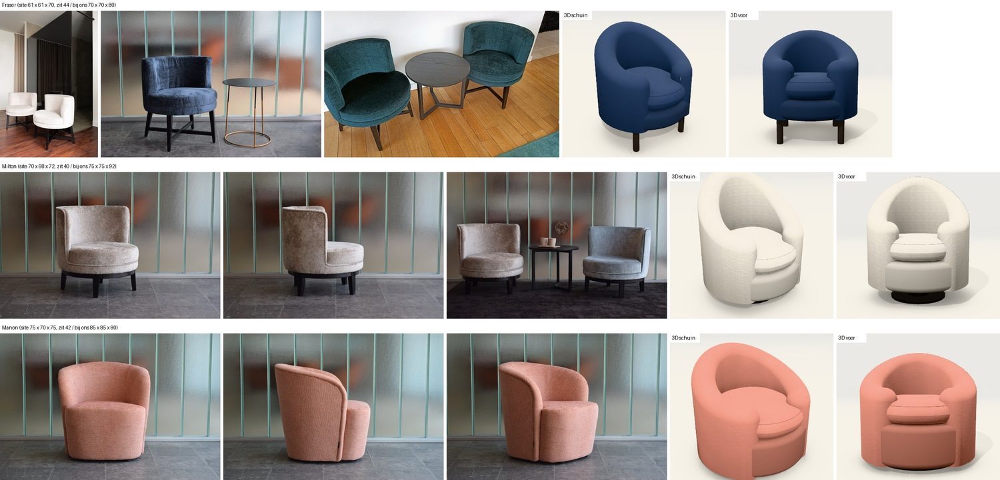

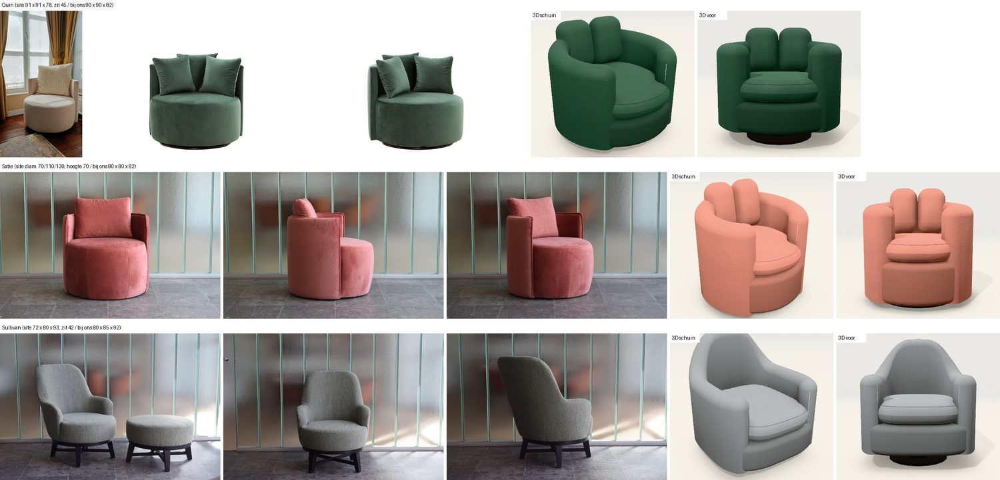

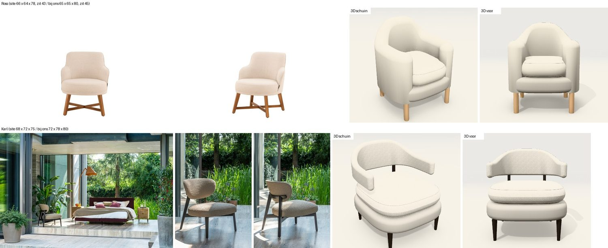

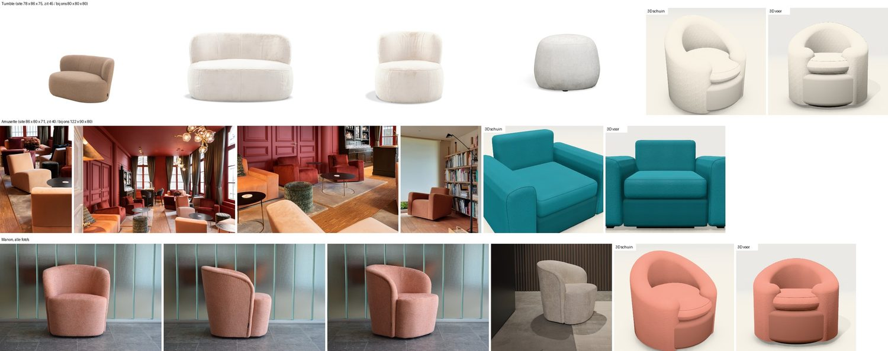

Bijna alle fauteuils van de klant volgen dezelfde bouwwijze:

1. **Zitting:** een dikke, ronde, vaste trommel in de stof (15 à 22 cm), vaak met een bies boven- of onderaan. Geen los,
   bol kussen op een donkere onderbouw.
2. **Schaal:** een dunne wand rond de achterste helft, met een vlakke of aflopende bovenrand. Ze staat rond de zitting
   tot onderaan (Milton, Satie, Quin) of erop (Fraser). Dikte volgens de site (diepte − zitdiepte): Milton 8 cm, Ross
   11, Fraser 12, Mabel 16.
3. **Onderstel:** een houten ring op vier poten (Milton, Sullivan), vier poten met een kruis (Fraser, Ross), slanke
   schuine poten onder een dun frame (Mabel, Karl), een lage ronde voet (Quin) of tot op de vloer (Satie, Manon, Tumble).
4. **Losse rugkussens:** gewone vierkante kussens (Quin, Satie). Wij tekenen drie rechtopstaande rollen.

## Per fauteuil

Maten in cm: breedte × diepte × hoogte, en de zithoogte.

| Model | Site | Bij ons | Op de foto | Wat afwijkt bij ons |
|---|---|---|---|---|
| **Milton** | 70 × 68 × 72, zit 40 | 75 × 75 × 92, zit 45 | Ronde zitting met bies onderaan; dunne schaal met vlakke rand rond de achterste helft, tot onderaan; zwarte houten ring op vier poten. | 20 cm te hoog; eivormige kuip met dikke wand; los kussen; draaivoet met kolom. |
| **Fraser** | 61 × 61 × 70, zit 44 | 70 × 70 × 80, zit 45 | Ronde zitting in twee lagen; lage, dunne schaal met vlakke rand rond de zitting, tot onderaan (eerst gelezen als "op de zitting"; de foto van opzij toont dat ze tot onderaan loopt); zwart onderstel: vier poten met een kruis. | Te groot; bolle kuip met boogrug; los kussen; vier losse cilinderpoten. |
| **Satie** | ⌀ 70 (ook 110 en 130), hoogte 70 | 80 × 80 × 82 | Trommel tot op de vloer; dunne schaal met vlakke rand en een bies; één groot vierkant kussen. | Dikke wand; drie rollen als rugkussens; los zitkussen op een onderbouw. |
| **Quin** | 91 × 91 × 78, zit 45 | 90 × 90 × 82 | Grote trommel op een lage, zwarte ronde voet; dunne schaal met vlakke rand; drie vierkante kussens. | Dikke wand; drie rollen; los zitkussen; draaivoet met kolom. |
| **Mabel 1-zit** | 68 × 65 × 76, zit 45 | 75 × 75 × 80 | Kuip met een dunne wand die van de rug schuin naar voren zakt; dikke zitting met bies; dun donker frame op vier slanke poten. | Dikke wand met boogrug en platte armen; los kussen. |
| **Mabel 2-zit** | 150 × 65 × 76, zit 45 | 164 × 82 × 80 | Dezelfde kuip, 150 cm breed. | Opgebouwd als arm + zit + arm: een andere zetel. |
| **Mabel méridienne** | 150 × 65 × 76, zit 45 | 184 × 80 × 84 | Ligbank met de kuipwand rond één uiteinde, schuin aflopend langs de rug; de andere helft open. | Opgebouwd als arm + chaise met een rechte rug. |
| **Ross** | 66 × 64 × 78, zit 43 | 65 × 65 × 80, zit 45 | Dunne schaal met bies; hoge, rechte rug met schouders; lage armen die vooraan in een boog naar de zitting zakken; één dikke ronde zitting; houten onderstel met kruis. | Wand van 13 cm; boogrug; los kussen; cilinderpoten zonder kruis. |
| **Sullivan** | 72 × 80 × 93, zit 42 | 80 × 85 × 92, zit 45 | Hoge rug die met een holle zwaai naar lage armen zakt; dikke ronde zitting; zwart frame: vier schuine poten met een ring. | Te breed; draaivoet met kolom; los kussen. |
| **Karl** | 68 × 72 × 75 | 72 × 78 × 80 | Geen armen: een brede, ovale rugschijf op een donker houten frame; dikke ronde zitting; vier slanke schuine poten. | Een schaal die als armen rondloopt; zitting in twee banden. |
| **Tumble** | 78 × 86 × 75, zit 45 (ook 134 en 160 breed) | 80 × 80 × 80 | Een zachte, bolle kiezel als zitting met een lage, dikke rugrol erachter; tot op de vloer. | Eivormige kuip met een hoge wand en een los kussen. |
| **Manon** | 75 × 70 × 75, zit 42 | 85 × 85 × 80, zit 45 | Kuip tot op de vloer: de rand van de schaal loopt van de hoge rug aan beide kanten schuin af naar voren; de zitting steekt er vooraan uit. (Eerst gelezen als een scheve kuip; op de vier foto's groot bekeken is ze symmetrisch.) | Te groot; dikke wand; los kussen. |
| **Amusette fauteuil** | 86 × 80 × 71, zit 40 | 122 × 90 × 80, zit 45 | Blokvormige clubfauteuil, rug en armen bijna even hoog, tot op de vloer. | 36 cm te breed; rug te hoog. |
| **Pebble** | (alleen de poef staat op de site) | 85 × 85 × 92 | Goedgekeurd op 5/11. | Maten van de fauteuil nog te vragen aan de klant. |

## Wat de motor nu kan

In `vormgeving.kuip` van een model staan velden die de gekozen kuipvorm overschrijven (`kuip.ts`, gedeeld door de 3D en
het boven- en vooraanzicht):

- `dikte`, `boog`, `voorBoven`: dikte van de schaal, hoe ver ze rondloopt, hoogte aan het uiteinde;
- `profiel`: het verloop van de bovenrand als punten [plaats, hoogte], bv. overal op rughoogte, of een hoge rug die met
  een schouder naar lage armen zakt;
- `zitTrommel`, `zitRand`: de zitting als één vaste trommel van de poten tot de zithoogte;
- `zitNaad`: die trommel in twee lagen, een kussen op een band (Fraser);
- `zitIn`: de schaal steekt een paar cm rond de trommel uit, een trapje tussen schaal en zitting (Satie, Quin, Fraser,
  Manon); de zitting, het onderstel en beide tekeningen volgen;
- `schaalOp`: de schaal staat op de zitting in plaats van eromheen; op een trommel begint ze waar de bolle rand van de
  zitting begint (Tumble);
- `boogRechts`, `profielRechts`: de schaal aan de rechterkant anders dan links (Mabel méridienne);
- `kussens`, `kussenMaat`, `kussenHoog`: losse rugkussens als gewone kussens (een lens: dunne rand, bol midden) die
  tegen de rand van de schaal leunen; bij meer dan één staat het middelste achteraan en de andere schuin ervoor;
- `frameDik`, `frameKruis`: dikte van het houten frame onder de zitting, en een kruis tussen de poten onder een ring
  (Sullivan);
- schuine poten: bij een onderstel met frame staan de poten schuin naar buiten, zoals op de foto's (één bron
  `framePoten` voor de 3D en het vooraanzicht; de voet blijft binnen het grondvlak);
- poten: de keuzes *Houten frame op vier poten* (`ringframe`: het frame volgt het grondvlak van de zitting) en *Vier
  poten met kruis* (`kruisframe`), sinds 13/11 in de catalogus (prijs 60 en 45 euro, verzonnen);
- de schaal van zo'n fauteuil krijgt een naad of bies langs haar rand, volgens de keuze *Naden*.

Zonder die gegevens verandert er niets aan een fauteuil: de bestaande kuipvormen tekenen zoals vroeger.

## Omgebouwd: Milton, Mabel 1-zit en Mabel 2-zit

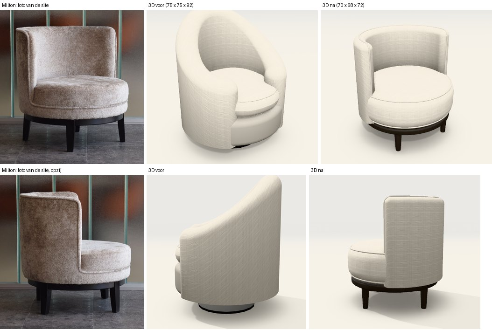

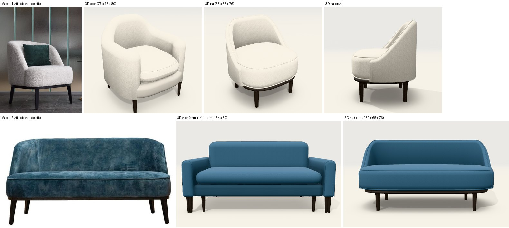

| Model | Voor | Na | Prijs voor | Prijs na |
|---|---|---|---|---|
| **Milton** | 75 × 75 × 92, eivormige kuip, los kussen, draaivoet | 70 × 68 × 72, zithoogte 40; vaste ronde zitting; schaal van 8 cm met een vlakke rand en een bies; houten frame op vier poten | 963 | 884 |
| **Mabel 1-zit** | 75 × 75 × 80, dikke wand met boogrug, los kussen | 68 × 65 × 76, zithoogte 45; leuning van 7 cm die achteraan staat en aan de zijkanten tot op de zitting zakt; vaste zitting met bies; dun frame op vier poten | 990 | 1.007 |
| **Mabel 2-zit** | 164 × 82 × 80, arm + zit + arm | 150 × 65 × 76: dezelfde kuip als de 1-zit, als één element | 1.552 | 1.163 |

- **Uit de productpagina:** breedte, diepte, hoogte, zithoogte, en de dikte van de schaal van Milton (diepte − zitdiepte).
- **Benadering uit de foto's:** hoe ver de schaal rondloopt, het verloop van de bovenrand, de poothoogte (Milton 18,
  Mabel 22), de dikte van het frame, de ronding van het grondvlak.
- **De leuning van Mabel** (bijsturing van Jonas): ze stopt rond het midden van de zitdiepte en zakt daar in een
  vloeiende lijn tot net onder de zithoogte, zodat ze in de zitting duikt. Het voorste deel van de zitting ligt vrij.
- **Keuzes:** *Houten frame op vier poten*, *Vaste zitting* en *Bies in dezelfde stof*. De prijs en de offertetekst
  volgen dus wat de 3D toont.
- **Tekeningen:** het boven- en vooraanzicht van deze drie modellen zijn mee veranderd (zelfde bron, `kuip.ts`): de
  zitting als één blok, de leuning met haar nieuwe verloop, het frame en de poten. Nagekeken in beeld; in het
  vooraanzicht stonden de uiteinden van de schaal eerst als twee palen vóór de zitting, dat is rechtgezet.

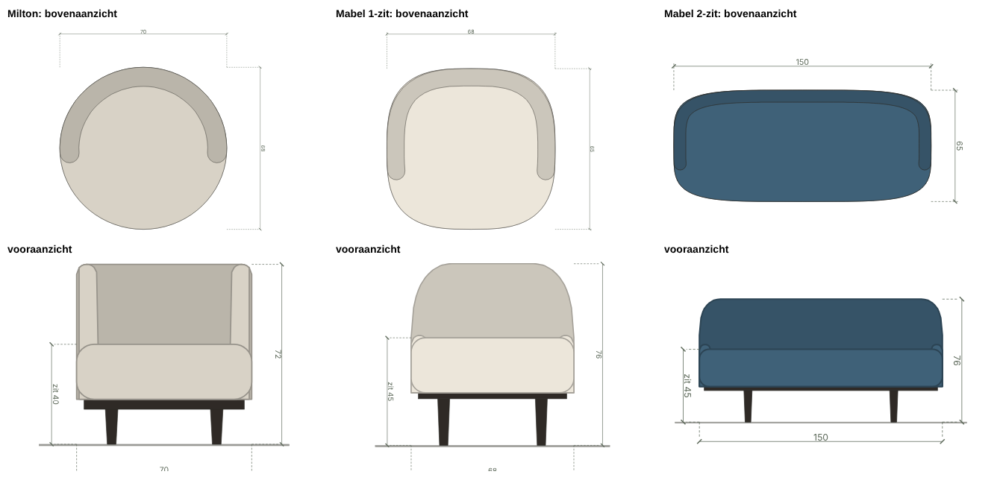
- **Wat nog verschilt van de foto:** de stof en de kleur zijn die van het model, niet die van de foto. (De poten
  stonden hier eerst recht; sinds de tweede ronde staan ze schuin naar buiten, ook in het vooraanzicht.)

Fout onderweg gevonden: bij een breed grondvlak met een korte schaal kromp de zitting tot een klein blokje, omdat de
motor de voorkant van het grondvlak mat tegen de wand achteraan. Rechtgezet, met een test.

**De prijs, regel per regel** (euro, exclusief btw; alle prijzen verzonnen):

| Regel | Milton | Mabel 1-zit | Mabel 2-zit | Beslist? |
|---|---|---|---|---|
| Houten frame op vier poten | +60 | +60 | +60 | Ja (13/11) |
| Vaste zitting (−3 %) | −26 | −30 | −35 | Ja (13/11) |
| Maten van de site (element en rughoogte) | zit in de totalen | zit in de totalen | zit in de totalen | Ja (13/11) |
| Bies in dezelfde stof (+4 %) | +32 | +36 | +43 | **Nog niet gevraagd** |
| Poothoogte op maat, rekent als *hoog* | +40 (18 cm, geschat uit de foto; vroeger een draaivoet zonder poothoogte) | +40 (22 cm; stond al op *hoog*) | +40 (22 cm; stond al op *hoog*) | **Milton nog niet gevraagd** |
| **Totaal voor → na** | 963 → 884 | 990 → 1.007 | 1.552 → 1.163 | |

**Open afwijkingen:**
- **Zitdiepte van Mabel:** de site geeft 49 cm bij een diepte van 65, dus 16 cm voor de rug. Onze leuning is 7 cm dik
  (zoals ze er op de foto's bovenaan uitziet), wat een zitdiepte van ±58 cm geeft. De echte rug is onderaan wellicht
  dikker of helt achterover; na te vragen bij de klant.
- **De nieuwe pootkeuzes** staan bij elk gestoffeerd element, niet alleen bij fauteuils (een keuze kan niet aan een
  type gebonden worden). Onder een zitelement geeft *Houten frame op vier poten* een recht frame met poten onder de
  hoeken (test); in beeld is dat nog niet bekeken.
- ***Vier poten met kruis*** staat sinds de tweede ronde op Fraser en Ross.
- **Een andere keuze bij *Vorm fauteuil*** op een omgebouwd model geeft geen fout (test), maar de eigen vorm van het
  model blijft dan grotendeels gelden.

## Omgebouwd (vervolg): de andere fauteuils

Na het akkoord van Jonas op Milton en de Mabels (13/11: "ja zijn goed zo, de mabel meridienne wijkt wel nog af. Graag
alles op deze manier opbouwen"). Eén model per stap, telkens met dezelfde controles: maten van de site in een test,
foto / vroeger / nu naast elkaar, boven- en vooraanzicht bekeken, prijs regel per regel, de andere modellen ongewijzigd.

| Model | Site | Opbouw nu | Prijs voor | Prijs na | Beeld |
|---|---|---|---|---|---|
| **Mabel méridienne** | 150 × 65 × 76, zit 45 | Eén kuip: de leuning draait om het linkeruiteinde en loopt langs de rug schuin af; vroeger arm + chaise van 184 × 80. | 1.938 | 1.401 | [beeld](afbeeldingen/fauteuils-meridienne-na.jpg) |
| **Fraser** | 61 × 61 × 70, zit 44 | Ronde zitting in twee lagen; lage rechte schaal die errond uitsteekt; vier schuine zwarte poten met een kruis. | 842 | 835 | [beeld](afbeeldingen/fauteuils-fraser-na.jpg) |
| **Satie** | ⌀ 70, hoogte 70 | Trommel tot op de vloer; dunne schaal met bies die errond uitsteekt; **één** los rugkussen (Jonas: "Satie heeft maar 1 kussen"). | 1.018 | 959 | [beeld](afbeeldingen/fauteuils-satie-na.jpg) |
| **Quin** | 91 × 91 × 78, zit 45 | Grote trommel op een lage ronde voet; dunne schaal; vier losse kussens (de productpagina: "4 kussens inbegrepen"; eerst drie gezet op de foto's). | 1.341 | 1.393 | [beeld](afbeeldingen/fauteuils-quin-na.jpg) |
| **Ross** | 66 × 64 × 78, zit 43 | Dunne schaal met bies: brede hoge rug, steile schouders, lage armen tot op de zitting; houten poten met kruis. | 768 | 806 | [beeld](afbeeldingen/fauteuils-ross-na.jpg) |
| **Sullivan** | 72 × 80 × 93, zit 42 | Hoge smalle rug die naar lage armen zakt; ronde zitting op een zwarte ring met vier poten en een kruis (vroeger een draaivoet). | 998 | 954 | [beeld](afbeeldingen/fauteuils-sullivan-na.jpg) |
| **Karl** | 68 × 72 × 75 | Geen armen: een dikke rugschijf zweeft boven een ronde zitting, op een donker houten frame. | 990 | 970 | [beeld](afbeeldingen/fauteuils-karl-na.jpg) |
| **Tumble** | 78 × 86 × 75, zit 45 | Eén bolle zitting tot op de vloer met een dikke rug (24 cm) erop. | 1.084 | 1.081 | [beeld](afbeeldingen/fauteuils-tumble-na.jpg) |
| **Manon** | 75 × 70 × 75, zit 42 | Dunne schaal met bies die van de rug naar voren afloopt, tot op de vloer, rond een trommel. | 1.050 | 966 | [beeld](afbeeldingen/fauteuils-manon-na.jpg) |
| **Amusette fauteuil** | 86 × 80 × 71, zit 40 | Geen kuip: arm + zit + arm zoals de Amusette sofa, op de maten van de site. | 1.520 | 1.473 | [beeld](afbeeldingen/fauteuils-amusette-na.jpg) |

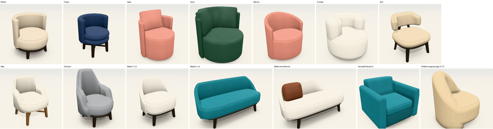

**Uit de productpagina:** breedte, diepte, hoogte en zithoogte (bij Satie en Quin is niet zeker of de hoogte de schaal
of de kussens bedoelt, zie verder). **Geschat uit de foto's** (benadering, zo gemarkeerd in
het model): de poothoogte (Fraser 26, Ross 26, Sullivan 22, Karl 28, Quin 4, Satie, Tumble en Manon 2), de zithoogte
van Satie (45) en Karl (42), de dikte van de schaal, hoe ver ze rondloopt, het verloop van haar rand, de maat van de
losse kussens.

**Prijsregels die uit de foto komen en niet apart gevraagd zijn** (alle prijzen verzonnen):

| Regel | Waar | Waarom |
|---|---|---|
| Bies in dezelfde stof (+4 %) | Satie +36, Ross +29, Manon +38, Mabel méridienne +52 | De foto toont een bies langs de rand van de schaal. Fraser, Quin, Sullivan, Karl en Tumble hebben er geen gekregen. |
| Poothoogte op maat, rekent als *hoog* (+40) | Fraser, Ross (stonden al op *hoog*), Sullivan (vroeger een draaivoet), Karl (stond al op *hoog*) | De poten zijn op de foto 22 à 28 cm. |
| Onderstel | Fraser en Ross *Vier poten met kruis* (+45, vroeger cilinderpoten +8); Sullivan en Karl *Houten frame op vier poten* (+60; Sullivan vroeger draaivoet +85, Karl conische poten +0) | Beslist op 13/11 als echte keuzes. |
| Vaste zitting (−3 %) | Alle omgebouwde kuipen | Beslist op 13/11. |

**Wat nog afwijkt van de foto's:**

- **Sullivan:** op de foto helt de rug achterover (vandaar 80 cm diep); bij ons staat de schaal recht boven het
  grondvlak. De motor kan een schaal niet laten hellen.
- **Manon:** op de foto staat de schaal bovenaan wat naar buiten; zelfde beperking.
- **Karl:** op de foto lopen de achterpoten door tot achter de rug, met een gebogen houten band rond de rugschijf; bij
  ons dragen twee stijlen de schijf.
- **Quin:** de vier kussens staan netter gerangschikt dan op de foto, waar ze los door elkaar liggen.
- **Zitdiepte (nagerekend tegen de site):** bij zes modellen is de zitting bij ons dieper dan op de productpagina,
  omdat onze schaal overal even dik is en recht staat. De echte rug is onderaan dikker dan aan de rand, of helt
  achterover.

  | Model | Diepte | Zitdiepte site | Dus voor de rug | Schaal bij ons | Zitdiepte bij ons | Verschil |
  |---|---|---|---|---|---|---|
  | Milton | 68 | 60 | 8 | 8 | 60 | 0 |
  | Amusette fauteuil | 80 | 55 | 25 | 25 | 55 | 0 |
  | Fraser | 61 | 49 | 12 | 9 | 52 | +3 |
  | Ross | 64 | 53 | 11 | 6 | 58 | +5 |
  | Mabel (1-zit, 2-zit, méridienne) | 65 | 49 | 16 | 7 | 58 | +9 |
  | Sullivan | 80 | 60 | 20 | 10 | 70 | +10 |
  | Tumble | 86 | 59 | 27 | 24 | 62 | +3 |
  | Manon | 70 | 52 | 18 | 6 | 64 | +12 |
  | Quin | 91 | 50 | 41 (schaal en kussens) | 6 + kussens | ±63 | +13 |

  Karl en Satie hebben geen zitdiepte op de site. **Voorstel (nog niet gebouwd, te beslissen door Jonas):** een schaal
  die aan de rand dun is en ter hoogte van de zitting zo dik als de site aangeeft. Dan klopt de zitdiepte, blijft de
  rand zoals op de foto, en krijgt de rug vanzelf de helling die Sullivan en Manon nu missen. Het raakt het uitzicht
  van de goedgekeurde Mabels (de binnenkant van de leuning wordt schuin).
- **Ross en Sullivan:** de armen zijn op de foto dikker en boller dan de schaal; bij ons is de schaal overal even dik.
- **Poten:** op de foto vierkant en naar onderen smaller; bij ons rond. De houtkleur van Ross (cognac) bestaat niet als
  keuze; hij staat op eik naturel.
- **Amusette fauteuil:** de armen zijn 13 cm breed in plaats van 15 (het zitelement begint bij 60 cm); op de foto is de
  zitting één blok tot op de vloer, bij ons een kussen op een onderbouw, zoals bij de Amusette sofa.
- **Hoogte van Satie en Quin (onzeker):** wij leggen de hoogte van de site (70 en 78 cm) op de rand van de schaal; de
  losse kussens komen erboven (83 en 88 cm, de maat in het vooraanzicht). Nagemeten op de foto's van opzij klopt dat
  niet helemaal: bij Quin ligt de rand bij een zithoogte van 45 op ±71 cm en de kussens op ±84 cm, dus 78 past bij geen
  van beide; bij Satie (geen zithoogte op de site, 45 geschat) is de rand ±1,46 keer de zithoogte, wat 66 cm geeft.
  Welke hoogte de site bedoelt, is na te vragen bij de klant.
- **Stof en kleur** zijn die van het model, niet die van de foto.

**Fouten onderweg gevonden en rechtgezet:**

- De poten van het onderstel stonden recht; bij de hoge poten van Fraser viel dat meteen op. Nu schuin, voor alle
  modellen met een frame.
- Het losse rugkussen stak van achter door de schaal heen (het helt achterover rond zijn onderkant). Het staat nu
  onderaan zoveel verder naar voren als het tot de rand van de schaal achteruit helt.
- Drie losse kussens langs de schaal versmolten tot één gevulde rug. Nu een lensvorm per kussen en een schuine opstelling.
- Het bovenaanzicht tekende gedraaide kussens recht (ze staken buiten de schaal); het vooraanzicht tekende het achterste
  kussen bovenop de voorste.
- De rug van Tumble hing als een losse rol boven de bolle rand van de zitting. Een schaal die op een trommel staat,
  begint nu waar die rand begint.
- Quin had drie kussens (geteld op de foto's); de productpagina zegt vier. De tekst van de pagina's was bij de tweede
  ronde niet opnieuw gelezen, alleen de maten. Daarna alle pagina's nagelezen: de zitdieptes hierboven komen daaruit.
- De tests over de keuze *Vorm fauteuil* hingen aan modellen van de klant (Tumble, Manon, Satie); ze gebruiken nu een
  gewone fauteuil uit de catalogus.

## Hockers en poefs bij de fauteuils

Drie poefs hebben hun maten op de pagina van de fauteuil staan; twee ervan staan ook op een foto.

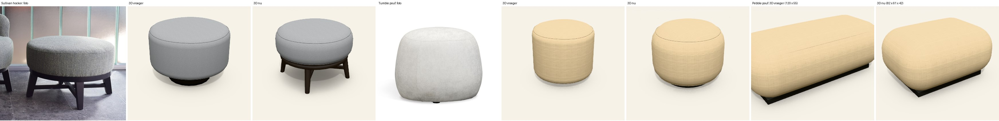

| Model | Site | Opbouw nu | Prijs voor | Prijs na |
|---|---|---|---|---|
| **Sullivan hocker** | 62 × 62 × 42 | Dezelfde ronde zitting en hetzelfde onderstel als de fauteuil: zwarte ring op vier schuine poten met een kruis (vroeger 65 × 65 op een draaivoet). | 478 | 493 |
| **Tumble pouf** | ⌀ 59, hoogte 45 | Rond en bol tot op de vloer, met sterk afgeronde randen (vroeger een rechte cilinder van 50 cm). | 371 | 392 |
| **Pebble pouf** | 82 × 61 × 42 | Kiezel op de maten van de site (vroeger 120 × 55). | 518 | 455 |

- **Motor:** een poef kan een eigen hoogte krijgen (`vormgeving.kuip.hoogte`, anders 2 cm onder de zithoogte), een bolle
  rand (`zitRand`) en een frame met kruis. Onder een ronde poef volgen het frame en de poten de cirkel; met een recht
  frame stonden de poten buiten de ronde zitting. De maat "zit" in het vooraanzicht toont de hoogte van de poef.
- **Prijsregel uit de foto:** Sullivan hocker poothoogte op maat (22 cm, rekent als *hoog*, +40); het onderstel gaat
  van draaivoet (+85) naar houten frame (+60).
- **Niet omgebouwd:** de Fraser hocker en de Mabel hocker (geen foto en geen maten gevonden; niet verzinnen),
  Stockholm, Kanto en Fez (de pagina met de poefs gaf geen links naar productpagina's).

## Sofa's, zetelbedden en poefs nagelopen (13/11)

Alle veertien sofa's, de zes zetelbedden en de drie poefs zonder eigen pagina getekend en naast hun foto gelegd. Geen
model gewijzigd, dus geen prijs.

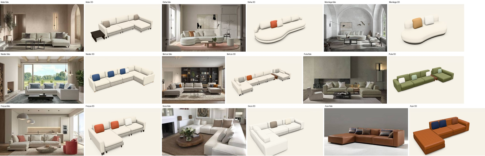

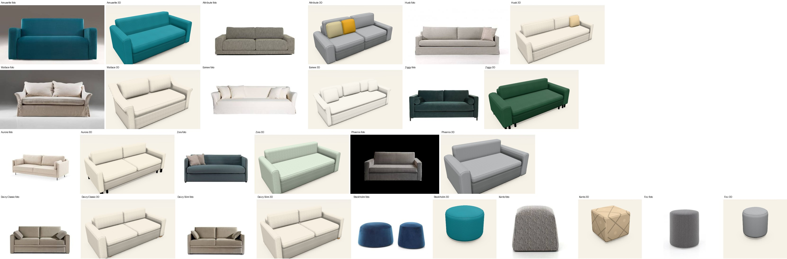

**Let op:** deze eerste doorgang gebruikt de kleine foto's uit de demo (420 px). Op die schaal zie je de opbouw, geen
details.

| Groep | Bevinding |
|---|---|
| **Sofa's** | De opbouw klopt bij alle veertien (ze zijn op 3/11 en 4/11 al naar de site gebracht): chaise, hoek, tussenstuk, armen, losse kussens staan waar ze op de foto staan. Negen hebben de maten van de site (Kotor, Doha, Montego, Nestor, Belize, Pula, Amusette, Attribute, Wallace). Voor Fréjus, Gozo, Azar, Husk en Esmee geeft de site geen maten in tekst; ze blijven een benadering. |
| **Zetelbedden** | De opbouw (arm + zit + arm) klopt, maar de **maten niet**: de site heeft voor Ziggy, Zora, Daizy Classic en Daizy Slim een technische tekening. Zie het voorstel hieronder. Zora heeft op de foto armen die rond de rug doorlopen; bij ons losse armen met een ronde bovenkant. Ziggy heeft twee rugkussens en rolkussens tegen de armen. |
| **Poefs** | Stockholm loopt op de foto naar boven smaller toe (bij ons een rechte cilinder) en is donkerblauw. Kanto is een kubus die naar boven smaller wordt. Fez klopt. Geen van de drie heeft een eigen pagina met maten. |

### Voorstel: de zetelbedden op de maten van de tekening (niet doorgevoerd)

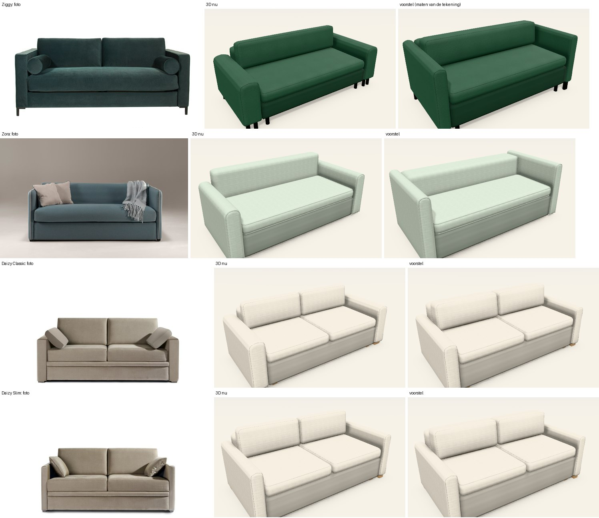

Uit de technische tekeningen op de productpagina's:

| Model | Zithoogte | Hoogte karkas | Arm (hoog × breed) | Diepte | Zitdiepte |
|---|---|---|---|---|---|
| Ziggy | 50 | 76 | 76 × 10 | 98 | 55 |
| Zora | 47 | 74 | 74 × 10 | 98 | 55 |
| Daizy Classic | 47 | 74 | 60 × 14 | 98 | 55 |
| Daizy Slim | 47 | 74 | 60 × 8 | 98 | 55 |
| Phoenix (alleen tekst) | 46 | geen | geen | geen | 55 |
| Aurora | geen | geen | geen | geen | geen |

Bij ons staan ze allemaal op zithoogte 45, 95 cm diep, met armen van 62 cm hoog en 12 tot 22 cm breed.

**Waarom niet doorgevoerd:** de maten van de tekening maken vier modellen 135 tot 208 euro duurder, vooral door
toeslagen in de catalogus die voor een gewone zetel bedoeld zijn. Dat is een prijswijziging die Jonas eerst moet zien.

| Model | Prijs nu | Met de maten van de tekening | Verschil | Waar het vandaan komt |
|---|---|---|---|---|
| Ziggy | 2.470 | 2.605 | +135 | zithoogte 50 rekent als *hoog* (+60), armhoogte 76 op maat (+30), dikkere rug en hoger karkas (+31), rest uit de maten |
| Zora | 2.301 | 2.509 | +208 | zithoogte 47 rekent als *hoog* (+60), armhoogte 74 op maat (+30), vaste rug van 30 cm dik (+106) |
| Daizy Classic | 2.253 | 2.397 | +144 | zithoogte 47 rekent als *hoog* (+60), dikkere rug en rugkussen (+20), rest uit de maten |
| Daizy Slim | 2.172 | 2.311 | +139 | zithoogte 47 rekent als *hoog* (+60), dikkere rug en rugkussen (+19), rest uit de maten |
| Phoenix | 2.052 | 2.052 | 0 | zithoogte 46 rekent als *standaard* |

**Te beslissen door Jonas:**

1. Mogen de zetelbedden op de maten van de tekening, met deze prijzen? Of eerst de toeslag voor de zithoogte herzien
   (47 cm is voor een zetelbed de gewone hoogte, niet *hoog*)?
2. De armen van Ziggy en Zora zijn 10 cm breed en die van Daizy Slim 8 cm; het type arm begint bij 12 cm. Mag die grens
   naar 8 cm?
3. De vaste rug van Zora zou 43 cm dik moeten zijn voor een zitdiepte van 55; de rugdikte stopt bij 30 cm.

De modelgegevens van het voorstel staan klaar (buiten de repo), zodat het na een akkoord één stap is.

## Eerste proef (voor de bijsturing)

Alleen als beeld; de leuning van Mabel liep hier nog tot bijna vooraan.

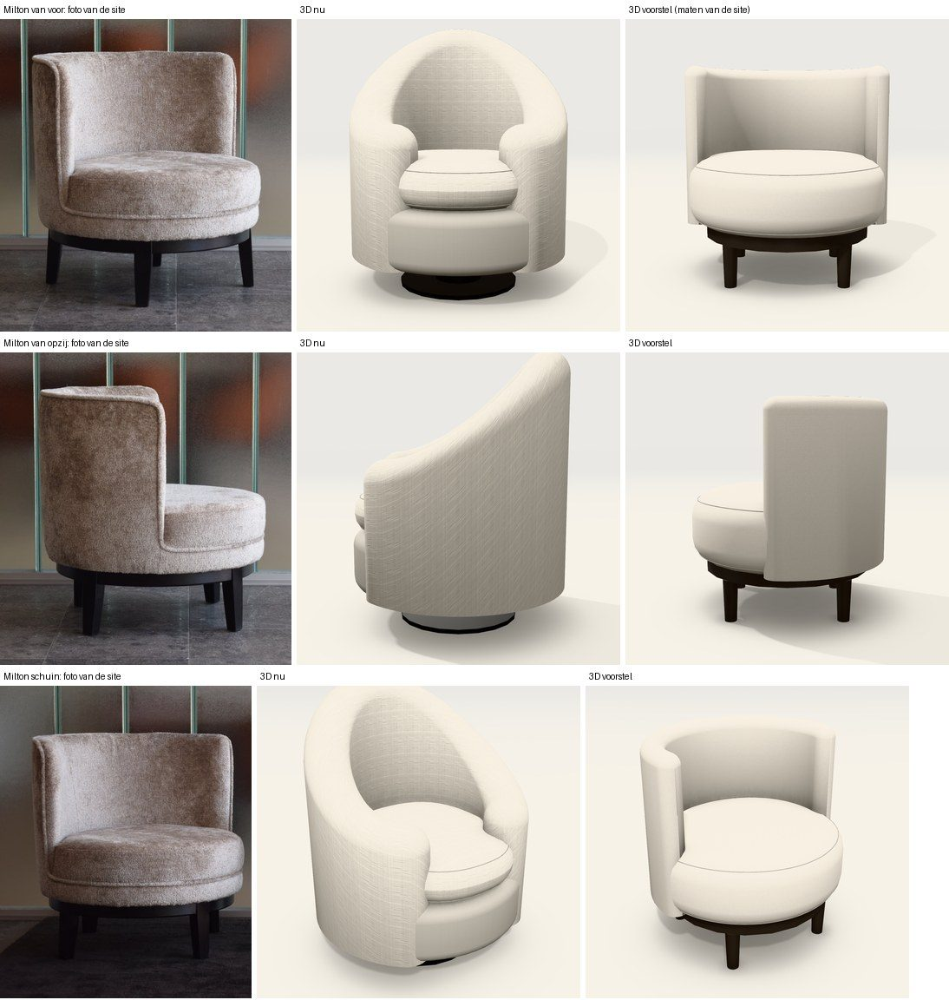

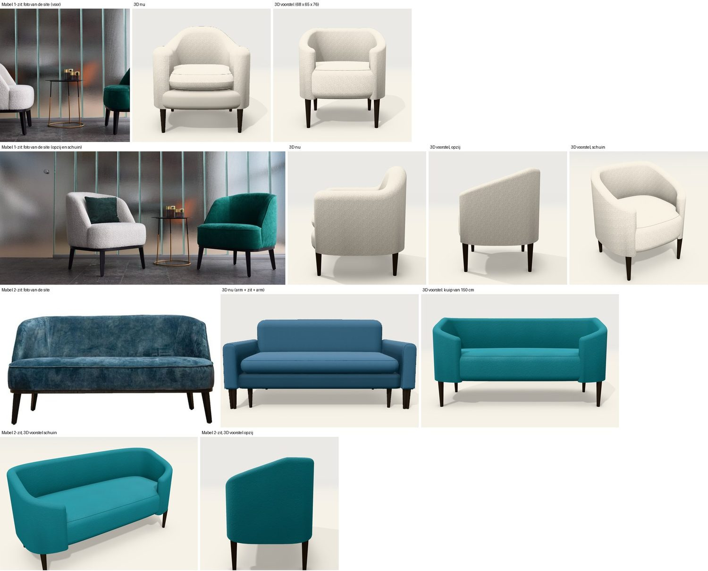

- **Milton:** 70 × 68 × 72, zithoogte 40; schaal 8 cm, vlakke rand, tot onderaan; trommel van 22 cm; ring op vier
  poten. De poothoogte (18 cm) en hoe ver de schaal rondloopt (96° per kant) zijn een benadering uit de foto's.
- **Mabel 1-zit:** 68 × 65 × 76; wand 7 cm, vlak tot voorbij de achterhoeken en dan recht aflopend naar 14 cm boven de
  zitting; trommel van 23 cm. Benadering uit de foto's.
- **Mabel 2-zit:** dezelfde kuip op 150 cm, als één element van het type fauteuil. De catalogus laat dat type maar tot
  110 cm toe.

## Wat de prijs raakt

Alle prijzen zijn verzonnen. Volgens de vaste regel besliste Jonas hierover (13/11): de maten van de site mogen, vaste
zitting en onderstel worden echte keuzes, en het type fauteuil mag tot 160 cm.

**1. De maten van de productpagina's** (breedte, diepte, hoogte en zithoogte; geen andere keuzes):

| Model | Prijs nu | Met de maten van de site | Verschil |
|---|---|---|---|
| Fraser | 842 | 822 | −20 |
| Karl | 990 | 939 | −51 |
| Mabel 1-zit | 990 | 941 | −49 |
| Manon | 1.050 | 958 | −91 |
| Milton | 963 | 863 | −100 |
| Quin | 1.341 | 1.437 | +95 |
| Ross | 768 | 764 | −4 |
| Satie | 1.018 | 953 | −65 |
| Sullivan | 998 | 967 | −31 |
| Tumble | 1.084 | 1.114 | +30 |

**2. Vaste zitting.** De trommel in de 3D raakt de prijs niet. Maar de offerte zegt dan nog "losse zitkussens". De
keuze *Vaste zitting* kost −3 %.

**3. Het onderstel.** Een ring op vier poten of een kruis bestaat niet als keuze. Als nieuwe keuze in de catalogus
krijgt ze een (verzonnen) prijs en verandert de offertetekst van die modellen.

**4. Mabel 2-zit** is 150 cm breed; het type fauteuil stopt bij 110 cm. Ook Satie bestaat in 110 en 130 cm.

## Nog te doen

- De zetelbedden op de maten van de technische tekening, na het akkoord van Jonas op de prijzen (voorstel hierboven).
- De sofa's en zetelbedden nog eens op de grote foto's van de site, model per model (deze doorgang was op 420 px):
  Zora (armen die rond de rug doorlopen), Ziggy (twee rugkussens, rolkussens), en de vijf sofa's zonder maten.
- De Fraser hocker, de Mabel hocker en de poefs Stockholm, Kanto en Fez: geen eigen pagina, dus geen maten; Stockholm
  en Kanto lopen op de foto naar boven smaller toe.
- Een schaal die helt of uitwaaiert (Sullivan, Manon), vierkante poten, dikkere armen dan de schaal (Ross, Sullivan).
- De maten van de Pebble fauteuil vragen aan de klant (alleen de poef staat op de site).
- Pas publiceren na goedkeuring.
