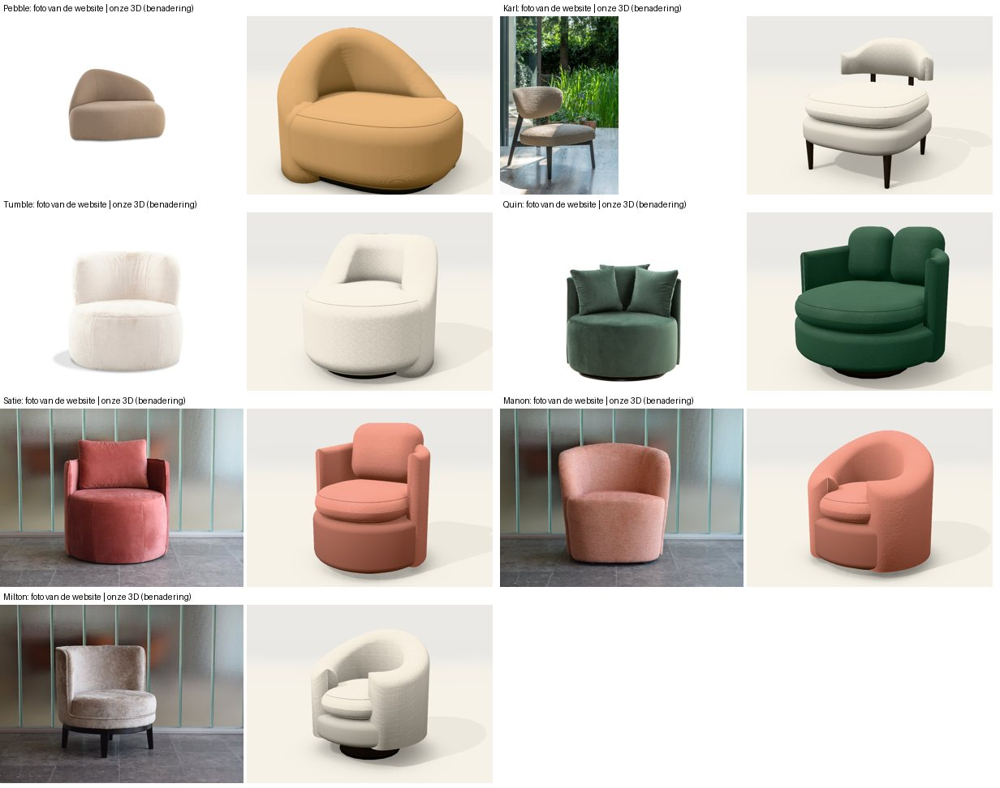
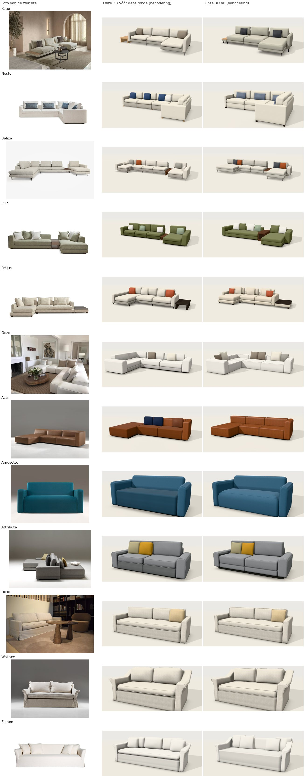
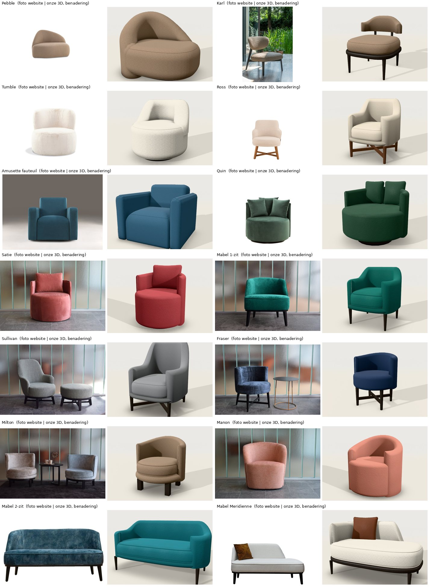
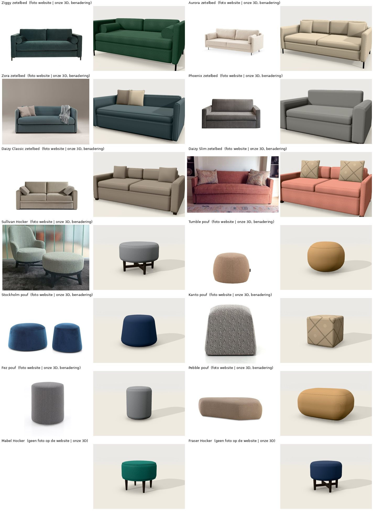
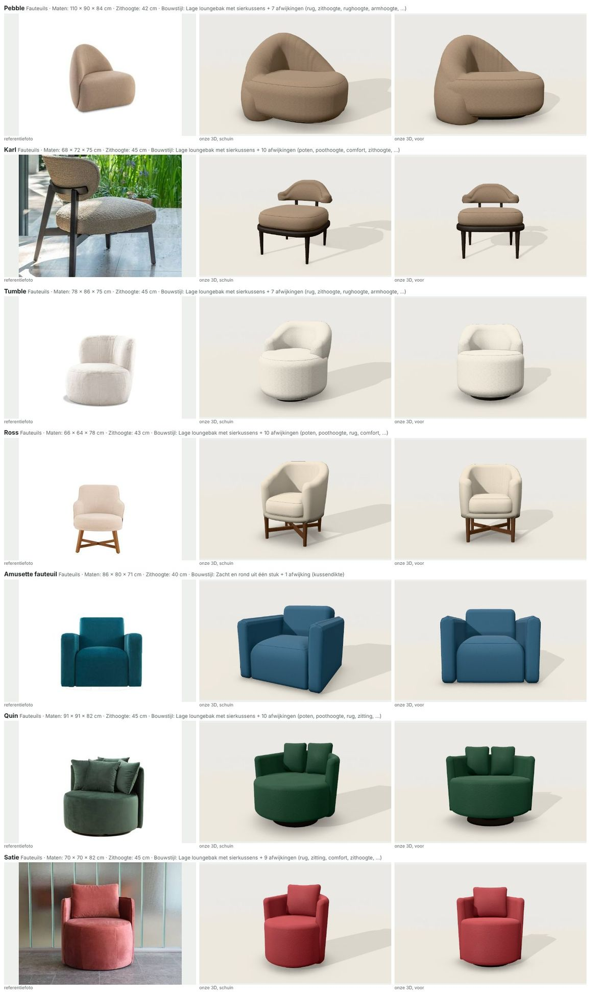
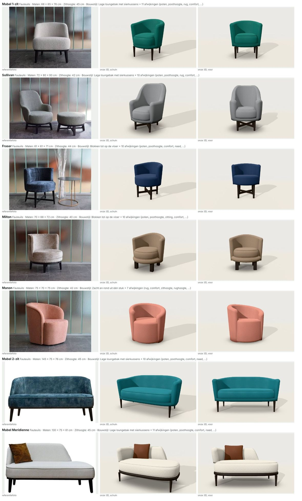
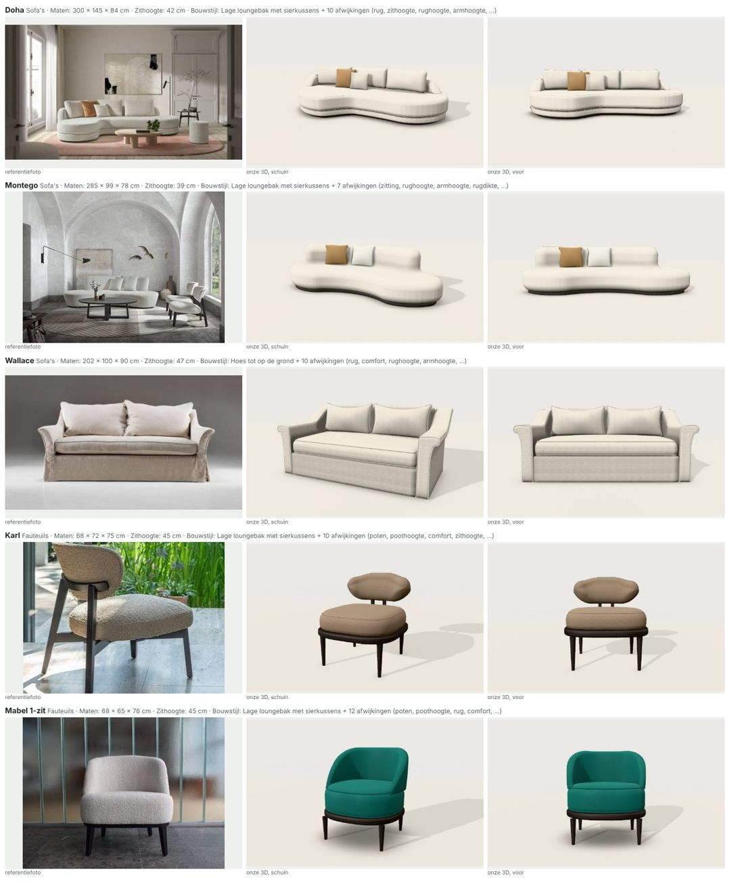
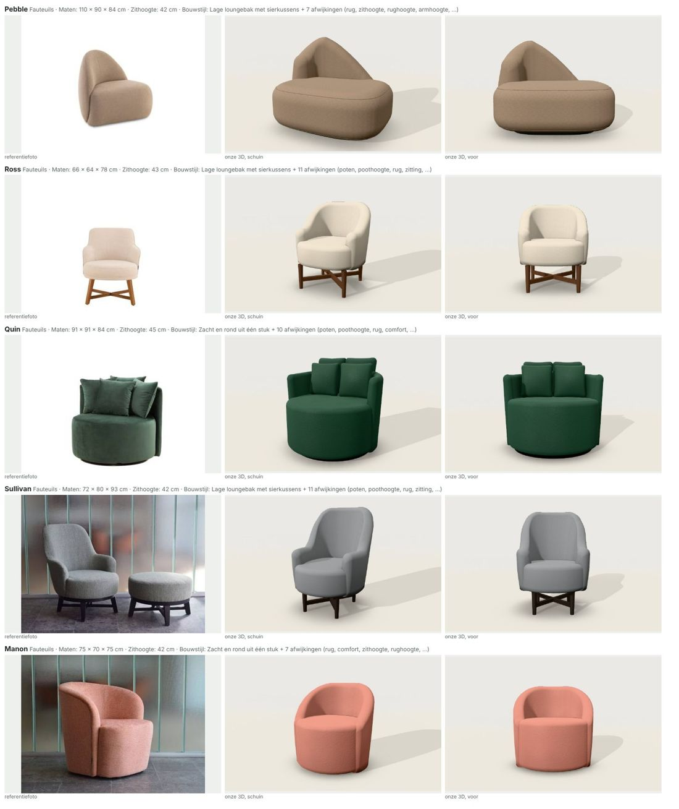

# Zetels naast de productfoto's van de website (10 en 11/11/2026)

Aanleiding (Jonas, 10/11): "Gebruik deze website voor de 3D van de zetels op punt te zetten. Ook de moeilijke zetels gecontroleerd? Zonder rechte vormen? Graag ook testen op de zetel Doha." Daarna: "Ook de kamer toevoegen in de 3D. Bovenste deel is hoger op foto en zijkant niet afgerond. Kijk zo kritisch naar alle sofa's."

Bron: de productpagina's van www.corneille-silence.be (foto's van ±1100 px, technische tekeningen en maten waar ze staan). Alle 14 sofa's en 8 fauteuils zonder rechte vormen zijn vanuit hetzelfde standpunt als de foto gerenderd en ernaast gelegd.

> **Blijft gelden:** onze 3D is een **benadering** op basis van de foto's. Maten die niet op de productpagina staan, zijn afgeleid uit de verhoudingen op de foto en zo gemarkeerd in `packages/core/voorbeelden/modellen.ts`. Stoffen, kleuren en prijzen zijn demowaarden. De foto's zelf zitten niet in de repo, alleen de vergelijkingsbeelden.

## 1. Doha (uitgebreid getest)

| Wat de foto's tonen | Vroeger bij ons | Nu |
|---|---|---|
| Breedte ±3 m (afgeleid: de hoogte met rugkussen is 84 cm) | 360 cm: te lang en te plat | 300 cm (115 + 95 + 90) |
| De **bovenste band** (de zitting) is hoger dan de onderste | Twee even dikke banden (22 op 16) | Zitting 25 op een onderbouw van ±13 |
| De **zijkant is recht**, met een zachte rand | Twee bolle worsten (afronding bijna de halve hoogte) | Kleine afronding: zijkant bijna recht |
| De lage rug **zakt aan de uiteinden** in een kwartronde naar de zitting | Een stompje op volle hoogte aan elk uiteinde | Links draait de rug om het uiteinde als armleuning en zakt; rechts stopt hij vóór het ronde uiteinde en zakt |
| Drie grote rugkussens | Vier kleinere | Drie |
| Korte, duidelijke S-bocht naar het loungedeel | Lange, flauwe overgang | Kortere overgang |
| Sierkussen in cognac | Fel oranje | Camel |

Nog anders dan de foto: de rugkussens zijn op de foto iets hoger en hoekiger, de armleuning links is er forser, en de stof is er grijzer en gemêleerd (bij ons Bouclé Écru: effen en lichter).

**Algemene regel die hieruit komt** (motor, `doorlopend.ts`): bij een doorlopende zetel met **losse rugkussens** zakt de lage rug aan een afgerond uiteinde naar de zitting. Een **vaste, hoge rug** (Montego) houdt een rechte, ronde kop.

## 2. De kamer

Nieuw decor **Salon**, naar de kamer op de foto's van Doha: lichte wanden met kaderlijsten, een raam met lichte gordijnen, een grijze eiken vloer, een rond oudroze tapijt, een ronde houten salontafel, een zwarte staanlamp, takken in een vaas en een lijntekening aan de wand. Het is onze eigen opbouw met de bestaande bouwstenen, geen kopie van de foto.

De 3D **opent voortaan in deze kamer**. *Studio* (lege achtergrond) en de andere decors blijven een keuze onder de 3D. Wie nog de oude standaard bewaard had, krijgt één keer de kamer.

## 3. Sofa's: wat is aangepast

| Sofa | Verschil met de foto | Aangepast |
|---|---|---|
| **Kotor** | De plank aan de zijkant is lichte eik, de poten zijn slank en donker; bij ons was alles zwart gebeitst hout | Eiken plank, slanke donkere poten |
| **Montego** | Op de foto van boven zit de rug niet in het midden: aan één kant loopt hij bijna tot het uiteinde, aan de andere kant blijft een groot rond stuk zitting vrij | Een smal en een breed deel (95 + 165), zodat de rug naar links schuift |
| **Fréjus** | Laag bij de grond op pootjes van 8 cm, dunne onderbouw met dikke zitkussens, lage armen, rechts een donker houten blad; bij ons op hoge poten, zonder blad | Pootjes 8 cm, zithoogte 42, zitkussens 22, armen 58, houten blad rechts |
| **Azar** | Er staat een technische tekening op de pagina die nog niet gebruikt was: hoogte 74, arm even hoog als de rug, zithoogte 40, diepte 98; blokvormig | Maten overgenomen, vaste zitting, strakke blokken, arm op 74 |
| **Amusette** | De zitting is één stuk met een ronde voorkant tot op de grond; de stof is grijsblauw en vlak geweven | Vaste zitting, stof Wol Oceaan in plaats van Velours Petrol |
| **Attribute** | Strakke, hoekige armen en kussens; bij ons te bol | Strakker (zachtheid 3) |

## 4. Sofa's: bekeken en niet gewijzigd

| Sofa | Oordeel |
|---|---|
| **Nestor** | Opstelling, blokvoetjes, nekrol en kussens kloppen. De rugkussens zijn op de foto iets rechter. |
| **Belize** | Opstelling met twee chaises en plank klopt. De plank is op de foto lichter van kleur. |
| **Pula** | Volgt de eerste foto (plank en chaise rechts). De pagina toont ook een hoekopstelling met chaise links: een andere samenstelling van dezelfde elementen. |
| **Gozo** | Blokvormig en laag, klopt. Op de foto's zijn de rug- en armblokken dikker en staan er meer losse kussens. |
| **Husk** | Hoes, slanke armen, één lang zitkussen: klopt. Geen plooien in de hoes (bekende beperking). |
| **Wallace** | Uitlopende armen en hoes kloppen. |
| **Esmee** | Klopt in lijn. Op de foto liggen de rugkussens alleen aan de twee uiteinden en is het midden van de rug vrij. |

## 5. Fauteuils zonder rechte vormen

| Fauteuil | Verschil met de foto | Aangepast |
|---|---|---|
| **Pebble** | Op de foto duidelijk breder dan hoog (±1,34 : 1); bij ons 85 breed en 92 hoog | 110 breed, 84 hoog, kleur van de foto. De pagina geeft geen maten voor de fauteuil: benadering |
| **Karl** | De rug is een ovaal kussen achter de zitting, zonder vleugels naar voren; maten op de pagina: 68 × 72 × 75 | Maten overgenomen, de schelp loopt minder ver rond |
| **Tumble** | Een ronde zitting als een trommel, met een dikke rug rond de achterste helft, breed bovenaan en met ronde schouders; bij ons een wand die bijna helemaal rond liep tot op de vloer, met een klein kussen erin | Nieuwe vorm *Koepelrug op ronde zitting*: de zitting is één ronde vorm in de stof, de rug staat erop. Maten van de pagina (78 × 86 × 75, zithoogte 45) |
| **Quin** | Een dunne wand rond de achterste helft, vooraan is de ronde zitting vrij, grote losse kussens; bij ons een dikke wand bijna helemaal rond, smalle rolkussens en een donkere onderbouw | Vorm *Trommel* aangepast (dunne wand, halve omtrek, bredere kussens, onderbouw in de stof), maten van de pagina (91 × 91 × 78) |
| **Satie** | Zelfde opbouw als Quin; de pagina geeft diameters 70, 110 en 130 | Zelfde vorm, de kleinste maat (70) |
| **Manon**, **Milton**, **Mabel 1-zit** | Vorm klopt in grote lijnen | Maten van de productpagina overgenomen |

Ross, Sullivan, Fraser, Amusette fauteuil, Mabel 2-zit en Meridienne, de zetelbedden en de poufs zijn op 11/11 bekeken: zie hoofdstuk 8.

## 6. Wat overal nog verschilt

1. **Licht en tint.** De foto's zijn sfeerbeelden met gedempt licht; lichte stoffen zijn er grijzer en tonen meer schaduw. Bij ons is een lichte stof bijna wit en zie je de vorm minder. Een kleur in onze 3D komt wel overeen met de staal (gemeten: Velours Petrol #1f6b75 wordt #217a83).
2. **Gemêleerde stoffen** (de bouclé van Doha) zijn bij ons effen.
3. **Rugkussens** zijn op de foto's vaak hoger, hoekiger en met meer per zitplaats.
4. **Plooien** in hoezen en kreuken in leder tekenen we niet.
5. **Niet getest op de M5** (WebGPU); alles is gecontroleerd op de WebGL2-weg.

## 7. Werkwijze (om te herhalen)

> Sinds de heranalyse van 11/11 staat de werkwijze, met vast gereedschap, in `docs/werkwijze-3d.md`. De stappen hieronder
> zijn de eerste versie.

1. Haal de grote foto's van de productpagina (`…_orig.jpg`) in een eigen map buiten de repo.
2. Meet op de foto de verhouding breedte : hoogte en leg ze naast de maten van de pagina. Staat de breedte er niet, leid ze af uit een hoogte die er wel staat, en markeer ze als benadering.
3. Render het model vanuit hetzelfde standpunt: `window.__zetel3d.kijk({ hoekH, hoekV, afstand })` zet de camera exact.
4. Leg foto en render naast elkaar en benoem de verschillen in gewone woorden (hoogte van een band, rechte of ronde zijkant, aantal kussens) voor je iets wijzigt.
5. Pas eerst de gegevens van het model aan (maten, opties, vormgeving); wijzig de motor alleen voor een regel die voor meer modellen geldt.
6. Draai `npm test` en `npm run beelden`, en leg een bewuste wijziging vast met `-- --vernieuw`.

## 8. Tweede, kritische ronde (11/11): alle 42 modellen en alle instellingen

Aanleiding (Jonas, 11/11): "Graag nog eens zeer kritisch de kwaliteit van alle zetels t.o.v. de foto's en alle mogelijke
settings bekijken. We willen een uniek topproduct maken." Tijdens de ronde kwamen erbij:
- "De 3e zetel lijkt er helemaal niet op, van waar komen die buizen als armleuning?" (Zora);
- "Bij ons zit er nog veel verschil op dikte kussens. De rechthoekige zetels zijn moeilijk van elkaar te onderscheiden";
- "Kunnen we de technieken niet overnemen die Sketchfab gebruikt?" (antwoord: `docs/3d-technieken.md`);
- "De longchairs hebben geen poten onder het lange deel";
- "Deze stoelen lijken nog niet zo goed op de foto" en daarna "Fraser heeft geen apart kussen, Manon is in 1 stuk, Mabel
  Meridienne ook graag nog eens controleren."

### 8.1 Wat bij alle zetels fout zat (motor)

| Bevinding | Oorzaak | Aangepast |
|---|---|---|
| **Alle rechte sofa's leken op elkaar** | Elk zitkussen had rondom dezelfde grote afronding (een zeepvorm) en lag op een grijze, vlakke band | Kussen zoals het genaaid is: plat op de onderbouw, scherpe hoeken in het grondvlak, alleen de bovenrand rolt om. Onderbouw in de stof zelf, met het weefsel |
| **Losse kussens waren zeepblokjes** | Sierkussens en donzen rugkussens waren afgeronde balken | Kussen met een mesrand: dun aan de naad, dik in het midden, licht holle zijden. Elk sierkussen staat een paar graden gedraaid |
| **Trosjes van twee of drie poten** tussen de elementen | Elk element kreeg zijn eigen vier poten | Poten per zetel: geen poot naast een arm, één paar op de grens tussen twee zittingen |
| **Geen poten onder het lange deel van een chaise longue** (melding van Jonas) | De nieuwe regel keek alleen naar links en rechts, niet naar hoe diep de buur komt | Per hoek bekeken: steekt een element voorbij zijn buur uit, dan staat daar een eigen poot |
| **Slanke metalen poot te dik** | 4,5 cm, zoals een houten poot | 2,4 cm |
| **Bovenkant brandde uit** (lichte zetel = witte vlek) | De bovenkant was 1,5 tot 2,5 keer zo helder als de staal | Licht per sfeer geijkt: bovenkant ±1,3 à 1,5 ×, voorkant ±0,9 × |
| **Witte zetel op een witte achtergrond** | Decor *Studio* is bijna wit | Nieuw decor *Fotodoek (grijs)*, zoals de productfoto's van Attribute, Azar en Wallace |
| **Bies was een witte lijn** | De ribbel vangt veel licht | Bies in dezelfde stof iets donkerder; gewone naden dunner en lichter |
| **Hout zonder tekening** | De nerf herhaalde op een afgerond blad om de centimeter | Nerf op ware grootte |
| **Donkere plaat onder een ronde poef** | De verdekte voet stak onder de ronding uit | Geen voet als de poef tot op de vloer loopt; anders binnen de ronding |
| **Ronde poufs met vlakjes** langs de rand | Te weinig punten langs de omtrek en in de afronding | Fijner verdeeld |
| **Kuipfauteuils met twee lagen** (kussen op een even dikke onderbouw) | De onderbouw was overal even dik | Per model: een dun frame op hoge poten (Karl, Ross, Mabel, Sullivan) of één gestoffeerde trommel zonder los kussen (Quin, Satie, Fraser, Manon) |
| **Kamers open aan de linkerkant**, parket als dambord, verf als terrazzo | Decor had alleen een achter- en rechterwand; te grof getekende texturen | Linkerwand (verdwijnt als de camera erachter staat), rustiger parket, fijnere verf |

### 8.2 Sofa's (14)

| Sofa | Wat de foto's tonen | Aangepast |
|---|---|---|
| **Kotor** | Dun karkas op slanke poten, dikke donskussens die over de onderbouw steken, eiken blad dat **op** de onderbouw ligt, één korte arm rechts, kiezelgrijs | Poten 11, onderbouw 10, zitkussens 23 met 3 cm oversteek; blad op de onderbouw (nieuwe uitvoering); arm even diep als de zitting; donzen kussens met mesrand; stof Chenille Kiezel (gemeten) |
| **Doha** | (10/11) | Rugkussens met mesrand |
| **Montego** | (10/11) | Geen wijziging |
| **Nestor** | Witte bak op donkere blokvoetjes, rechte rugkussens, per zitplaats een blauwgrijs **lendenkussen**; twee zitplaatsen en de hoek aan de lange kant | Opstelling van de foto; rugkussens met een band; lendenkussens (nieuw formaat) in blauwgrijs; donkere voetjes |
| **Belize** | Links een **breed loungedeel zonder arm** met twee rugkussens, twee zitplaatsen, blad op de onderbouw, chaise met korte arm; dunne strakke kussens; licht grijs gemêleerd | Opstelling van de foto (chaise tot 160 cm breed, met twee rugkussens); poten 15; stof Melange Kiezel (gemeten) |
| **Pula** | Een bak tot op de vloer: brede armen even hoog als de rug, **één lange zitmatras**, geen rugkussens maar losse sierkussens | Eén zitelement van 240 cm; vaste lage rug (66 cm); zes sierkussens; arm even diep als de sofa |
| **Fréjus** | Een **plateau** dat onder de kussens uitsteekt, dikke donskussens, armen en karkas ±66 cm, donker blad op het plateau | Opgemeten op de foto van voren: zithoogte 47, kussens 24, plateau 6 cm uit; chaise 120 breed; vierkante donkere pootjes; blad van 80 cm op het plateau; stof Melange Natuur |
| **Gozo** | **Blokken tot op de vloer** met een bies langs de randen, lage dikke rug, sierkussens | Vaste zitting en vaste rug (30 dik, 62 hoog), bies, zes sierkussens |
| **Azar** | Drie rugblokken, dus ook achter de chaise | Rug achter de chaise; sierkussens weg (niet op de productfoto) |
| **Amusette** | De voorkant van de zitting rolt in een grote boog tot op de grond | Vaste zitting met grote rol (zachtheid 8), tot op de vloer |
| **Attribute** | Gewone naden, dikke zitkussens tot vlak boven een teruggetrokken sokkel | Bies weg, zitkussens 24, sokkel 8 |
| **Husk**, **Wallace** | Klopten in lijn | Wallace: donzen rugkussens met mesrand en bies; Husk: bies subtieler |
| **Esmee** | Eén hoes over een vaste zitting en een vaste rug (±85 cm), vier sierkussens aan de uiteinden | Vaste zitting en rug, vier sierkussens |

### 8.3 Fauteuils (14)

| Fauteuil | Wat de foto's tonen | Aangepast |
|---|---|---|
| **Pebble** | Taupe, niet camel | Stof Teddy Taupe (gemeten) |
| **Karl** | Taupe bouclé; het zitkussen ligt op een **dun donker houten frame** op hoge poten | Frame in hout (5 cm) op poten van 26 cm; stof Teddy Taupe |
| **Tumble** | (10/11) | Geen wijziging |
| **Ross** | Houten kruisvoet, dun frame onder een dik zitkussen, brede rug | Kruisvoet (nieuw), poten 23, kussen 15, warm crème |
| **Amusette fauteuil** | 86 breed (productpagina), zelfde lijn als de sofa | Maten van de pagina (was 122 breed), zitting met grote rol |
| **Quin**, **Satie** | De zitting is **één ronde trommel**, geen los zitkussen; losse kussens met puntige hoeken | Vaste zitting; rugkussens met mesrand; Satie in Velours Framboos (gemeten) |
| **Mabel 1-zit** | Smaragdgroen velours, brede rug, dik zitkussen met bies op een dun frame | Stof Velours Smaragd (gemeten), bies, poten 22; rug met brede bovenkant |
| **Sullivan** | Donkere houten kruisvoet | Kruisvoet, poten 20, kussen 17 |
| **Fraser** | Lage wand rondom even hoog, kruisverbinding tussen de poten; **geen apart zitkussen** (melding van Jonas): de zitting is één gestoffeerde trommel op het frame | Vorm *Trommel* met vaste rug en vaste zitting, kruisvoet, poten 26 |
| **Milton** | Dunne wand rond de rug, rond zitkussen met bies, **vier korte donkere poten** (geen draaivoet) | Vorm *Trommel* met vaste rug, blokpoten, bies, taupe |
| **Manon** | **Uit één stuk** (melding van Jonas): de zitting is een ronde trommel tot op de vloer, met een dunne wand die er ver omheen loopt; geen los kussen, geen aparte onderbouw | Vaste zitting tot op de vloer; vorm *Omhullend* met een dunnere wand |
| **Mabel 2-zit** | **Eén gebogen schelp** (rug en armen uit één stuk) op een dik zitkussen | Eén schelp van ±145 cm (was een rechte sofa met rolarmen); blauw velours, bies |
| **Mabel Meridienne** | De rug loopt hoog **rond het linkeruiteinde**, blijft achteraan op die hoogte tot ±60 % van de breedte en zakt dan kort en steil naar de zitting. Ze staat **op** het zitkussen (de bies loopt eronder door), op een dun donker frame met vier poten | Nieuwe vorm *Méridienne* (was een arm met een chaise); op vraag van Jonas nog eens nagekeken en bijgesteld |

### 8.4 Zetelbedden (6) en poufs (8)

| Model | Wat de foto's of de tekening tonen | Aangepast |
|---|---|---|
| **Ziggy** | Technische tekening: arm 10 breed en 76 hoog, zithoogte 50 | Slanke armen even hoog als de rug, rolkussens, slanke poten |
| **Aurora** | Slanke armen, een los kussen tegen elke arm | Armen 10, twee kussens |
| **Zora** | Technische tekening: arm 10 breed, hoog; grijsblauw (melding van Jonas: "buizen als armleuning") | Slanke rechte armen in plaats van rolarmen; petrolgrijs (gemeten); twee beige sierkussens |
| **Phoenix** | Donker, warm grijs | Stof Chenille Steengrijs |
| **Daizy Classic**, **Daizy Slim** | Technische tekening: arm 14 en 8 breed, 60 hoog, zithoogte 47 | Maten overgenomen; kussens tegen de armen; Slim in oudroze zoals op de eerste foto |
| **Sullivan Hocker** | Kruisvoet zoals de fauteuil | Kruisvoet |
| **Tumble pouf** | Bolle ton tot op de vloer | Nieuwe vorm *Bol*, geen voet |
| **Stockholm pouf** | Onderaan breder dan bovenaan, donkerblauw | Nieuwe vorm *Taps*, donkerblauw |
| **Kanto**, **Fez**, **Pebble pouf** | Tot op de vloer; Fez hoger dan breed; Pebble pouf 82 × 61 (productpagina) | Geen voet; maten van de pagina |
| **Mabel Hocker**, **Fraser Hocker** | Geen foto op de website | Zelfde stof en poten als hun fauteuil |

### 8.5 Instellingen

Elke keuze is één keer gezet op een gewone sofa en bekeken: poten (11 + kruisvoet), poothoogte, hout, metaal, zithoogte,
zitting, rug, nekrol, rughoogte, naden, armstijl (7), armhoogte; de twaalf decors, de zeven lichtsferen (in een kamer en in
de studio), *Snel* en *Mooi*, *Blokken* en *Zacht*.

- **Decors:** linkerwand, parket en verf aangepast (zie 8.1). Nieuw: *Fotodoek (grijs)*.
- **Licht:** alle sferen geijkt. *Bewolkt* bleekte in een kamer alles uit: bijgesteld en nagemeten (bovenkant ±1,3 × de
  staal). Daarbij gevonden: sinds de overstap naar WebGPU (4/11) had de instelling voor de sterkte van het omgevingslicht
  geen effect meer; het stond altijd op volle sterkte. De ijking van vandaag is daarmee gemeten en klopt dus, maar de
  nette oplossing (de instelling weer laten werken en alle sferen opnieuw ijken, ook in de bouwdemo) is een volgende stap.
  *Avond* in een kamer toont lichtbanden op de wand (de zon door het raam): zo gelaten.
- **Zacht (proef):** de onderbouw heeft nu dezelfde kleur als rug en armen en smelt ermee samen tot één karkas.
- **Nieuw in de catalogus:** *Houten kruisvoet*, *Houten blad op de onderbouw*, formaat van een sierkussen
  (*Vierkant* of *Lendenkussen*), poefvormen *Bol* en *Taps*, fauteuilvorm *Méridienne*, en in de vormgeving
  *Zitkussen steekt uit of plateau eronder*. De arm kan vanaf 8 cm (prijs ongewijzigd tot 12 cm); een chaise tot 160 cm
  en een fauteuil tot 150 cm breed.
- **Nieuwe stofkleuren** (gemeten op de foto's, demowaarden): Chenille Kiezel, Melange Kiezel, Teddy Taupe, Velours Smaragd, Velours Framboos, Katoen Petrolgrijs.

### 8.6 Wat nog verschilt

1. **Plooien en kreuken.** Onze kussens zijn glad; op de foto's plooit de stof. Zie `docs/3d-technieken.md` voor de volgende stap.
2. **De hoes tot op de grond** (Husk, Wallace, Esmee) heeft geen plooien op de hoeken en geen band onderaan.
3. **Maten zonder bron.** Gozo, Husk, Esmee, Aurora, Phoenix, Mabel 2-zit en Mabel Meridienne hebben geen maten op de productpagina: alles is uit de foto afgeleid.
4. **Stoffen.** De kleuren zijn gemeten op de foto's, maar het zijn onze demostoffen, niet de stoffen van de klant.
5. **Niet getest op de M5** (WebGPU); alles is gecontroleerd op de WebGL2-weg in de cloud.
6. **Prijzen** van de aangepaste modellen zijn mee veranderd (andere elementen en opties). Het blijven demowaarden.

## 9. Derde ronde (11/11): ronde vormen

Melding: "Ronde vormen vormen zeker problemen, bepaalde zetels zien er helemaal niet correct uit." Oorzaken, oplossing en
de tabel per vorm staan in `docs/werkwijze-3d.md` hoofdstuk 10. Kort: de gebogen wand van elke kuipfauteuil is herbouwd
als een gepolsterde schaal die helt, de vormen zijn bijgesteld naar alle foto's van de productpagina's, en er zijn twee
vormen bij (*Ton* voor Mabel, *Hoge ronde rug* voor Sullivan).

Wat nog verschilt: de poten van Ross en Sullivan staan recht (op de foto's schuin, vanuit een ronde voet); Quin heeft op
de foto vijf losse kussens (bij ons twee); de hellingen zijn geschat uit foto's.

## 10. Vierde ronde (11/11): de opmerkingen van het controleblad

Jonas beoordeelde elf zetels op het controleblad: Kotor akkoord ("dit ziet er zeer goed uit"), tien met een opmerking.
Elke opmerking is opnieuw naast **alle** foto's van de productpagina gelegd (`fotos-bron/<model>/`), niet alleen naast
de ene foto van het blad. Bij vier modellen bleek de opbouw zelf anders dan we dachten.

| Model | Opmerking | Wat de foto's tonen | Wat is aangepast |
|---|---|---|---|
| Doha | "meer curve, het bovenste kussen is in proportie groter dan het onderste deel" | Een zetel in een boog; een dikke zitting op een dunne onderbouw | De uiteinden buigen 24 cm naar voren; zitting 28 cm op een onderbouw van 10 cm |
| Montego | "ziet er groter uit en heeft een grotere curve" | Een brede boon met een sterke boog | 285 cm breed (was 260), de uiteinden 60 cm naar voren (was 30) |
| Karl | "de leuning heeft een andere vorm" | Een ovaal kussen op het frame: bijna rechte bovenkant, een buik onderaan, bijna recht achter de zitting | De rug is een ovaal kussen met ronde hoeken (onderaan een grote straal), zonder vleugels naar voren |
| Mabel 1-zit | "de leuning is kleiner" | Een dikke zitting over het hele grondvlak; de rug staat erop, is laag en dun en zakt vooraan tot op de zitting | Vorm *Ton* opnieuw gemaakt: zitting 20 cm dik op een dun frame, rug 8 cm dik erop. Geldt ook voor Mabel 2-zit |
| Manon | "de leuning is meer afgerond" | Symmetrisch: achteraan hoog, aan beide kanten in een ronde lijn tot op de zitting; vooraan steekt de trommel vrij uit | Vorm *Omhullend* opnieuw gemaakt (tot dan een scheve spiraal met één lage arm: zo is de zetel niet) |
| Pebble | "het samenkomen van leuning en zetel is verticaal, bij ons lopen ze door elkaar" | De zitting is een volle, hoekige kiezel; de schaal staat erachter en rond één hoek, daar een verticale naad | Vorm *Organisch* opnieuw gemaakt: volle zitting, schaal 19 cm dik achteraan en rond de linkerhoek, bovenrand bijna recht naar rechts |
| Quin | "de voet is groter en minder gecentreerd, de kussens vullen de zetel meer" | De trommel loopt tot vlak boven de vloer op een brede, platte voet; vier grote kussens | Brede draaivoet, trommel 4 cm boven de vloer (was 12), vier kussens van ±37 cm die elkaar overlappen |
| Ross | "de zitting is in één stuk en ziet er anders uit" | Een ronde zitting uit één stuk die vooraan vrij uitsteekt; de armen zijn laag en stoppen op ±twee derde van de diepte | Vaste zitting uit één stuk; armen korter (boog 114° i.p.v. 128°) en lager (11 cm boven de zitting i.p.v. 17) |
| Sullivan | "zitting in één stuk" | Een dikke ronde zitting uit één stuk, de armen stoppen voor de voorkant | Vaste zitting uit één stuk; armen iets korter en lager |
| Wallace | "kan er meer vorm komen in de kussens?" | Grote, los gevulde donskussens met oortjes | Los gevulde kussens: dunnere naad, bollere buik, holle zijden met oortjes, een bovenrand die doorzakt; zitkussen 18 cm |

**Twee fouten in de motor die hierbij boven kwamen** (ze gelden voor meer modellen, elk met een test):

- **Punten op gelijke afstanden langs de wand.** Bij een hoekig grondvlak lagen de punten van de wand opeengepakt aan de
  uiteinden; de rug zakte dan pas in de laatste centimeters, met een knik (de "oortjes" aan de rug van Karl).
- **De breedte blijft de buitenmaat, ook in een boog.** Een zetel in een boog werd smaller dan zijn maat: Doha van
  300 cm werd 263 cm, Montego van 285 cm werd 228 cm. Nu wordt hij langs de boog zoveel langer dat hij van uiteinde tot
  uiteinde weer zijn breedte heeft.

**Wat een benadering blijft.** Alles is afgeleid uit foto's. Van Pebble, Doha en Montego geeft de productpagina geen
breedte; de helling en de dikte van de schalen zijn geschat. Pebble bestaat in een linkse en een rechtse uitvoering
(de foto's tonen beide); wij tonen er één. De poten van Ross en Sullivan staan nog recht (op de foto's schuin).

**Gemeten na de ronde:** 288 tests; beeldvergelijking: Doha, Montego en Pebble veranderd (bewust, referenties
vernieuwd), Kotor, Husk, Stockholm en de bouwdemo 0,00 %.

