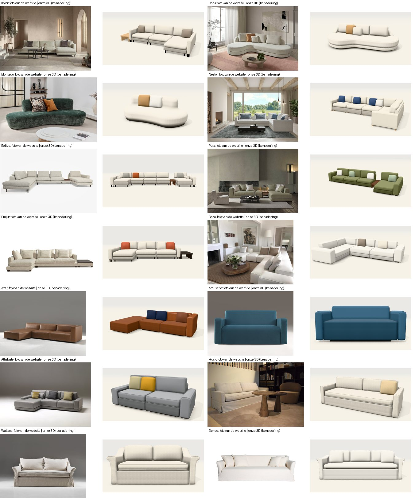
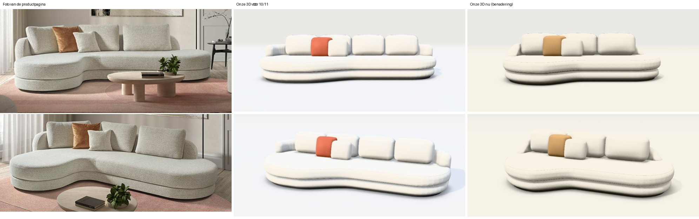

# Zetels naast de productfoto's van de website (10/11/2026)

Aanleiding (Jonas, 10/11): "Gebruik deze website voor de 3D van de zetels op punt te zetten. Ook de moeilijke zetels gecontroleerd? Zonder rechte vormen? Graag ook testen op de zetel Doha." Daarna: "Ook de kamer toevoegen in de 3D. Bovenste deel is hoger op foto en zijkant niet afgerond. Kijk zo kritisch naar alle sofa's."

Bron: de productpagina's van www.corneille-silence.be (foto's van ±1100 px, technische tekeningen en maten waar ze staan). Alle 14 sofa's en 8 fauteuils zonder rechte vormen zijn vanuit hetzelfde standpunt als de foto gerenderd en ernaast gelegd.

> **Blijft gelden:** onze 3D is een **benadering** op basis van de foto's. Maten die niet op de productpagina staan, zijn afgeleid uit de verhoudingen op de foto en zo gemarkeerd in `packages/core/voorbeelden/modellen.ts`. Stoffen, kleuren en prijzen zijn demowaarden. De foto's zelf zitten niet in de repo, alleen de vergelijkingsbeelden.

## 1. Doha (uitgebreid getest)

| Wat de foto's tonen | Vroeger bij ons | Nu |
|---|---|---|
| Breedte ±3 m (afgeleid: de hoogte met rugkussen is 84 cm) | 360 cm: te lang en te plat | 300 cm (115 + 95 + 90) |
| De **bovenste band** (de zitting) is hoger dan de onderste | Twee even dikke banden (22 op 16) | Zitting 25 op een onderbouw van ±13 |
| De **zijkant is recht**, met een zachte rand | Twee bolle worsten (afronding bijna de halve hoogte) | Kleine afronding: zijkant bijna recht |
| De lage rug **zakt aan de uiteinden** in een kwartronde naar de zitting | Een stompje op volle hoogte aan elk uiteinde | Links draait de rug om het uiteinde als armleuning en zakt; rechts stopt hij vóór het ronde uiteinde en zakt |
| Drie grote rugkussens | Vier kleinere | Drie |
| Korte, duidelijke S-bocht naar het loungedeel | Lange, flauwe overgang | Kortere overgang |
| Sierkussen in cognac | Fel oranje | Camel |

Nog anders dan de foto: de rugkussens zijn op de foto iets hoger en hoekiger, de armleuning links is er forser, en de stof is er grijzer en gemêleerd (bij ons Bouclé Écru: effen en lichter).

**Algemene regel die hieruit komt** (motor, `doorlopend.ts`): bij een doorlopende zetel met **losse rugkussens** zakt de lage rug aan een afgerond uiteinde naar de zitting. Een **vaste, hoge rug** (Montego) houdt een rechte, ronde kop.

## 2. De kamer

Nieuw decor **Salon**, naar de kamer op de foto's van Doha: lichte wanden met kaderlijsten, een raam met lichte gordijnen, een grijze eiken vloer, een rond oudroze tapijt, een ronde houten salontafel, een zwarte staanlamp, takken in een vaas en een lijntekening aan de wand. Het is onze eigen opbouw met de bestaande bouwstenen, geen kopie van de foto.

De 3D **opent voortaan in deze kamer**. *Studio* (lege achtergrond) en de andere decors blijven een keuze onder de 3D. Wie nog de oude standaard bewaard had, krijgt één keer de kamer.

## 3. Sofa's: wat is aangepast

| Sofa | Verschil met de foto | Aangepast |
|---|---|---|
| **Kotor** | De plank aan de zijkant is lichte eik, de poten zijn slank en donker; bij ons was alles zwart gebeitst hout | Eiken plank, slanke donkere poten |
| **Montego** | Op de foto van boven zit de rug niet in het midden: aan één kant loopt hij bijna tot het uiteinde, aan de andere kant blijft een groot rond stuk zitting vrij | Een smal en een breed deel (95 + 165), zodat de rug naar links schuift |
| **Fréjus** | Laag bij de grond op pootjes van 8 cm, dunne onderbouw met dikke zitkussens, lage armen, rechts een donker houten blad; bij ons op hoge poten, zonder blad | Pootjes 8 cm, zithoogte 42, zitkussens 22, armen 58, houten blad rechts |
| **Azar** | Er staat een technische tekening op de pagina die nog niet gebruikt was: hoogte 74, arm even hoog als de rug, zithoogte 40, diepte 98; blokvormig | Maten overgenomen, vaste zitting, strakke blokken, arm op 74 |
| **Amusette** | De zitting is één stuk met een ronde voorkant tot op de grond; de stof is grijsblauw en vlak geweven | Vaste zitting, stof Wol Oceaan in plaats van Velours Petrol |
| **Attribute** | Strakke, hoekige armen en kussens; bij ons te bol | Strakker (zachtheid 3) |

## 4. Sofa's: bekeken en niet gewijzigd

| Sofa | Oordeel |
|---|---|
| **Nestor** | Opstelling, blokvoetjes, nekrol en kussens kloppen. De rugkussens zijn op de foto iets rechter. |
| **Belize** | Opstelling met twee chaises en plank klopt. De plank is op de foto lichter van kleur. |
| **Pula** | Volgt de eerste foto (plank en chaise rechts). De pagina toont ook een hoekopstelling met chaise links: een andere samenstelling van dezelfde elementen. |
| **Gozo** | Blokvormig en laag, klopt. Op de foto's zijn de rug- en armblokken dikker en staan er meer losse kussens. |
| **Husk** | Hoes, slanke armen, één lang zitkussen: klopt. Geen plooien in de hoes (bekende beperking). |
| **Wallace** | Uitlopende armen en hoes kloppen. |
| **Esmee** | Klopt in lijn. Op de foto liggen de rugkussens alleen aan de twee uiteinden en is het midden van de rug vrij. |

## 5. Fauteuils zonder rechte vormen

| Fauteuil | Verschil met de foto | Aangepast |
|---|---|---|
| **Pebble** | Op de foto duidelijk breder dan hoog (±1,34 : 1); bij ons 85 breed en 92 hoog | 110 breed, 84 hoog, kleur van de foto. De pagina geeft geen maten voor de fauteuil: benadering |
| **Karl** | De rug is een ovaal kussen achter de zitting, zonder vleugels naar voren; maten op de pagina: 68 × 72 × 75 | Maten overgenomen, de schelp loopt minder ver rond |
| **Tumble** | Een ronde zitting als een trommel, met een dikke rug rond de achterste helft die naar de zitting zakt; bij ons een wand die bijna helemaal rond liep tot op de vloer | Nieuwe vorm *Koepelrug op ronde zitting*, maten van de pagina (78 × 86 × 75, zithoogte 45) |
| **Quin** | Een dunne wand rond de achterste helft, vooraan is de ronde zitting vrij, grote losse kussens; bij ons een dikke wand bijna helemaal rond en smalle rolkussens | Vorm *Trommel* aangepast (dunne wand, halve omtrek, bredere kussens), maten van de pagina (91 × 91 × 78) |
| **Satie** | Zelfde opbouw als Quin; de pagina geeft diameters 70, 110 en 130 | Zelfde vorm, de kleinste maat (70) |
| **Manon**, **Milton**, **Mabel 1-zit** | Vorm klopt in grote lijnen | Maten van de productpagina overgenomen |

Nog niet opnieuw bekeken: Ross, Sullivan, Fraser, Amusette fauteuil, Mabel 2-zit en Meridienne, de zetelbedden en de poufs.

## 6. Wat overal nog verschilt

1. **Licht en tint.** De foto's zijn sfeerbeelden met gedempt licht; lichte stoffen zijn er grijzer en tonen meer schaduw. Bij ons is een lichte stof bijna wit en zie je de vorm minder. Een kleur in onze 3D komt wel overeen met de staal (gemeten: Velours Petrol #1f6b75 wordt #217a83).
2. **Gemêleerde stoffen** (de bouclé van Doha) zijn bij ons effen.
3. **Rugkussens** zijn op de foto's vaak hoger, hoekiger en met meer per zitplaats.
4. **Plooien** in hoezen en kreuken in leder tekenen we niet.
5. **Niet getest op de M5** (WebGPU); alles is gecontroleerd op de WebGL2-weg.

## 7. Werkwijze (om te herhalen)

1. Haal de grote foto's van de productpagina (`…_orig.jpg`) in een eigen map buiten de repo.
2. Meet op de foto de verhouding breedte : hoogte en leg ze naast de maten van de pagina. Staat de breedte er niet, leid ze af uit een hoogte die er wel staat, en markeer ze als benadering.
3. Render het model vanuit hetzelfde standpunt: `window.__zetel3d.kijk({ hoekH, hoekV, afstand })` zet de camera exact.
4. Leg foto en render naast elkaar en benoem de verschillen in gewone woorden (hoogte van een band, rechte of ronde zijkant, aantal kussens) voor je iets wijzigt.
5. Pas eerst de gegevens van het model aan (maten, opties, vormgeving); wijzig de motor alleen voor een regel die voor meer modellen geldt.
6. Draai `npm test` en `npm run beelden`, en leg een bewuste wijziging vast met `-- --vernieuw`.
