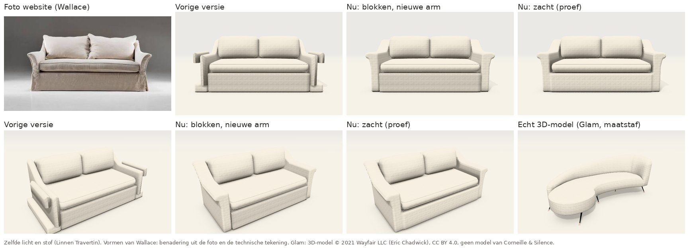
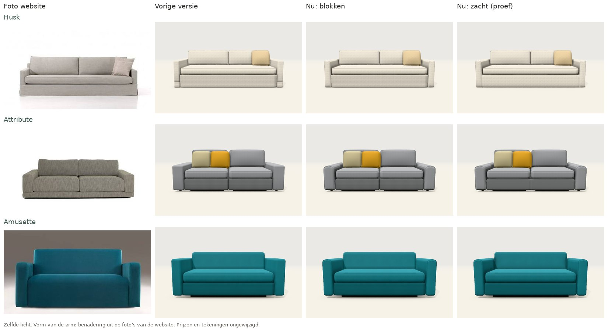

# Zachte vormen: zelf zetels opmaken zoals een echt 3D-model (stap 1, 4/11/2026)

## Vraag

Kunnen we het echte 3D-model (de proef met de Glam Velvet Sofa, zie `echte-3d-modellen.md`) als voorbeeld gebruiken om
zelf de zetels op te maken in 3D?

Het antwoord had twee kanten:

- **Het bestand ombouwen tot Kotor of Wallace: nee.** Een afgewerkt 3D-model kun je uitrekken, maar niet omvormen tot
  een andere zetel. En het zou een zetel van Wayfair blijven, met een andere naam erop.
- **Het voorbeeld volgen: ja.** De motor maakt zulke vormen nu zelf, uit onze maten. Dat is stap 1 uit het voorstel;
  stap 2, een 3D-bestand per model via een 3D-programma, is (nog) niet gedaan.

## Wat het echte model ons leerde

Wat het Glam-model echter maakt dan onze blokken:

- **één doorlopende vorm**: zitting, rug en arm lopen in elkaar over;
- **zachte overgangen** in plaats van hoeken;
- **schaduw in de plooien en hoeken**;
- **een eigen vorm per onderdeel**, zoals een arm die naar buiten krult. Die vorm komt niet uit losse balken.

## Wat er nieuw is

1. **Instelling "Vormen" in de 3D:** *Blokken* (zoals altijd) of *Zacht (proef)*.
   - **Zacht:** de motor smelt de gestoffeerde delen van het karkas samen tot één doorlopende vorm. Dat zijn de
     onderbouw, de armen, de rug en de hoes.
   - **In de hoeken:** daar komt een afronding, zoals stof die over de hoek spant. Tussen de delen van één element is
     die afronding ruimer, bv. de arm met zijn krul en de hoes eronder.
   - **Geen richels:** waar twee vlakken in elkaars verlengde liggen, ontstaat geen richel.
   - **Schaduw:** in de hoeken en plooien zit schaduw, ook waar de kussens tegen de vorm liggen.
   - **Wat niet meesmelt:** losse kussens, hout en metaal blijven zoals ze waren.
   - **Wat hetzelfde blijft:** prijs, tekeningen en offerte veranderen niet.
2. **De uitlopende arm (Wallace, Esmee) is opnieuw getekend, ook bij *Blokken*:** één doorsnede die van voor naar
   achter loopt.
   - **Binnenkant:** recht tegen de zitting.
   - **Buitenkant:** onderaan iets naar binnen, bovenaan naar buiten uitlopend tot een opgerolde rand, die over de
     zijkant uitsteekt.
   - **Naar achteren:** de arm loopt op tot de hoogte van het karkas.
   - **Met een hoes tot op de grond:** de arm loopt zelf tot op de vloer, zonder trapje meer eronder.

   De vorm is een benadering uit de foto en de technische tekening (arm 21 cm breed, 63 cm hoog, karkas 86 cm).
3. **De strakke arm (track arm) heeft een eigen doorsnede, ook bij *Blokken*** (4/11, tweede ronde). Die stijl komt het
   meest voor: in 16 van de 21 modellen met armen, waaronder Kotor, Nestor, Belize, Pula, Husk, Attribute en Amusette.
   - **Bovenkant:** zacht afgerond, en in het midden licht bol, zoals gevulde stof.
   - **Zijkanten:** licht bol; onderaan een kleine afronding.
   - **Voorpaneel:** afgeronde rand, in het midden licht bol.
   - **Zachtheid:** hoe rond en hoe bol volgt de zachtheid van het model.
   - **Hoes tot op de grond** (Husk): de arm loopt in één stuk tot op de vloer, zonder trapje.
   - **Naad of bies:** rond het voorpaneel van elke arm met een eigen vorm (strak en uitlopend) loopt een naad of bies,
     volgens de keuze *Naden* (bies bij Husk, Attribute en Wallace).
   - **Vooraanzicht:** de tekening (modelkaart, offerte) toont dezelfde vorm.

   
4. **Ronde vormen blijven zoals ze waren.** Kuipfauteuils (Pebble, Ross, Karl …) en het afgeronde eindelement (Doha,
   Montego) waren al rond getekend. Samengesmolten gaven ze in de proef foutjes aan de randen, dus die delen smelten niet
   mee.

## Hoe het werkt (kort)

De motor gebruikt dezelfde werkwijze als 3D-programma's (*afstandsvelden* en *surface nets*):

1. **Afstand per deel:** voor elk deel berekent de motor hoe ver een punt ervan ligt, en in welke richting.
2. **Samenvoegen:** de motor voegt die afstanden zacht samen, met een afronding die afhangt van de hoek tussen de delen.
3. **Oppervlak:** uit een raster van 2 cm haalt hij het oppervlak. Hij verdeelt de punten gelijkmatig en legt elk punt er precies op.
4. **Schaduw:** de schaduw in de hoeken komt uit dezelfde afstanden, met de kussens en de vloer erbij.

| Waar | Wat |
|---|---|
| `packages/core/src/zachtevorm.ts` | `zachteVorm(blokken, opties)` geeft posities, normalen, textuurcoördinaten en schaduw. `smeltMee(blok)` zegt welke blokken meesmelten. `zachtVeld()` geeft het veld zelf, voor tests. Vormen: afgeronde balk (ook gekanteld), rol, gebogen wand, vrije omtrek en het nieuwe *profiel*. |
| `packages/core/src/ruimtelijk.ts` | `Blok.vorm = 'profiel'` met `profiel` (doorsnede), `uit` (richting buitenkant), `rand` (afronding van het voorpaneel) en `kopBol` (bolling van het voorpaneel). `uitlopendProfiel()` en `strakProfiel()` geven de doorsnede, gedeeld met het vooraanzicht. |
| `packages/demo-web/src/drie-d.ts` | Groepen per stof die elkaar raken, de vormen worden onthouden en pas na het slepen berekend (tot dan de blokken). Klikken en markeren per element. Een *profiel* wordt ook bij *Blokken* zo getekend, met de naad of bies rond het voorpaneel (`profielNaad`). |
| Tests | `packages/core/test/zachtevorm.test.ts` (dicht oppervlak, afronding in de hoek, geen richel op een naad, Wallace) en `details.test.ts` (uitlopende en strakke arm). |

## Grenzen van de proef

- **Snelheid (*Zacht*):** gemeten op de server, na het opwarmen zoals in de browser:
  - Wallace, Husk, Attribute en Amusette: 0,2 à 0,4 s;
  - Kotor en de grote hoeksofa's (Nestor, Belize, Pula): 0,3 à 0,7 s, met een raster van 2,5 cm vanaf 3 m³.

  Op een tablet duurt het waarschijnlijk langer, en dan staat het scherm even stil. Daarom staat *Zacht* standaard uit
  en wordt de vorm pas na het slepen berekend.
- **Snelheid (*Blokken*):** een arm met een eigen vorm rekent bij het eerste beeld ±40 ms en wordt daarna onthouden.
- **Gewicht:** 45.000 à 110.000 driehoeken per sofa, tegenover enkele duizenden bij *Blokken*.
- **Alleen de uitlopende en de strakke arm hebben een eigen vorm.** De rolarm, de lage Engelse rolarm, de schuine arm
  en de arm met houten blad zijn nog balken die zacht samensmelten. Dat geeft minder winst: het samensmelten alleen
  verandert weinig, de winst zit in een eigen vorm per stijl. De rug en de onderbouw zijn ook nog balken.
- **Geen plooien of hangende stof:** geen kreukels in de hoes, geen kussens die doorzakken.
- **Benaderingen:** voor modellen zonder technische tekening blijft elke 3D een benadering uit foto's, hoe mooi ze ook
  oogt.
- **Niet getest op een echt toestel:** alleen in Chromium zonder grafische kaart (swiftshader), niet op een tablet of
  telefoon.

## Volgende stappen (als we verder gaan)

1. **Een eigen doorsnede voor de andere armstijlen:** rolarm (Mabel, Zora), Engels, schuin, met houten blad. Daarna de
   rug (recht, hellend, rond), de onderbouw en een hoes met een geplooide voorkant. Telkens één vorm in de motor, die
   voor alle modellen met die stijl geldt.
2. **Sneller rekenen:** in de achtergrond rekenen, zodat het scherm niet stilstaat.
3. **Daarna kiezen:** *Zacht* standaard aan, als het op een tablet vlot genoeg is.
4. **Stap 2 voor topmodellen:** een 3D-bestand per model (zie `echte-3d-modellen.md`).
