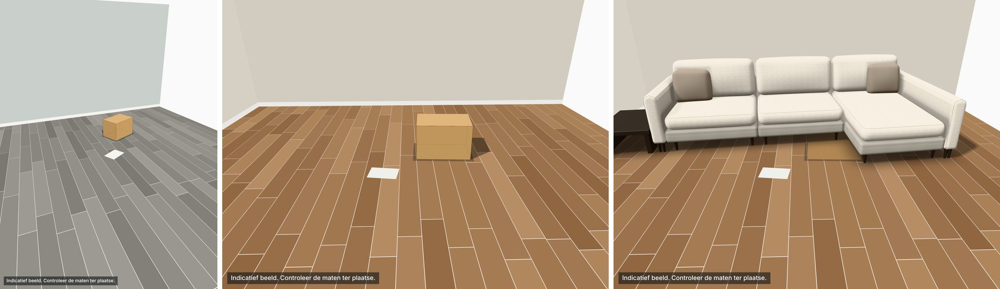

# Zetel in eigen kamer: eerste versie (6 november 2026)

Gebouwd volgens de analyse *Analyse - zetel in eigen kamer* (manier A: de vloer aanklikken). Alles wat daar onder
"Later" staat, zit er niet in. Dit verslag zegt wat gebouwd is, wat getest is en wat nog niet.

*Links en midden: de proefdoos van de app (half doorzichtig) valt op de doos in de foto. Rechts: Kotor in dezelfde
kamer. Het zijn zelfgemaakte testbeelden, geen echte foto's.*

## Kort

- **Knop *In mijn kamer*** in de ontwerper, naast *Fotorealistische foto* (onder de 3D). Er opent een eigen venster.
- **Werkwijze:**
  1. Kies een foto (JPG of PNG).
  2. Klik de vier hoeken van het A4 (of een tegel of tapijt) aan.
  3. De zetel staat in de foto, op schaal en in de gekozen stof.
  4. Sleep en draai de zetel en kies de richting van de schaduw.
  5. Bewaar het beeld als PNG, met de zin *"Indicatief beeld. Controleer de maten ter plaatse."*
- **Privacy:** alles gebeurt in de browser. De foto gaat niet naar een server, wordt nergens bewaard en verdwijnt bij
  *Sluiten*. Er is geen AI-dienst nodig.
- **Rekentest:** in orde. Met een zelfgemaakt beeld met een gekende camera vindt de functie lens, hoogte en stand
  terug, met een afwijking van nagenoeg nul.
- **Maatproef:** de echte maatproef met foto's van echte kamers is **nog niet gedaan**, want die foto's zijn er nog
  niet. De nagebootste maatproef toont dat **een A4 op 2 à 3 m vaak niet binnen 5 % blijft**. Met een vloertegel of
  een tapijt lukt het veel beter. Cijfers hieronder.
- **three.js:** de repo gebruikt **0.187** (`packages/demo-web/package.json`, geïnstalleerd 0.187.0). Het bestand met
  r128 dat de analyse noemt (`configurators om te openen/configurator-corneille-silence-2.html`) staat niet in deze
  repo. Ik kon het dus niet nakijken. De nieuwe code bouwt op de huidige code (0.187, WebGPU met WebGL2 als terugval).

## Wat de gebruiker ziet

1. **Foto.** Uitleg in het lege venster: *"Maak de foto liefst van een lege plek, rechtstaand, met de vloer goed in
   beeld. Leg een A4-blad of iets anders met een gekende maat op de vloer, op de plaats van de zetel."*
   - Een staande gsm-foto staat rechtop: de oriëntatie uit de foto-gegevens (EXIF) wordt toegepast.
   - De foto wordt verkleind tot hoogstens 2560 pixels.
2. **Maatvoorwerp.** Keuze *A4-blad (29,7 × 21)*, *Vloertegel 60 × 60* of *Eigen maat* (lange en korte zijde).
   - Klik de vier hoeken aan, rond de rand, en begin met de lange zijde.
   - Als je de muis of vinger ingedrukt houdt, verschijnt een vergrootglas om precies te mikken.
   - Een hoek kan je achteraf verslepen.
   - Bij de randen staat de maat (29,7 cm, 21 cm), zodat je ziet welke zijde welke maat kreeg.
3. **Zetel.** De zetel komt eerst op het maatvoorwerp te staan, met de voorkant naar de camera.
   - Slepen verplaatst de zetel. Klik je naast de zetel, dan springt hij naar die plaats.
   - Draaien kan met een schuifknop of met de knoppen ↺ 15° en ↻ 15°.
   - *Opnieuw plaatsen* zet hem terug op het maatvoorwerp.
   - De grootte ligt vast: die volgt uit de maat.
4. **Licht.** Eén schuifknop *richting van de schaduw*. Het licht van de configurator blijft, met een slagschaduw op
   de vloer van de foto.
5. **Bewaren.** Een PNG op de grootte van de foto, met de zin linksonder. Er gaan geen gegevens van de foto mee.

**Meldingen** (in gewone taal, bovenaan het paneel):
- *Kies iets groters* als het maatvoorwerp minder dan 0,5 % van de foto beslaat.
- Een melding als de hoeken niet bij een rechthoek van die maat passen.
- *We rekenen met 28 mm* als de lens niet te bepalen is. Dan verschijnt ook de schuifknop *Afstand tot de foto*.
- Een melding als het aanklikken niet lukt, met de zin uit de analyse: *"zonder zichtbare vloer werkt het niet"*.
- Op een gsm een aparte melding als het maatvoorwerp te klein is om aan te klikken.

**Maatproef (voor de test)**, een inklapbaar vak onderaan:
- een **proefdoos** van gekende maat in de plaats van de zetel, om op de echte doos te zetten;
- **Meten**: twee punten op de vloer geven de afstand, een derde punt recht boven het tweede geeft de hoogte.

Daarmee kan de echte maatproef met de app zelf gebeuren.

## Afwijkingen van de analyse (en waarom)

1. **Voorkennis bij het rekenen.** De analyse schatte de lens uit de foto, met 28 mm als die schatting buiten 18–50 mm
   valt. Dat blijft zo, maar met twee zachte voorkeuren:
   - de gsm wordt ongeveer rechtop gehouden (±3°);
   - de lens ligt rond 28 mm (±20 %).

   **Waarom:** een A4 op 2 à 3 m is maar 0,2 à 0,8 % van de foto. Klikfouten van één à twee pixels gaven zonder die
   voorkeuren vaak 10 à 30 % fout, of meer. Met de voorkeuren is dat veel minder (tabel hieronder). Toont de foto
   duidelijk iets anders, dan wint de foto. Bij een tegel of tapijt speelt de voorkeur nauwelijks mee.
2. **Grens voor *Kies iets groters*: 0,5 %** in plaats van ±3 %. Een A4 haalt bij een gewone foto nooit 3 %. Dan zou
   de melding er altijd staan, ook als de maat goed is. Vanaf ±0,5 % haalt de nagebootste proef het doel meestal.
3. **Eerst langs de lange zijde klikken.** Als de app de lange en de korte zijde van een klein A4 verwisselt, geeft dat
   de grootste fouten. De app volgt daarom de volgorde van de gebruiker, tenzij de foto duidelijk anders zegt.
4. **Vergrootglas en maatproef-vak:** niet in de analyse, wel nodig om precies te klikken en om de maatproef te kunnen
   doen.
5. **Beginplaats:** op het maatvoorwerp, met de voorkant van de zetel door het midden ervan. De uitleg vraagt het A4 te
   leggen waar de zetel moet komen.

## Bewijs dat het klopt

### 1. Maatproef

**Echte maatproef: nog niet gedaan.** Volgens de analyse bezorgt Jonas 3 kamerfoto's: een doos van gekende maat op de
vloer, met een A4 ernaast, zonder personen. Zonder die foto's is er geen echte uitslag. Wat ik wel deed:

**a) Nagebootste maatproef** (`npm run maatproef -w @configurator/core`, script `core/voorbeelden/maatproef.ts`).
- Drie kamers met een gekende gsm-camera (24–26 mm, staand of zittend).
- Een A4, tegel of tapijt op ±2 à 3 m.
- Klikfouten zoals een mens: ±0,75 schermpixel (zorgvuldig, met vergrootglas) of ±2 schermpixels (gewoon), op een
  foto van ±1000 px breed op het scherm.
- Bij gewoon klikken ook een lichte tonvorm van de lens.
- 400 keer per geval. De app "meet" telkens een doos: de twee onderste voorhoeken voor de breedte, de bovenhoek voor
  de hoogte.

Percentage van de keren binnen 5 % (breedte / hoogte), met de rekenwijze van de app:

| Maatvoorwerp | Klikken | Kamer 1 (A4 op 2,6 m) | Kamer 2 (A4 schuin op 3 m) | Kamer 3 (A4 op 1,8 m, zittend) |
|---|---|---|---|---|
| A4 | zorgvuldig | 100 % / 100 % | **59 % / 92 %** | 100 % / 100 % |
| A4 | gewoon | **68 % / 65 %** | **29 % / 48 %** | 86 % / 75 % |
| Tegel 60 × 60 | zorgvuldig | 100 % / 100 % | 78 % / 100 % | 100 % / 100 % |
| Tegel 60 × 60 | gewoon | 90 % / 87 % | **50 % / 82 %** | 96 % / 89 % |
| Tapijt 200 × 140 | zorgvuldig | 100 % / 100 % | 98 % / 100 % | (niet in beeld) |
| Tapijt 200 × 140 | gewoon | 98 % / 94 % | 61 % / 86 % | (niet in beeld) |

Ter vergelijking: de rekenwijze zoals in de analyse (alleen schatten, anders 28 mm), met een A4 en gewoon klikken,
haalde 48 % / 41 %, 17 % / 30 % en 66 % / 56 %. Met zorgvuldig klikken was dat 75 % / 82 %, 38 % / 78 % en
97 % / 96 %.

**Wat dit zegt:**
- Een A4 op 2 à 3 m haalt het doel van 5 % niet betrouwbaar. Het slechtst gaat het als het A4 klein en schuin in de
  foto ligt (kamer 2), of als je snel klikt.
- Een tegel of tapijt helpt veel.
- In kamer 2 is ook de doos klein en ver (50 cm op 3 m). Daardoor telt de klikfout op de doos zelf mee. Daarom blijft
  de breedte daar ook met een tapijt onder de 5 % in maar 61 % van de keren (bij gewoon klikken).
- De volledige tabellen (mediaan en 9 op 10) staan in de bijlage.

**b) Proef in de browser met zelfgemaakte foto's.**
- Werkwijze: de 3 kamers van hierboven als beeld getekend, geladen in de app, de vier hoeken van het A4 aangeklikt met
  de muis en de doos gemeten met *Meten*, in Chromium.
- Hoe precies: de muis klikt op hele schermpixels; dat is ongeveer "zorgvuldig".

| Kamer | Echte doos (breedte × hoogte) | Gemeten in de app | Fout |
|---|---|---|---|
| 1 (A4 op 2,6 m) | 60 × 40 cm | 59,5 × 39,9 cm | 0,8 % / 0,3 % |
| 2 (A4 schuin op 3 m) | 50 × 35 cm | 48,0 × 34,6 cm | 4,0 % / 1,1 % |
| 3 (A4 op 1,8 m) | 40 × 30 cm | 40,1 × 30,1 cm | 0,3 % / 0,3 % |

**Kanttekening:** dit zijn getekende beelden met perfect rechte lijnen en een vlak A4. Een echte foto heeft een lens
die lijnen licht buigt, een A4 dat niet helemaal plat ligt en minder scherpe hoeken. **De echte uitslag kan slechter
zijn.**

### 2. Rekentest

In orde: `core/test/kamerfoto.test.ts`, 19 tests. Getest:
- **Vijf zelfgemaakte camera's:** 18 tot 45 mm, liggend en staand, zittend en staand, licht scheef.
- **Zonder voorkennis:** lens, camerahoogte en de afstand tot het A4 komen exact terug. De lens wijkt minder dan
  0,01 mm af en de hoogte minder dan 1 mm.
- **Met voorkennis:** een zetel tot 1,5 m naast het A4 blijft bij een gewone gsm-lens binnen 4 % van de beeldbreedte.
- **Klikvolgorde:** begin bij een andere hoek, klik in de andere richting of gekruist: de uitkomst blijft dezelfde.
- **Maat:** 29,7 × 21 of 21 × 29,7 invullen geeft dezelfde uitkomst.
- **Recht van boven:** dan gebruikt de app 28 mm.
- **Lens buiten het bereik** (70 mm): de app rekent met 28 mm, met een melding.
- **Vaste lens** van de schuifknop: wordt gebruikt.
- **Te klein voorwerp:** de app geeft de melding *Kies iets groters*.
- **Geen vierhoek:** de app geeft een foutmelding.
- **Hulpfuncties:** vloerpunt, hoogte boven een punt, assen voor three.js.

### 3. Beelden

- **Chromium:** getest op 1920 × 1080, 1512 × 900, 1280 × 800 en 390 × 844 (gsm, aanraken).
  - Op alle vier: de knop, het aanklikken en de zetel werken.
  - Op 390 px is een A4 op 2,6 m maar ±25 × 10 pixels groot. Aanklikken lukt dan, maar precies is het niet. De app
    zegt dat in een melding en raadt een computer, een tablet of iets groters aan.
- **EXIF-proef:** een staande foto die liggend bewaard is (oriëntatie 6), kwam rechtop in de app.
- **WebKit (Safari) en Firefox: niet getest.** In deze cloudomgeving is alleen Chromium beschikbaar. Te doen op een
  toestel, bijvoorbeeld Safari op de Mac in de toonzaal.
- **WebGPU: niet getest.** In de cloud is er geen WebGPU, dus alleen de WebGL2-weg is getest. WebGPU zelf moet op de
  M5 getest worden.
- **Beeldvergelijking** van de bestaande 3D (`npm run beelden`): 10 beelden, alle 0,00 % anders. De bestaande 3D is dus
  niet veranderd.

### 4. Gebruik

**Niet gedaan:** dit vraagt één persoon die de app niet kent en zonder hulp een zetel plaatst, met de tijd erbij.

## Grenzen (eerlijk)

- **Voorwerpen vóór de zetel:** een salontafel vóór de zetel komt in het beeld achter de zetel. Daarom de zin "Maak
  de foto liefst van een lege plek".
- **Licht en kleur:** de zetel krijgt het licht van de foto niet mee. De stofkleur is indicatief.
- **Groothoeklens:** een groothoeklens buigt rechte lijnen. Dat corrigeert de app niet.
- **Ver of schuin maatvoorwerp:** een A4 ver weg of schuin geeft meer fout (zie de maatproef).
- **Vloer:** zonder zichtbare vloer werkt het niet.
- **Lens ver van 28 mm:** bij een klein A4 trekt de voorkennis een lens van bijvoorbeeld 18 mm (groothoek) of 50 mm
  (tele) naar 28 mm. Met een tegel of tapijt niet. De schuifknop *Afstand tot de foto* kan het rechtzetten.
- **De zetel in de kamer is een kopie** van de 3D op het moment dat je het venster opent. Pas je daarna de zetel aan,
  open het venster dan opnieuw. De foto en de hoeken moeten dan ook opnieuw.

## Wat Jonas nog kan doen of kiezen

1. **Drie kamerfoto's voor de echte maatproef.** Wat erop moet:
   - een doos van gekende maat op de vloer en een A4 ernaast;
   - rechtstaand genomen, met een gewone gsm-camera (geen groothoek);
   - zonder personen.

   Foto's van klanten alleen met hun toestemming. Twee manieren om de proef te doen:
   - zelf in de app, met *Maatproef → Meten*;
   - of je bezorgt mij de foto's en de maat van de doos, dan meet ik en noteer ik de echte uitslag.

   Neem liefst ook één foto met een tegel of tapijt.
2. **Eerste model:** de analyse noemt `corneille-silence-2`. De knop werkt met elk model in de ontwerper: hij neemt de
   zetel zoals hij in de 3D staat.
3. **Zin op het beeld:** nu het advies uit de analyse, *"Indicatief beeld. Controleer de maten ter plaatse."*. Je
   kan dat aanpassen: één regel in `demo-web/src/kamer.ts` (`ZIN_OP_BEELD`).
4. **Standaardlens:** 28 mm zoals in de analyse. Recente gsm's hebben 24–26 mm. In de nagebootste proef deed 26 mm het
   beter:
   - kamer 2, A4, zorgvuldig klikken: 79 % in plaats van 59 % binnen 5 % (breedte);
   - bij gewoon klikken: nauwelijks verschil.

   Let op: de nagebootste kamers hebben zelf 24–26 mm, dus dat voordeel zit deels in de proef zelf. Dat is één getal
   in `core/src/kamerfoto.ts` (`LENS_BEREIK.standaard`).
5. **Grens *Kies iets groters*:** 0,5 % (zie hierboven), ook één getal (`MIN_VLAK`).
6. **Gebruikstest** met iemand die de app niet kent.
7. **Safari en Firefox** op een toestel nakijken, en WebGPU op de M5.

## Code

- **Motor:** `packages/core/src/kamerfoto.ts`.
  - `kalibreer(punten, maat, foto, opties)`: homografie, lens uit de rechthoek, stand van de camera, verfijnd met
    Levenberg-Marquardt, met de voorkennis `STANDAARD_VOORKENNIS`.
  - Verder `projecteer`, `vloerpunt`, `hoogteBoven`, `afstand` en `cameraAssen` (voor three.js).
  - Geen OpenCV en geen 3D-bibliotheek.
- **Tests:** `packages/core/test/kamerfoto.test.ts`.
- **Nagebootste maatproef:** `packages/core/voorbeelden/maatproef.ts` (`npm run maatproef -w @configurator/core`).
- **Venster:** `packages/demo-web/src/kamer.ts` (`openKamer`).
  - Een eigen kleine 3D-weergave met doorzichtige achtergrond boven de foto, met een onzichtbare vloer
    (`ShadowMaterial`) voor de schaduw.
  - Het vergrootglas.
  - Bewaren op fotoresolutie, met de zin erop.
  - Voor tests: `window.__kamer`.
- **3D:** `Viewer3D.kopie()` in `packages/demo-web/src/drie-d.ts` geeft een kopie van de zetel, met de
  contactschaduw, het omgevingslicht en de lichtsterktes. De meshes delen geometrie en materiaal. De opbouw in
  `core/src/ruimtelijk.ts` is niet veranderd.
- **Knop:** `#o-3d-kamer` in `index.html`, gekoppeld in `ontwerper.ts`. De opmaak staat in `index.html` (`.kamer…`).

## Bijlage: volledige uitslag van de nagebootste maatproef

Per cel: mediaan / 9 op 10 keer beter dan / deel van de keren binnen 5 %. Fout in % van de echte maat van de doos.

### A4, zorgvuldig klikken (±0,75 px op het scherm)
| Rekenwijze | Kamer | Voorwerp in de foto | Breedte | Hoogte |
|---|---|---|---|---|
| analyse | 1 | 0,3 % | 2,5 / 20,0 / 75 % | 1,7 / 27,9 / 82 % |
| analyse | 2 | 0,2 % | 6,5 / 38,5 / 38 % | 2,3 / 20,2 / 78 % |
| analyse | 3 | 0,7 % | 1,6 / 4,0 / 97 % | 1,6 / 3,7 / 96 % |
| app | 1 | 0,3 % | 1,3 / 2,6 / 100 % | 1,1 / 2,7 / 100 % |
| app | 2 | 0,2 % | 4,4 / 9,4 / 59 % | 1,7 / 4,4 / 92 % |
| app | 3 | 0,7 % | 0,9 / 2,0 / 100 % | 1,0 / 2,4 / 100 % |

### A4, gewoon klikken (±2 px) en een lichte tonvorm van de lens
| Rekenwijze | Kamer | Voorwerp in de foto | Breedte | Hoogte |
|---|---|---|---|---|
| analyse | 1 | 0,3 % | 5,2 / 16,9 / 48 % | 7,9 / ≥ 100 / 41 % |
| analyse | 2 | 0,2 % | 31,1 / 50,5 / 17 % | 11,7 / ≥ 100 / 30 % |
| analyse | 3 | 0,7 % | 3,5 / 12,0 / 66 % | 4,4 / 22,5 / 56 % |
| app | 1 | 0,3 % | 3,3 / 11,0 / 68 % | 3,9 / 24,6 / 65 % |
| app | 2 | 0,2 % | 9,0 / 41,1 / 29 % | 5,4 / ≥ 100 / 48 % |
| app | 3 | 0,7 % | 2,3 / 5,8 / 86 % | 2,8 / 7,0 / 75 % |

### Vloertegel 60 × 60
| Rekenwijze | Klikken | Kamer 1 (1,6 %) | Kamer 2 (0,9 %) | Kamer 3 (4,5 %) |
|---|---|---|---|---|
| analyse | zorgvuldig | B 0,9 / 2,0 / 100 % · H 0,9 / 2,1 / 100 % | B 2,9 / 7,2 / 75 % · H 1,1 / 2,6 / 100 % | B 0,7 / 1,6 / 100 % · H 0,7 / 1,8 / 100 % |
| app | zorgvuldig | B 0,9 / 1,8 / 100 % · H 0,9 / 2,1 / 100 % | B 2,9 / 6,4 / 78 % · H 1,1 / 2,5 / 100 % | B 0,6 / 1,6 / 100 % · H 0,7 / 1,8 / 100 % |
| analyse | gewoon | B 2,3 / 5,5 / 86 % · H 2,5 / 5,6 / 87 % | B 5,9 / 14,7 / 43 % · H 2,9 / 6,6 / 79 % | B 1,8 / 4,2 / 95 % · H 2,0 / 5,1 / 89 % |
| app | gewoon | B 2,2 / 5,0 / 90 % · H 2,4 / 5,4 / 87 % | B 5,0 / 12,7 / 50 % · H 2,5 / 6,0 / 82 % | B 1,8 / 4,1 / 96 % · H 2,1 / 5,2 / 89 % |

### Tapijt 200 × 140 (in kamer 3 niet helemaal in beeld)
| Rekenwijze | Klikken | Kamer 1 (13 %) | Kamer 2 (8 %) |
|---|---|---|---|
| analyse en app (gelijk) | zorgvuldig | B 0,5 / 1,3 / 100 % · H 0,7 / 1,7 / 100 % | B 1,5 / 3,4 / 98 % · H 0,8 / 2,1 / 100 % |
| analyse en app (gelijk) | gewoon | B 1,4 / 3,7 / 98 % · H 2,1 / 4,6 / 94 % | B 4,0 / 8,9 / 61 % · H 2,1 / 5,7 / 86 % |

Kamers:
- **Kamer 1:** woonkamer, staand (150 cm), 26 mm, liggende foto, doos 60 × 40 × 40 cm.
- **Kamer 2:** lege hoek, staand (165 cm), 24 mm, staande foto, doos 50 × 35 × 35 cm.
- **Kamer 3:** slaapkamer, zittend (120 cm), 26 mm, liggende foto, 3° scheef, doos 40 × 30 × 30 cm.
